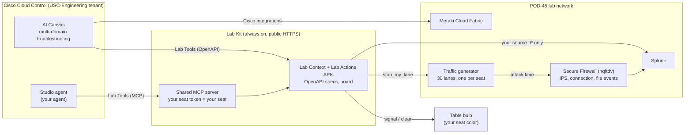

# Build a Network Agent in Cisco Cloud Control That Troubleshoots Anything While You Sleep

You are on call for **PseudoCo**, and you would like to sleep tonight. In the next four hours you
will teach Cisco Cloud Control to do your night shift: find what is broken across every Cisco
domain, add the business context only you know, decide how bad it is, wake you only when it
matters, and take one safe action you approve.

The lab follows three steps:

1. **Test a multi-domain troubleshooting prompt in AI Canvas.**
2. **Save the combined result** so it becomes a known-good example.
3. **Build an agent in Cloud Control Studio** that runs it however you choose, with a custom
   workflow of your own: an integration that brings in non-Cisco information and lights your
   table's bulb when your agent finds a problem.

!!! tip "What you leave with"
    A working Studio agent, a Canvas prompt you trust, an integration pattern (MCP or REST) you can
    point at any system your business depends on, and the take-home kit to rebuild it.

## How the lab is built

- **AI Canvas** does the Cisco multi-domain work with its built-in integrations (Meraki, Secure
  Firewall, Secure Access, Catalyst Center, Intersight, Nexus Dashboard).
- **Lab Tools** is the custom integration. It brings in what Cisco cannot know: PseudoCo's change
  calendar, business services, on-call policy and SaaS status. It also gives your agent its watch
  scope, the firewall events from your own lane, and two actions: light your bulb, and stop your lane.
- **Your seat token** is the key. Everyone uses the same URLs; the token decides which seat, which
  lane and which light you can see and touch. You can never act on another seat.

## Agenda (4 hours)

| Clock | Min | Step | Module | You finish with |
| --- | --- | --- | --- | --- |
| 0:00 | 10 | - | [Before you start](setup.md) | Seat card, logged in |
| 0:10 | 15 | 1 | [1.1 Orientation](part1/1-1-orientation.md) | Canvas, Studio and Lab Tools open |
| 0:25 | 25 | 1 | [1.2 Multi-domain diagnosis](part1/1-2-diagnose.md) | Root cause from Cisco data alone |
| 0:50 | 25 | 1 | [1.3 Make it yours: Lab Tools](part1/1-3-lab-tools.md) | Same answer plus change ID, business impact, severity |
| 1:15 | 15 | 2 | [2.1 Save the combined result](part1/2-1-save.md) | Pinned Canvas and your final prompt |
| 1:30 | 10 | - | Break | |
| 1:40 | 25 | 3 | [3.1 Shape the agent](part2/3-1-shape-agent.md) | Draft agent, manifest reviewed |
| 2:05 | 15 | 3 | [3.2 Sandbox test and publish](part2/3-2-test-publish.md) | Three tests passed, v1 published |
| 2:20 | 35 | 3 | [3.3 Build your custom workflow](part2/3-3-custom-workflow.md) | Your integration lights your bulb |
| 2:55 | 15 | 3 | [3.4 Wire it in and choose how it runs](part2/3-4-wire-schedule.md) | v2 published, run mode chosen |
| 3:10 | 25 | 3 | [3.5 Lights Out](part2/3-5-lights-out.md) | Light on at detection, off when fixed |
| 3:35 | 15 | - | [3.6 Your business](part2/3-6-your-business.md) | One agent idea for your own company |
| 3:50 | 10 | - | Wrap | Take-home kit, survey |

Finished early? The [stretch challenges](reference/stretch.md) have another hour of work.

## Your table and your color

Six tables of five seats. Your seat ID is `T<table>-<letter>`, for example **T3-C** is table 3,
seat C. Each table has one bulb; each seat letter has a color.

| Seat | A | B | C | D | E |
| --- | --- | --- | --- | --- | --- |
| Color | red | blue | purple | amber | cyan |

- One open issue at a table: the bulb shows that seat's color. Severity sets brightness (minor
  40%, major 70%, critical 100% and pulsing).
- Two or more open issues: the bulb cycles through the open seats' colors, 2 seconds each.
- The last issue at a table clears: a 3-second green flash, then dark.
- The projector board shows all 30 seats, time to detect and time to clear.
