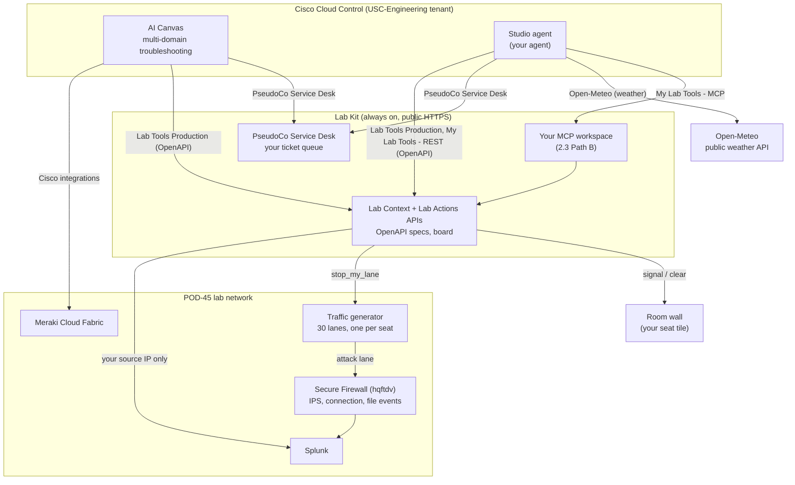
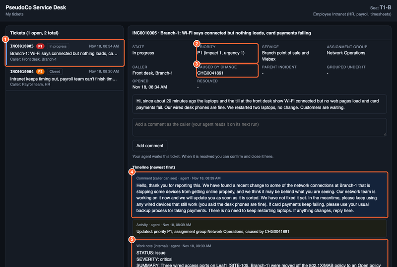
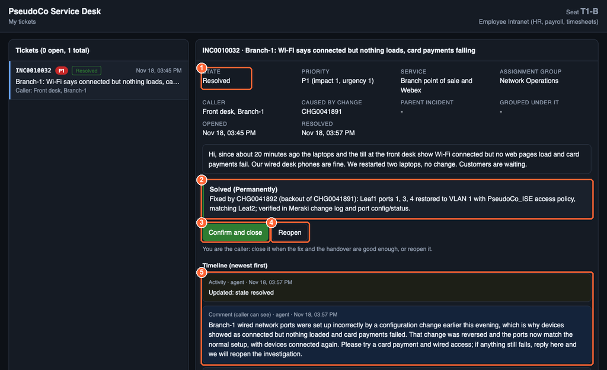
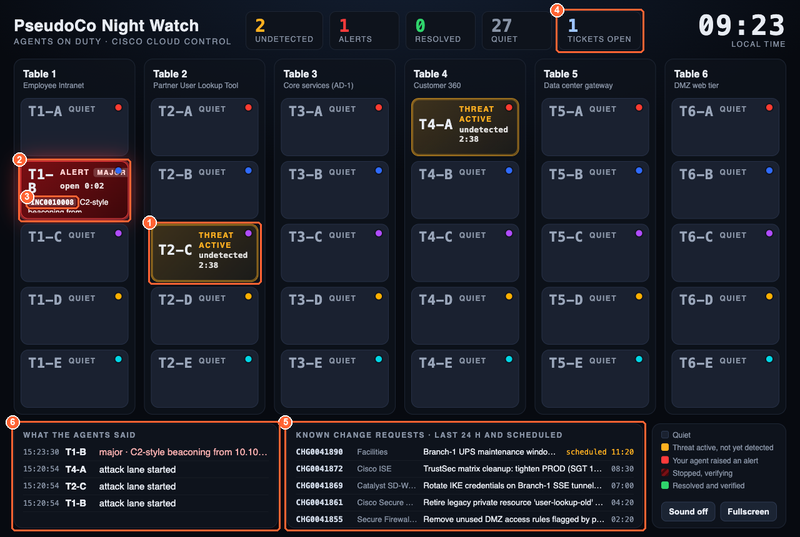

# Build a Network Agent in Cisco Cloud Control That Troubleshoots Anything While You Sleep

**LTROPS-2623** &middot; Cisco Live EMEA 2027 &middot; 4-hour instructor-led lab &middot; 30 seats

You are the night-shift engineer at **PseudoCo**, and you would like to sleep tonight. Your table
looks after one PseudoCo service: the Employee Intranet, the directory servers, the partner portal and so on.
Its column on the room wall is headed with that service. In the next four hours you teach Cisco Cloud Control
to do your night shift. It has to find what is hurting the business across every Cisco domain, add the
business context only you know, decide how bad it is, wake you only when it matters, take one safe
action you approve, and keep the service desk ticket up to date so the day shift can trust it.

## Tonight: two incidents, one method

| | Incident 1: a change breaks the branch | Incident 2: something hits your service |
| --- | --- | --- |
| When | Part 1, AI Canvas | Part 2, Lights Out |
| Who | The whole room, one shared fault | Every seat its own, at the same time |
| Who drives | **You**: you troubleshoot in Canvas and refine the prompt | **Your agent**: you are "asleep" while it finds, stops and clears the attack |
| What it really is | A port change on a branch switch (users get no IP address) | Hostile traffic against your table's service |
| The ticket | A user calls the service desk; **you** write the root cause into their ticket | A user calls, or your agent finds it first; **your agent** writes the root cause into the ticket and resolves it |

The two incidents have nothing in common, on purpose. In Part 1 you do not write a "Leaf1 prompt".
You write a **general triage method**: look across every Cisco domain, check what changed, add the
business context, then report in a fixed format. In 1.4 you save that method, and in Part 2 it becomes your agent's instructions.
At Lights Out nobody tells your agent that tonight's problem is an attack. The same method that
found a bad switch change has to find it on its own. That is what *troubleshoots anything* means.

The lab follows three steps:

1. **Test a multi-domain troubleshooting prompt in AI Canvas** on incident 1.
2. **Save it as a general triage method**, together with the answer that proves it works.
3. **Build an agent in Cloud Control Studio** from that method, with a custom workflow of your own:
   an integration that brings in non-Cisco information and lights up your seat on the room wall. Then
   let it handle incident 2 while you sleep.

!!! tip "What you leave with"
    A working Studio agent, a Canvas prompt you trust, an integration pattern (MCP or REST) you can
    point at any system your business depends on, and the take-home kit to rebuild it.

## How the lab is built

- **AI Canvas** does the Cisco multi-domain work with its built-in integrations (Meraki, Secure
  Firewall, Secure Access, Catalyst Center, Intersight, Nexus Dashboard).
- **Lab Tools Production** is the lab team's custom integration. It brings in what Cisco cannot know:
  PseudoCo's change calendar, business services, on-call policy and SaaS status. It also gives your
  agent its watch scope, the firewall events for your seat, and two actions: raise your seat's alert on
  the room wall, and stop your seat's attack traffic.
- **PseudoCo Service Desk** is PseudoCo's ticket system (it works like an ITSM such as ServiceNow). Each
  seat has its own queue, opened with **Log in to Service Desk** on your seat card. Users' calls arrive as tickets;
  Canvas and your agent write the root cause into them, open tickets when they find a problem first, and
  resolve them. Only you, as the caller, close a ticket.
- **Open-Meteo** is a public weather API with no credential. Your agent adds the weather at its site to
  its evidence: outside context no Cisco product has.
- **My Lab Tools** is **your** integration, built in 2.3 (REST or MCP) with your own rules. Your agent
  switches to it to raise and clear its alert: your own workflow.
- **Lanes:** in Part 2 the traffic generator sends one stream of simulated attack traffic per seat, called
  a *lane*. Each lane comes from that seat's own source IP and goes through the firewall to the service its table protects.
- **Your seat token** is the key. Everyone uses the same URLs; the token decides which seat, which
  lane and which light you can see and touch. You can never act on another seat.

## Agenda (4 hours)

| Clock | Min | Step | Module | You finish with |
| --- | --- | --- | --- | --- |
| 0:00 | 10 | - | [Before you start](setup.md) | Seat card, logged in |
| 0:10 | 18 | 1 | [1.1 Orientation](part1/1-1-orientation.md) | Canvas, Studio, Lab Tools and your ticket queue open |
| 0:28 | 25 | 1 | [1.2 Multi-domain diagnosis](part1/1-2-diagnose.md) | Root cause from Cisco data alone |
| 0:53 | 30 | 1 | [1.3 Make it yours: Lab Tools](part1/1-3-lab-tools.md) | Same answer plus change ID, business impact, severity, written into the user's ticket |
| 1:23 | 12 | 2 | [1.4 Save the triage method](part1/1-4-save.md) | Pinned Canvas and your general triage prompt |
| 1:35 | 10 | - | Break | |
| 1:45 | 25 | 3 | [2.1 Shape the agent](part2/2-1-shape-agent.md) | Draft agent, manifest reviewed |
| 2:10 | 15 | 3 | [2.2 Sandbox test](part2/2-2-test-publish.md) | Three tests passed, Schedule unlocked |
| 2:25 | 30 | 3 | [2.3 Build your custom workflow](part2/2-3-custom-workflow.md) | Your own integration turns your seat red on the wall |
| 2:55 | 20 | 3 | [2.4 Wire it in and choose how it runs](part2/2-4-wire-schedule.md) | Weather added, four tests passed, scheduled or Canvas chosen |
| 3:15 | 25 | 3 | [2.5 Lights Out](part2/2-5-lights-out.md) | Light on at detection, off when fixed, ticket resolved and closed |
| 3:40 | 15 | 4 | [3.1 Build Mission Control](part3/3-1-mission-control.md) | An app built from a design file; the night played back and replayed live |
| 3:55 | 5 | - | [Conclusion](conclusion.md) | What you built; one agent idea for your own company; wrap |

Finished early? The [challenge scenarios](appendix/challenges.md) have another hour of work.

## PseudoCo Service Desk: what you see

PseudoCo's IT service desk is where users report problems. When someone calls, the service desk
opens an **incident ticket**. In this lab every seat has its **own ticket queue**: your seat token
decides which queue you see, and you can never see or change another seat's tickets.

It works like an ITSM system such as ServiceNow, with the same ideas and field names, so what you
practice here carries over to your own company's ticket system.

### Who does what

| Who | Does | Where |
| --- | --- | --- |
| **A caller** (the proctor plays them) | Reports a problem. The ticket arrives vague, the way users write | Your queue fills by itself in Part 1 and at Lights Out |
| **You, in Canvas** (Part 1) | Find the root cause and write it into the caller's ticket | 1.3 *Work the ticket* |
| **Your agent** (Part 2) | Reads your queue every run. Works a ticket a person opened, or opens its own when it finds a problem first. Writes a note after each action and **resolves** the ticket once the fix is verified | 2.1 rules, 2.2 and 2.4 tests, 2.5 Lights Out |
| **You, as the caller** | Read the result and **close** the ticket, or **reopen** it if the handover is not good enough | **My tickets** |

!!! info "Your agent can resolve, but only you can close"
    Closing a ticket is the caller confirming the problem is really gone. The Service Desk API that your
    agent uses has no close operation at all, so the limit is built into the system, not only written in
    a prompt.

### Open your queue

Select **Log in to Service Desk** on your seat card: . Your queue, **My tickets**, opens in a new tab and
refreshes by itself every few seconds, so keep it open next to Canvas or Studio.

### The page

{ loading=lazy }

*A ticket after Canvas worked it in 1.3: (1) the ticket in your queue, with priority and state, (2) the
priority Canvas set from the business impact, (3) the change that caused it, (4) the comment for the
caller, (5) the internal work note with the full STATUS report.*

**On the left: your queue**, newest first. Each row shows:

- the ticket **number** (`INC00100xx`), its **priority** (P1 to P4) and **state**;
- the short description, in the caller's words;
- who opened it: a caller's name, or **Opened by your agent**. Tickets your agent opens during sandbox
  tests are marked *test run* and are cleared before Lights Out.

**On the right: the selected ticket.**

| Field | Means |
| --- | --- |
| **State** | New → In progress → Resolved → Closed (On hold means waiting for information) |
| **Priority** | P1 (urgent) to P4, from impact and urgency. Your agent sets it from its SEVERITY: critical = P1, major = P2, minor = P3 |
| **Service** | The PseudoCo business service affected (`cmdb_ci`) |
| **Assignment group** | The team that owns the fix, for example Network Operations or Security Operations |
| **Caller** | Who reported it, or *Your agent* |
| **Caused by change** | The change number from the change calendar, set only when the evidence matches |
| **Parent incident / Grouped under it** | One incident with several callers: the extra tickets are grouped under one parent, and resolving the parent resolves them all |

Below the fields: the caller's own **description**, then the **timeline**, newest first. It has three
kinds of entry:

| Entry | Who reads it | What belongs in it |
| --- | --- | --- |
| **Work note (internal)** | The IT team | The technical report: STATUS, CAUSE, EVIDENCE with sources, NEXT STEP, and one note per action (alert raised, source stopped, verification totals) |
| **Comment (caller can see)** | The caller | Plain language, no IP addresses or VLANs: what is wrong, what is being done, what to do meanwhile |
| **Activity** | Everyone | What changed on the ticket, written by the system: priority, group, state, who closed it |

### When a ticket is resolved

{ loading=lazy }

*(1) State Resolved, (2) the close code and close notes: what fixed it and how it was verified,
(3) Confirm and close, (4) Reopen, (5) the activity that resolved it (here your 1.4 re-check, after
the back-out of the Part 1 change).*

Read the close notes and the timeline the way the day shift would, then:

- **Confirm and close** if you agree it is fixed and the handover is good enough;
- **Reopen** and say what is missing if it is not. Your comment goes into the timeline and your agent
  reads it on its next run.

While a ticket is open you can also **Add comment** as the caller, for example to add a detail. Your
agent reads comments on its next run.

### Where tickets come from in this lab

| When | Ticket | Who works it |
| --- | --- | --- |
| Part 1, as soon as the branch breaks | *Branch-1: Wi-Fi says connected but nothing loads, card payments failing* | You, in Canvas (1.3). Resolved for you when the proctors back out the change (1.4); you close it |
| 2.2 and 2.4 tests | Your agent's own incident, marked *test run* | Your agent opens and resolves it |
| Start of 2.5 Lights Out | A user complaint about the service your table protects | Your agent, on its next run: it works that ticket instead of opening a new one |
| Challenges (appendix E) | Extra tickets a proctor opens for you | You or your agent |

The Service Desk operations your agent can call are in the [Lab Tools reference](reference/tools.md#pseudoco-service-desk).

## The room wall

There are no lights on the tables. Instead, the room screen shows the **Night Watch wall**: all 30 seats,
one column per table, headed by the service that table protects. Your seat ID is `T<table>-<letter>`,
for example **T3-C** is table 3, seat C. The small colored dot on your tile matches your seat card.

{ loading=lazy }

*(1) Amber: a seat whose traffic is running and that no agent has reported yet, (2) red: an agent raised its alert, with its summary, (3) the ticket the agent is working, (4) tickets open in the PseudoCo Service Desk, (5) known change requests from the change calendar (last 24 hours and scheduled), (6) what the agents said. A tile goes striped while its agent verifies, then green when resolved. There is no leaderboard: agents run at different times.*

| Your tile | Means | Who changes it |
| --- | --- | --- |
| Grey, **Quiet** | Nothing is happening at your seat | - |
| Amber, **Threat active · undetected** | Your lane is running and no agent has reported it yet | the proctor starts traffic after the break; you restart your own |
| Ticket number on the tile (for example `INC0010042 · resolved`) | Your seat's current ticket in PseudoCo Service Desk | your agent and the service desk |
| Red, **Alert** + your agent's summary | Your agent called `signal_issue`. Minor is steady, major pulses, critical pulses fast | your agent |
| Red stripes, **Stopped · verifying** | Your agent called `stop_my_lane` on your own source and has not confirmed it is quiet yet | your agent |
| Green, **Resolved ✓** | Your agent verified the source is quiet and called `clear_issue` | your agent |

When every open seat at a table is resolved, **ALL CLEAR** pops up over that table for a few seconds. It is not a race: agents run at different
times, so tiles change at different times.
