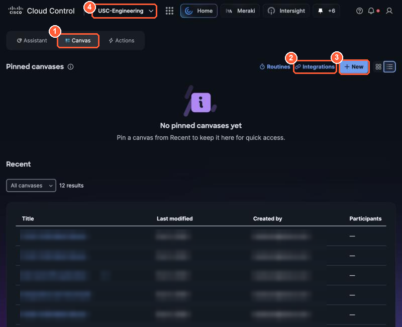
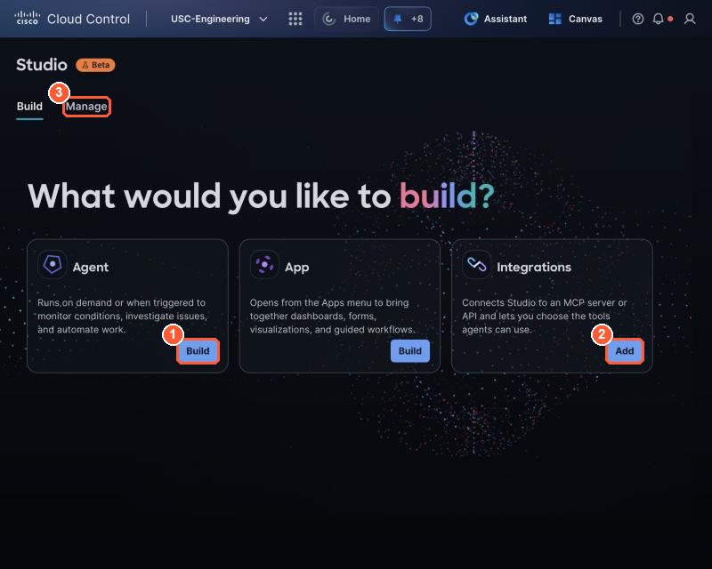
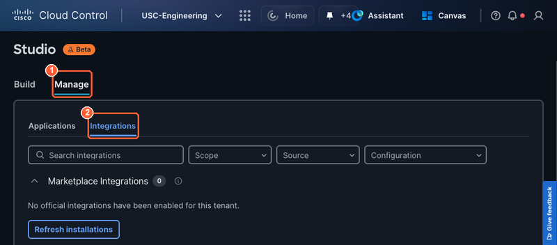
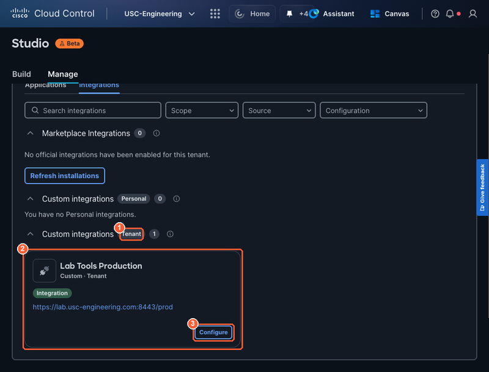
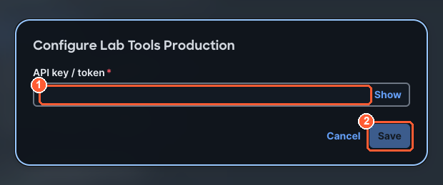
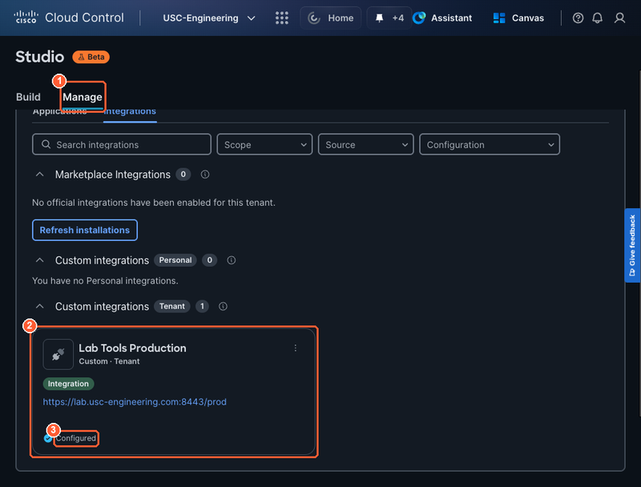
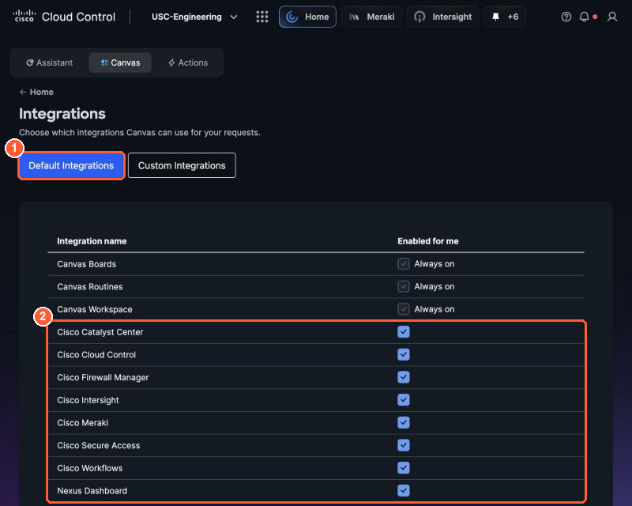
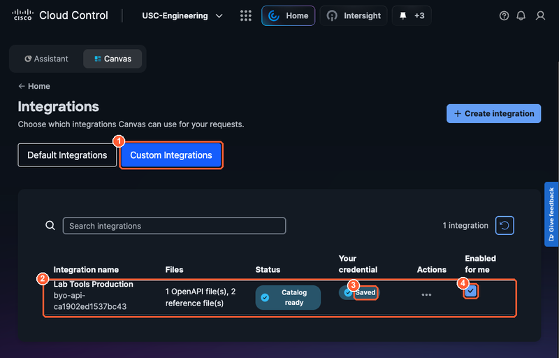

# 1.1 Orientation

!!! abstract "Goal"
    Find AI Canvas, Studio and the Lab Tools Production integration, and connect it to your seat.

## The lab network you are troubleshooting

POD-45 is a fully built PseudoCo network. You do not configure anything in this lab.

| Area | What is there | Cisco source Canvas can read |
| --- | --- | --- |
| Campus and branch | Meraki Cloud Fabric, leaves `Leaf1` and `Leaf2`, wired and wireless users | Cisco Meraki |
| Headquarters edge | Secure Firewall Threat Defense `hqftdv`, managed by cloud-delivered FMC | Cisco Firewall Manager |
| Data center | Intranet (198.18.5.15), AD (198.18.5.102), Splunk (198.18.5.109) | via Lab Tools (Splunk) |
| Partner DMZ | Partner User Lookup Tool / Customer 360 (198.18.9.2) | Cisco Firewall Manager |
| Remote access | Cisco Secure Access | Cisco Secure Access |
| Site 106 edge | Unified Edge nodes running the lab services and the traffic generator | - |

## Open the three places you will work

1. **AI Canvas**: on the Cloud Control home page, select **Canvas** (top left), then **+ New**.
   You get a new board with a chat panel. Leave it open.

    { loading=lazy }

    *(1) Canvas, (2) Integrations, (3) + New creates a board. Board names and owners are blurred in this guide.*

2. **Studio**: open the app launcher (the grid icon), then **Studio**. You will see three builders:
   **Agent**, **App** and **Integrations**. You connect Lab Tools Production here in a moment, and build an Agent in Part 2.

    { loading=lazy }

    *Studio: (1) Agent builder, (2) add an Integration, (3) Manage lists what you have built.*

3. **Canvas integrations**: go back to **Canvas**, then select **Integrations** above the board list.

## Connect Lab Tools to your seat

Integrations live in **Studio**. One integration, **Lab Tools Production**, is shared with the whole
organization, and both Canvas and your Studio agent use it. Everyone sees the same integration, but each
person adds their own credential, which stays private.

1. In **Studio**, select **Manage**, then **Integrations**.

    { loading=lazy }

    *(1) Manage, (2) Integrations.*

2. Under **Custom integrations: Tenant**, find **Lab Tools Production** and select **Configure**.

    { loading=lazy }

    *(1) Custom integrations: Tenant, (2) Lab Tools Production, (3) Configure.*

3. Paste your **seat token** from the seat card and select **Save**.

    Your seat token: <span class="sc-tokenbtn"></span>

    { loading=lazy }

    *Configure Lab Tools Production: (1) paste your seat token, (2) Save.*

4. The card now shows **Configured**.

    { loading=lazy }

    *(1) Studio → Manage → Integrations, (2) Lab Tools Production under Custom integrations: Tenant, (3) Configured.*

Then check Canvas can use it:

1. Go back to **Canvas → Integrations**. **Default Integrations** lists the Cisco integrations Canvas
   already uses (Cisco Meraki, Cisco Firewall Manager, Cisco Secure Access and others). Leave them all on.

    { loading=lazy }

    *(1) Default Integrations: (2) the Cisco integrations Canvas uses for multi-domain troubleshooting. Leave them ticked.*

2. Select **Custom Integrations**. **Lab Tools Production** shows **Your credential: Saved** (you added it
   in Studio) and **Enabled for me** ticked. There is nothing to change here.

    { loading=lazy }

    *(1) Custom Integrations, (2) Lab Tools Production, (3) Your credential: Saved, (4) Enabled for me.*

!!! note "Only use Lab Tools Production"
    If Custom Integrations also lists an older **Lab Tools**, leave it alone. This lab uses **Lab Tools Production** only.

### What Lab Tools is

Cisco integrations tell Canvas what the **network** is doing. They cannot tell it what only your
company knows: was that change approved, which business service sits on those ports, who is on call.
In a real company that lives in systems like ServiceNow, a service catalog, PagerDuty and vendor status
pages. **Lab Tools stands in for those systems**, for a pretend company called PseudoCo.

It is a Studio **custom integration**, published to the organization: you describe an API once, add
notes on how to use it, and both Canvas and Studio agents can call it. You can do the same with your
own company's APIs. The proctor set Lab Tools Production up with these files; you only add your credential:

| File in Lab Tools Production | What it is | What you get from it |
| --- | --- | --- |
| `openapi-labtools-prod.json` | The Lab Tools API description (OpenAPI) | Ten operations. **Lab Context:** four read-only lookups (change calendar, business services, on-call, SaaS status). **Lab Actions:** your seat's watch scope, its firewall events, raise or clear your alert on the room wall, stop your lane |
| `pseudoco_environment.md` | A usage note: the **PseudoCo environment map** | Which system is which ("Cloud Fabric" means Meraki site SITE-105, not Hyperfabric), how DHCP reaches AD-1, what is known and harmless, and the read-only rules. What a new engineer would get on day one. |
| `lane_triage_skill.md` | A usage note: the **night shift triage method** | How to check one seat's watch source. Used by your agent in Part 2. |

The OpenAPI file is the *what* (which calls exist). The two notes are the *how* (when to use
them, and what the words mean at PseudoCo). Neither note contains the answer to any exercise. Every
operation is listed in [Lab Tools reference](../reference/tools.md).

### Two ways in: OpenAPI (REST) and MCP

Studio accepts an integration in two forms. You use one now and build one of your own in 2.3:

| Form | What it is | In this lab |
| --- | --- | --- |
| **OpenAPI (REST)** | An API description file: every operation, its URL and arguments | **Lab Tools Production** (now, used by Canvas and your agent); **My Lab Tools - REST** if you take Path A in 2.3 |
| **MCP** (Model Context Protocol) | A small program that offers tools to an agent | **My Lab Tools - MCP** if you take Path B in 2.3 |

MCP is an open standard for giving an AI assistant tools: the server lists its tools and their
inputs, and the assistant calls them. Either way, every call reaches the same lab server with **your
seat token**, so it acts as your seat and only your seat.

When you build your agent in Part 2, its manifest lists the servers it may use:

| In the agent manifest | What it is | Capabilities |
| --- | --- | --- |
| `meraki-server` | Cisco-provided MCP server for **Cisco Meraki** | Read the org: networks, switches and ports, clients, events, configuration change log |
| `secure-access` | Cisco-provided MCP server for **Cisco Secure Access** | Read access and DNS activity, alerts and policy for the users and sites it protects |
| `firewall-server` (if listed) | Cisco-provided MCP server for **Cisco Secure Firewall** | Read firewall policy and objects |
| API integration *Lab Tools Production* | The Lab Tools OpenAPI integration from 1.1 | The ten Lab Tools operations, as your seat |
| API integration *My Lab Tools - REST*, or `byo-…` (a random ID) for *My Lab Tools - MCP* | **Your own** integration from 2.3 ("bring your own") | Your seat's alert: raise and clear it, by your rules |

The Cisco ones come with Cloud Control: nothing to install. Your own integration is the point of 2.3: it
is how you would give an agent your company's workflow (in Path B you even write the code). Until 2.3,
your agent has only Lab Tools Production and the Cisco servers, which is normal.


!!! info "Why a token and not a login"
    Lab Tools runs outside Cisco Cloud Control, like any system your business depends on. The token
    tells it who you are. The same pattern works for ServiceNow, a weather service or your own API.

## Checkpoint

In your Canvas board, ask:

```text
Using Lab Tools Production, call get_my_watch_scope and get_light_status. Show me the raw results.
```

- [ ] Canvas shows **your** seat ID (for example `T3-C`) and a `watch_source_ip`.
- [ ] `get_light_status` says your light is `off`.

If Canvas says it cannot find Lab Tools, see [Troubleshooting](../reference/troubleshooting.md#canvas-cannot-see-lab-tools).
