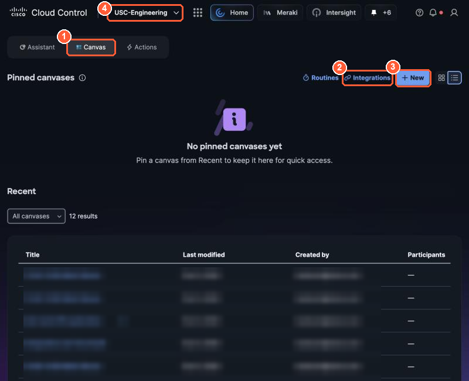
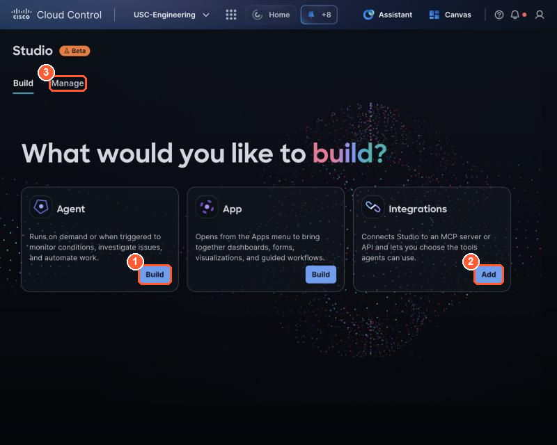
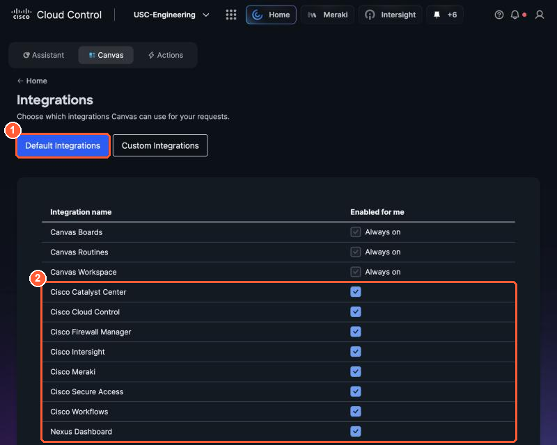
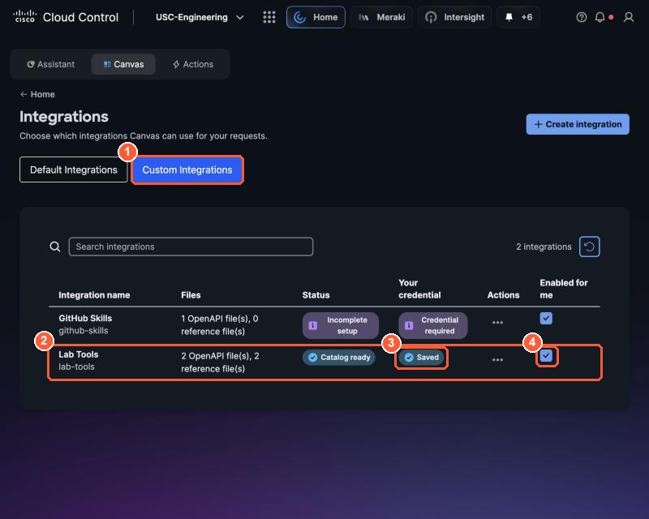
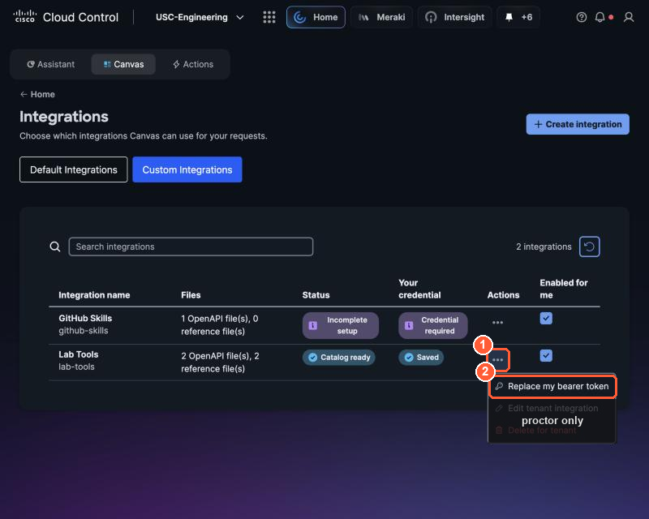

# 1.1 Orientation (0:10, 15 min)

!!! abstract "Goal"
    Find AI Canvas, Studio and the Lab Tools integration, and connect Lab Tools to your seat.

## The lab network you are troubleshooting

POD-45 is a fully built PseudoCo network. You do not configure anything in this lab.

| Area | What is there | Cisco source Canvas can read |
| --- | --- | --- |
| Campus and branch | Meraki Cloud Fabric, leaves `Leaf1` and `Leaf2`, wired and wireless users | Cisco Meraki |
| Headquarters edge | Secure Firewall Threat Defense `hqftdv`, managed by cloud-delivered FMC | Cisco Firewall Manager |
| Data center | Intranet (198.18.5.15), AD (198.18.5.102), Splunk (198.18.5.109) | via Lab Tools (Splunk) |
| Partner DMZ | Partner User Lookup Tool / Customer 360 (198.18.9.2) | Cisco Firewall Manager |
| Remote access | Cisco Secure Access | Cisco Secure Access |
| Site 106 edge | Unified Edge nodes running the lab services and the traffic generator | - |

## Open the three places you will work

1. **AI Canvas**: on the Cloud Control home page, select **Canvas** (top left), then **+ New**.
   You get a new board with a chat panel. Leave it open.

    { loading=lazy }

    *(1) Canvas, (2) Integrations, (3) + New creates a board. Board names and owners are blurred in this guide.*

2. **Studio**: open the app launcher (the grid icon), then **Studio**. You will see three builders:
   **Agent**, **App** and **Integrations**. You will use Agent and Integrations in Part 2.

    { loading=lazy }

    *Studio: (1) Agent builder, (2) add an Integration, (3) Manage lists what you have built.*

3. **Canvas integrations**: go back to **Canvas**, then select **Integrations** above the board list.

## Connect Lab Tools to your seat

On the Canvas **Integrations** page:

1. **Default Integrations** lists what Canvas can already use: Cisco Meraki, Cisco Firewall Manager,
   Cisco Secure Access and others. Leave them all on.

    { loading=lazy }

    *(1) Default Integrations: (2) the Cisco integrations Canvas uses for multi-domain troubleshooting. Leave them ticked.*

2. Select **Custom Integrations**. You will see **Lab Tools** (`lab-tools`). It is shared with the
   organization, so everyone sees the same card, but each person's credential is private.
3. On the **Lab Tools** card, open the **⋯** menu and add your credential
   (**Replace my bearer token**). Paste your **seat token** from the seat card and save.
4. Make sure **Enabled for me** is ticked.

    { loading=lazy }

    *(1) Custom Integrations, (2) Lab Tools. When you are done, (3) Your credential shows Saved and (4) Enabled for me is ticked.*

    { loading=lazy }

    *(1) The Lab Tools actions menu, (2) Replace my bearer token: paste your seat token here. The dimmed items exist only for proctors.*


!!! info "Why a token and not a login"
    Lab Tools runs outside Cisco Cloud Control, like any system your business depends on. The token
    tells it who you are. The same pattern works for ServiceNow, a weather service or your own API.

## Checkpoint

In your Canvas board, ask:

```text
Using Lab Tools, call get_my_watch_scope and get_light_status. Show me the raw results.
```

- [ ] Canvas shows **your** seat ID (for example `T3-C`) and a `watch_source_ip`.
- [ ] `get_light_status` says your light is `off`.

If Canvas says it cannot find Lab Tools, see [Troubleshooting](../reference/troubleshooting.md#canvas-cannot-see-lab-tools).
