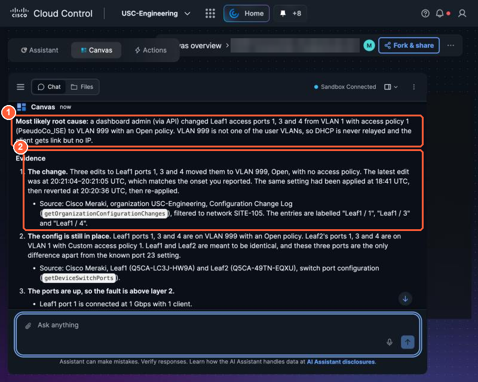
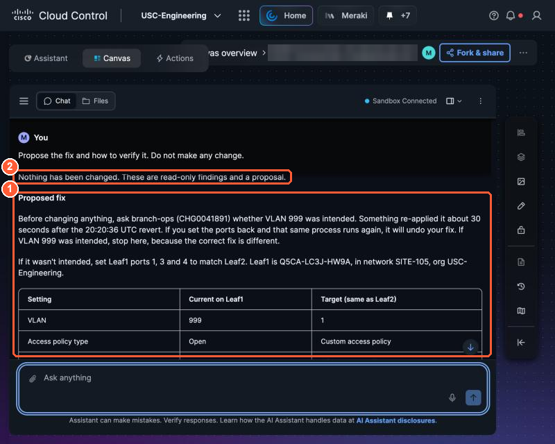

# 1.2 Multi-domain diagnosis in AI Canvas (0:25, 25 min)

!!! abstract "Goal"
    Find the root cause of a user complaint using only Cisco data, and notice what Canvas cannot tell you.

## The complaint

> "Since a few minutes ago, people plugged into the branch switch get a network link but no IP
> address. Wi-Fi is fine." - Branch office manager

## Climb the prompt ladder

Work in your Canvas board. Send one prompt at a time and read the answer before the next. Canvas
shows its plan and the commands it runs; open them to see which Cisco integration it used.

=== "Rung 1: symptom"

    ```text
    Wired users on the USC-Engineering Cloud Fabric leaf access ports get link but no IP address,
    starting a few minutes ago. What could cause this?
    ```

    Canvas picks the right system (Meraki Cloud Fabric, SITE-105) and often already reads the change
    log. Open its plan and note which data it chose. The next rungs make it show and source that data.

=== "Rung 2: correlate"

    ```text
    Check the Meraki org USC-Engineering: switch port configuration and status on Leaf1 and Leaf2,
    the configuration change log for the last 2 hours, DHCP and client events. Compare Leaf1 to Leaf2.
    ```

    Canvas starts reading real data: port settings, the change log, clients per port.

=== "Rung 3: root cause with evidence"

    ```text
    What is the single most likely root cause? Give the evidence, and name the Cisco source
    (product and object) for each piece.
    ```

=== "Rung 4: proposed fix"

    ```text
    Propose the fix and how to verify it. Do not make any change.
    ```

!!! success "What good looks like"
    Canvas finds that **Leaf1 ports 1, 3 and 4 were moved to an unused VLAN** a few minutes ago
    (the change log shows the edit), while Leaf2's matching ports still use the normal access VLAN
    and policy. Clients on those ports never reach the DHCP server, so they get no address. The fix
    it proposes is to restore the ports to match Leaf2, then confirm clients get an address again.
    Canvas may already quote the matching change ticket from Lab Tools. In 1.3 you make that, plus
    business impact, severity and on-call, part of a fixed answer format.

    { loading=lazy }

    *A good rung 3 answer: (1) the CAUSE ties the Leaf1 port change to a time, (2) the Meraki change log shows VLAN 1 changed to 999 on ports 1, 3 and 4.*

    { loading=lazy }

    *A good rung 4 answer: (1) a concrete fix that makes Leaf1 match Leaf2, then how to verify it, (2) no change made.*


## What you did and learned

**What you did:** you started from a user complaint with no device names and climbed four prompts.
Canvas picked the right system (the Meraki Cloud Fabric at SITE-105), read the configuration change
log, compared Leaf1 with Leaf2, named the three ports moved to VLAN 999, and proposed a fix without
changing anything.

**What you learned:**

- **Specific prompts get specific evidence.** Each rung asked for one more thing (real data, a
  comparison, sources, a fix), and the answer moved from possibilities to a cause you can check.
- **Ask for sources and say "do not change".** You can verify an answer with named sources, and an
  assistant that only proposes is safe to use on production.
- **Cisco data tells you *what* changed, not whether it mattered.** Whether the change was planned,
  which business service it hurt, and whether to wake someone all come from your company's own
  systems. That is what 1.3 adds, in a fixed answer format.

- [ ] My Canvas answer names Leaf1, the affected ports and the VLAN change, with sources.
