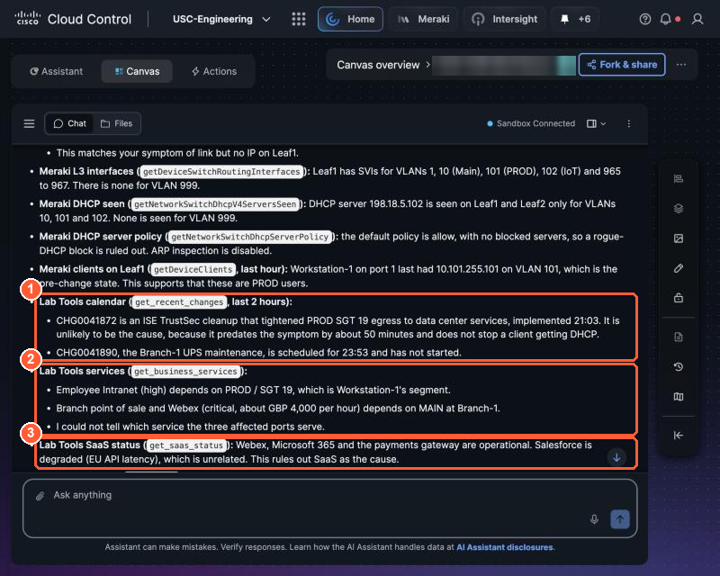

# 1.3 Make it yours: add Lab Tools (0:50, 25 min)

!!! abstract "Goal"
    Get the same root cause, now with the change ticket, the business impact, a severity you can
    defend, and a decision on whether to wake someone. Then make Canvas answer in a fixed format.

Cisco data told you *what* changed. Lab Tools adds what only PseudoCo knows:

| Lab Tools operation | Answers |
| --- | --- |
| `get_recent_changes` | Was this change planned? Ticket ID, who requested it, when |
| `get_business_services` | Which service depends on this segment or site, how critical, business hours, cost of downtime |
| `get_oncall` | Who is on call now and the wake-up policy |
| `get_saas_status` | Is a third-party provider down instead of the network? |

## Run the combined prompt

!!! info "Nobody types a prompt this long at 3 a.m."
    It is long on purpose, because it is a **checklist written out once**:

    - **Step 1** is your normal Cisco triage from 1.2.
    - **Step 2** names each PseudoCo source, so you can see what each one adds to the answer.
    - **Step 3** fixes the answer format. A person can scan it quickly, and in Part 2 your agent
      uses the same STATUS and SEVERITY lines to decide whether to raise an alert.

    In real work you write a prompt like this once and reuse it, just as you would a runbook. That is
    exactly what you do next. In 1.4 you strip tonight's details out of it and save it as a general
    triage method. In Part 2 that method becomes your agent's instructions, so a run needs no prompt at all.

Paste this into your Canvas board. Keep the bracketed parts or adapt them.

```text
Symptom: [wired users on the USC-Engineering Cloud Fabric Leaf1 access ports get link but no IP
address, starting a few minutes ago]
Scope: USC-Engineering Meraki org, Cloud Fabric Leaf1 and Leaf2.

1. Correlate across every Cisco domain you can see (Meraki switch ports and port config, the
   configuration change log, DHCP and client events) and find the root cause.
2. Also check, using Lab Tools:
   - the change calendar for anything in the 2 hours before the symptom started
   - which business service this affects, how critical it is, and its business hours
   - third-party SaaS status, to rule a provider outage in or out
   - who is on call, and whether this meets the wake-up policy
3. Answer in exactly this format:

STATUS: healthy | issue
SEVERITY: minor | major | critical   (set from business criticality, not just the network)
SUMMARY: one line, what is broken and who is affected
CAUSE: the most likely cause, with the change ID if one matches
EVIDENCE: bullets, each naming its source (Cisco product or Lab Tools)
NEXT STEP: the fix to propose, and whether to wake the on-call engineer. Do not make changes.
```

## Iterate until it is right

Good enough when **all four** are true:

- [ ] **CAUSE** names the Leaf1 port change **and** the matching change ID from the change calendar.
- [ ] **SEVERITY** comes from the business service, not from "three ports are down".
- [ ] **Every EVIDENCE bullet names its source** (for example "Cisco Meraki: change log" or
      "Lab Tools: get_recent_changes").
- [ ] **NEXT STEP** proposes a fix, makes no change, and says whether the on-call policy is met.

    { loading=lazy }

    *Lab Tools in the evidence: (1) the change calendar, (2) business services and their criticality, (3) SaaS status ruled out.*


!!! question "The judgment call"
    Those ports are at **Branch-1**, where the business service is **Branch payments and Webex**
    (critical, 08:00 to 21:00). The policy says *wake the primary only for critical services or
    anything affecting payments*. Is a card terminal on ports 1, 3 or 4? A good answer says what it
    knows, what it does not, and what it would check before paging someone. If Canvas guesses,
    tighten the prompt: *"If you cannot confirm the impact, say so and say what would confirm it."*

Common fixes when the answer is not there yet:

| Problem | Add to the prompt |
| --- | --- |
| No change ID | "Match the Meraki change log time to the Lab Tools change calendar." |
| Severity is "major" because "only three ports" | "Set severity from `get_business_services` criticality for the affected site and segment." |
| Evidence has no sources | "Every evidence bullet starts with its source in brackets." |
| It offers to fix it | "You are read-only. Propose; never change." |

## Quick second test: the red herring

Start a **new** board and ask:

```text
Users say Salesforce is slow this morning. Is it the network? Use Lab Tools and any Cisco data
you need, and answer in the same STATUS format.
```

- [ ] The right answer blames the provider: `get_saas_status` shows **Salesforce degraded**, and
      Cisco data shows no network fault. STATUS can still be `issue`, but CAUSE is the provider.

This is the habit you want in an agent that runs while you sleep: it must not wake you for
someone else's outage.
