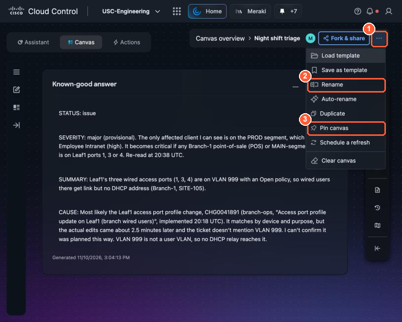
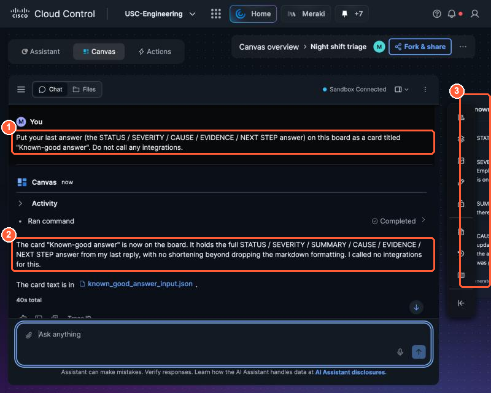
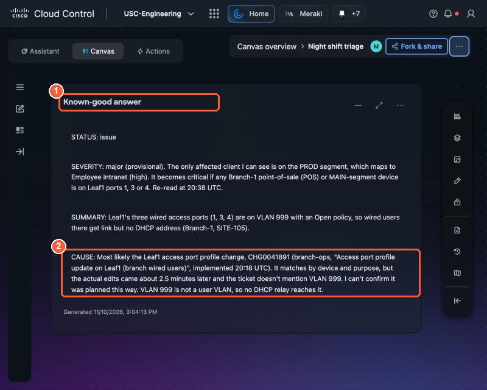
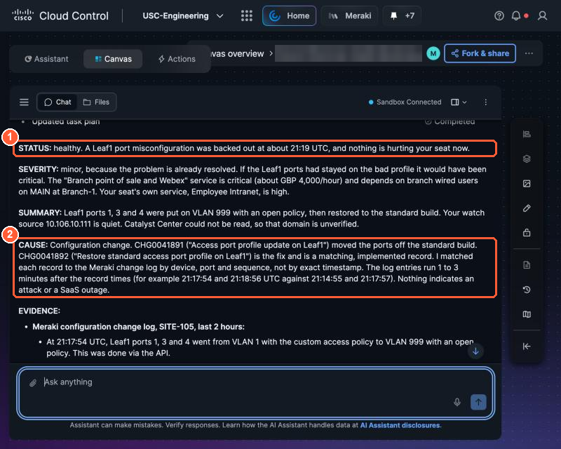

# 2.1 Save the triage method (1:15, 15 min)

!!! abstract "Goal"
    Keep the answer you trust, and turn the prompt that produced it into a **general triage method**
    that works for any problem. Your agent is built from that method in Part 2.

## Keep the answer

Work in the Canvas board that has your best 1.3 answer.

1. **Name and pin the board.** Open the board's **⋯** menu (top right). Choose **Rename** and call it
   **`Night shift triage`**, then open **⋯** again and choose **Pin canvas** so it stays at the top of your
   Canvas list.

    { loading=lazy }

    *(1) The board menu, (2) Rename: call it Night shift triage, (3) Pin canvas: keeps it at the top of your list.*

2. **Put the answer on the board as a card.** Canvas answers live in the chat; a card keeps one on the
   board where you and your table can see it. In the chat, send:

    ```text
    Put your last answer (the STATUS / SEVERITY / CAUSE / EVIDENCE / NEXT STEP answer) on this board
    as a card titled "Known-good answer". Do not call any integrations.
    ```

    { loading=lazy }

    *(1) The request, (2) Canvas confirms the card, (3) the card appears on the board behind the chat.*

3. **Look at the card.** Collapse the chat (the panel menu next to **Sandbox Connected** →
   **Collapsed**), then **Auto layout → Fit to view** in the right-hand toolbar.

    { loading=lazy }

    *(1) Your known-good answer as a card, (2) the CAUSE with the change ID: proof the method finds a real root cause.*

    It is your known-good example: proof that the method finds a real root cause, cites the change ID
    and sets a severity you can defend. Open the chat again from the left-hand toolbar when you are done.

## Turn your prompt into a method

Your 1.3 prompt starts with *this* incident: wired users on Leaf1 get no IP address. An agent
that watches overnight cannot start from a symptom, because nobody has complained yet. So remove everything
that is specific to tonight's branch fault, and keep the method:

| Keep (the method) | Remove (this incident) |
| --- | --- |
| Look across **every** Cisco domain, not only the one you suspect | "Leaf1 access ports", "no IP address", "Meraki only" |
| Check what changed recently and cite the change ID | "in the 2 hours before the symptom started" |
| Business impact, SaaS rule-out, on-call policy (Lab Tools) | The branch office and the payments service |
| The fixed answer format, and "propose, never change" | |

Copy this into a note on your laptop and adjust it to your own words from 1.3:

<div class="sc-autofill" data-setup="../../setup/"></div>

```text
You are the night-shift engineer for [the service I protect].
Each run, answer one question: is anything hurting it, and what should happen next?

1. Look across every Cisco domain I can see. Do not assume the cause in advance:
   - network health and recent configuration changes (Meraki)
   - firewall, IPS and file events (Secure Firewall)
   - access, DNS and anything else I can see (Secure Access, Catalyst Center)
2. Use Lab Tools for recent changes, business service impact, SaaS status and the on-call policy.
3. Answer: STATUS, SEVERITY (from business criticality), SUMMARY, CAUSE (with change ID if one
   matches), EVIDENCE (each bullet names its source), NEXT STEP (propose, never change).
```

!!! tip "Why firewall events are in the list"
    Incident 1 was a switch change, so you never needed the firewall. Leave it in anyway. A method
    that only checks where the last problem was will miss the next one, and in Part 2 the next one is
    not a switch change.

## Before the break

The proctors now clear the standing fault. Optional, if you have two minutes: run your general
method once more, pointed at the service that had the fault, **PseudoCo's branch wired users**. Paste
this into a **new** Canvas board (or your own wording, with the same service):

```text
You are the night-shift engineer for PseudoCo's branch wired users.
Each run, answer one question: is anything hurting it, and what should happen next?

1. Look across every Cisco domain I can see. Do not assume the cause in advance:
   - network health and recent configuration changes (Meraki)
   - firewall, IPS and file events (Secure Firewall)
   - access, DNS and anything else I can see (Secure Access, Catalyst Center)
2. Use Lab Tools for recent changes, business service impact, SaaS status and the on-call policy.
3. Answer: STATUS, SEVERITY (from business criticality), SUMMARY, CAUSE (with change ID if one
   matches), EVIDENCE (each bullet names its source), NEXT STEP (propose, never change).
```

It should come back `STATUS: healthy` and name the change ticket that backed out the Leaf1 change.
A method that finds the fault and then reports healthy after the fix is one you can trust.

{ loading=lazy }

*(1) STATUS healthy after the fix, (2) CAUSE names both tickets: the change that broke the ports and the one that restored them.*

- [ ] Your board is named **Night shift triage**, pinned, and has the **Known-good answer** card.
- [ ] Your general triage method is saved in a note.
- [ ] (Optional) After the fault is cleared, your method returns `STATUS: healthy`.

**Break: 10 minutes.**
