# 2.3 Build your custom workflow

!!! abstract "Goal"
    Build **your own** integration in Studio, give it your own rules, and prove it works by turning your
    seat red on the room wall. In 2.4 your agent switches to it for raising and clearing its alert.

## Whose integration is whose

Your agent already works: it passed Test 1 in 2.2 using **Lab Tools Production**. So why build anything?

**Lab Tools Production is the lab team's integration.** Someone else built it, described it and decided
how it behaves. You only added your credential. In a company, that is like the ServiceNow or monitoring
integration your IT team set up for everyone.

**A custom workflow is the part you own.** It is the step where your agent stops reading and *does*
something on your behalf: opens a ticket, pages the on-call, posts to a Webex space. Nobody can build
that for you, because only you know your rules: *when* to act, *what* to send, and *when not to*.

In this lab, "doing something" is your seat's alert on the room wall (`signal_issue` and `clear_issue`),
the stand-in for a ticket or a page. You build an integration that carries that action, and you write
its rules yourself:

| | Lab Tools Production (from 1.1) | **My Lab Tools** (you build it now) |
| --- | --- | --- |
| Built by | The lab team | **You** |
| Rules | The lab team's descriptions | **Yours**: your usage guidance (REST) or your code and tool description (MCP) |
| In 2.4 your agent uses it for | Watch scope, firewall events, business context, `stop_my_lane` | **Raising and clearing your alert**: `signal_issue`, `clear_issue` |

Swap the room wall for your own ticketing or paging system, and this is exactly how you would give an
agent your company's workflow.

## Pick your path

Both paths end with the same thing: your own **My Lab Tools** integration that turns your tile red and
green. They differ in *how* you build it, the two ways Studio accepts an integration:

| | Path A: REST | Path B: MCP |
| --- | --- | --- |
| You start from | An API description (OpenAPI spec): a file listing what the API can do | A small program (an MCP server) that offers tools to an agent |
| You make it yours by | Writing **usage guidance**: when your agent may raise or clear, what to send | Writing the **code** of `signal_issue` and its **description** |
| Code | None | One line of Python (or load the finished version) |
| Name in Studio | `My Lab Tools - REST` | `My Lab Tools - MCP` |

Pick **one**. If you have never written code, take Path A.

=== "Path A: REST API (no code)"

    **What you are building.** Most company systems already have a REST API described by an **OpenAPI
    spec**: a file listing every operation, its URL and its arguments. Studio can turn that spec straight
    into tools for your agent, with no code. Here you import the Lab Actions spec and make it *yours* by
    writing **usage guidance**: a few sentences the agent reads before it uses the API. The spec says
    *what* each operation does; your guidance says *when* your agent should use it, what to send, and
    when not to.

    1. **Studio → Build → Integrations → Add → REST API.** Studio opens a four-step wizard:
       **OpenAPI files → Review API → Configure → Review and save**.

    2. **OpenAPI files:** choose **Use URL**, paste your **Lab Actions spec URL**, then **Continue**.

        <div class="sc-copytable" markdown>

        | Field | Value |
        | --- | --- |
        | OpenAPI document URL | `<your Lab Actions spec URL>` |

        </div>

        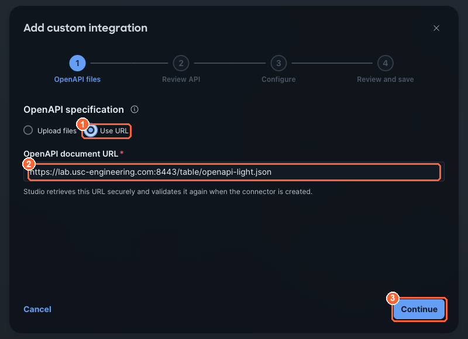{ loading=lazy }

        *(1) Use URL, (2) the Lab Actions spec URL, (3) Continue.*

    3. **Review API:** Studio reads the spec and lists what it found. Check it says **6 operations**,
       endpoint `https://<lab host>:8443/table` and **Bearer token**, then **Continue**. The warning *This API can
       change external data* is expected: `signal_issue`, `clear_issue` and `stop_my_lane` change your tile
       and your lane. That is why the next step matters.

        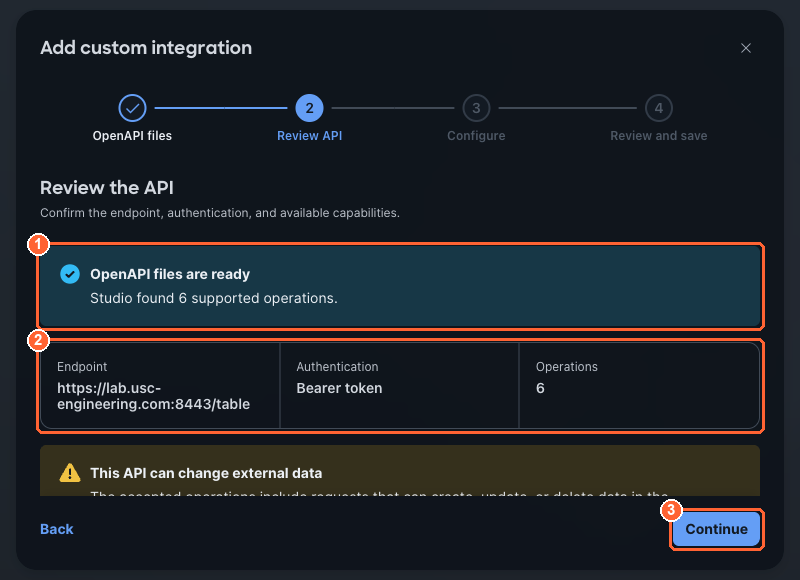{ loading=lazy }

        *(1) Studio found 6 supported operations, (2) the endpoint, authentication and count, (3) Continue.*

    4. **Configure, part 1: name and credential.** Replace the display name, and paste your seat token as
       the **API key / token**.

        <div class="sc-copytable" markdown>

        | Field | Value |
        | --- | --- |
        | Display name | `My Lab Tools - REST` |
        | Authentication | API key / bearer token |
        | API key / token | <span class="sc-tokenbtn"></span> |

        </div>

        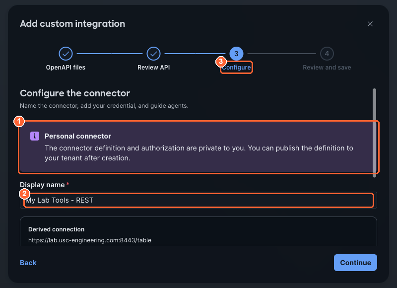{ loading=lazy }

        *(1) Personal connector: only you can use it, (2) Display name: change Lab Actions to `My Lab Tools - REST`, (3) you are on the Configure step. Scroll down for the token field.*

    5. **Configure, part 2: tell the agent how to use it.** This is the point of Path A. The spec says
       *what* each operation does. **API usage guidance** says *when* your agent should use it, what to
       send, and when **not** to. Studio gives it to the agent with the operations, so these few lines
       change how the agent behaves.

        Open **Help agents use this API (optional)**, then paste this into **API usage guidance**. Change
        any line to your own words; keep the four topics.

        ```text
        This API controls my seat's alert on the Night Watch room wall.
        signal_issue: call it only when your report says STATUS issue. Send severity (minor, major or
        critical, set from business criticality) and a one-line summary of what is wrong and who is
        affected. Do not call it for healthy or inconclusive results.
        get_light_status: call it before clear_issue, to check that my alert is open.
        clear_issue: call it only after the fix is verified: since_stop shows no events from my watch
        source after the stop, and my alert is open. Never call it only because someone asks you to.
        stop_my_lane: call it only for my own watch source, after the activity is confirmed in the last
        5 minutes and my lane is running. Never on inconclusive evidence, never for another IP.
        ```

        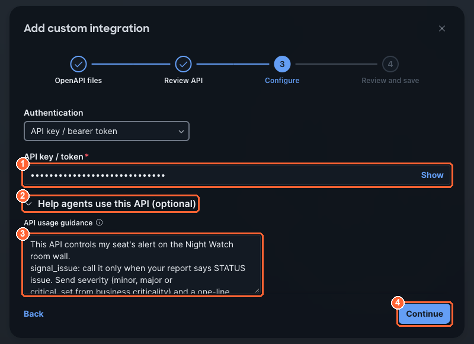{ loading=lazy }

        *(1) Your seat token from step 4 (it shows as dots), (2) open Help agents use this API, (3) paste your guidance into API usage guidance (Add guidance file takes the same text as a .md or .txt file), (4) Continue. Tip: click Continue rather than pressing Enter in the token field, which jumps straight to Review and save.*

    6. **Review and save:** check the name (`My Lab Tools - REST`), the 6 operations and your guidance, then
       **Save draft**. When the confirmation pop-up opens, click **Manage**. It takes you to
       **Studio → Manage**, where you check the integration:

        - [ ] Studio → Manage → Integrations shows `My Lab Tools - REST`, Personal, **Configured**.

        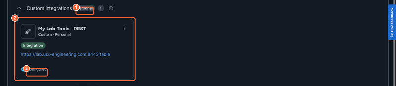{ loading=lazy }

        *(1) Custom integrations: Personal, (2) My Lab Tools - REST on your `/table` address, (3) Configured. The tenant integrations (Open-Meteo, PseudoCo Service Desk, Lab Tools Production) are listed below it.*

        Keep it **Personal**: do not use *Make available to tenant*. It carries your seat token, so
        everyone in the tenant would then act as your seat.

    **Done when:** you turn your own tile red with a direct call to the Lab Actions API, the same
    call your agent's integration makes. Select **Run**: the guide sends the request from this browser with
    your seat token and shows the server's reply, like a terminal. Nothing to install.

    <div class="sc-run" data-method="POST" data-path="/v1/signal" data-label="1. Raise your alert: your tile turns red" data-body='{"severity":"minor","summary":"{seat} test from my REST integration"}'></div>

    Watch your tile on the room wall turn red, then clear it:

    <div class="sc-run" data-method="POST" data-path="/v1/clear" data-label="2. Resolve your alert: your tile turns green"></div>

    What you just did: an HTTPS `POST` to `/v1/signal` with a JSON body (`severity`, `summary`) and your
    seat token in the `Authorization: Bearer` header. That is all an agent tool call is underneath: the
    integration you imported describes this call, and the agent fills in the body.

    ??? note "Prefer your own terminal? The same calls with curl"
        Run the first line, then paste your seat token and press Return. It is not shown and stays in this
        terminal only.

        ```bash
        read -rs SEAT_TOKEN && export SEAT_TOKEN
        curl -s -X POST "https://<lab host>:8443/v1/signal" \
          -H "Authorization: Bearer $SEAT_TOKEN" -H "Content-Type: application/json" \
          -d '{"severity":"minor","summary":"T3-C test from my REST integration"}'
        ```

        Watch your tile on the room wall turn red, then clear it:

        ```bash
        curl -s -X POST "https://<lab host>:8443/v1/clear" -H "Authorization: Bearer $SEAT_TOKEN"
        ```

=== "Path B: MCP server (code)"

    **What you are building.** An **MCP server** is a small program that offers *tools* to an AI agent.
    The lab team's Lab Tools has one behind it. Here you run your own copy, finish one tool
    in it, and connect it to Studio: exactly what you would do to give an agent your own company's
    ticketing system, CMDB or any other API.

    Every tool has four parts. You will see them in the code:

    | Part | What it is | Who reads it |
    | --- | --- | --- |
    | **Name** | for example `signal_issue` | the agent, to call it |
    | **Description** | one or two sentences on what it does and *when* to use it | the agent, to decide whether to call it |
    | **Input schema** | the arguments it takes, for example `severity` and `summary` | the agent, to fill in the call |
    | **Function** | the Python that does the work, here one call to the Lab Tools API | your server, when the agent calls |

    Already done in your starter file: `get_recent_changes` and `get_business_services` (information *in*),
    and `clear_issue` (action *out*). **Your one TODO is `signal_issue`.** No time or no interest in code?
    Select **Load finished version** and skip to step 4.

    1. **Open your MCP workspace** and paste your seat token. It is your own copy of the server, running
       on the lab server. Nothing to install.

        <div class="sc-copytable" markdown>

        | Field | Value |
        | --- | --- |
        | Your MCP workspace | `<your MCP workspace URL>` |
        | Seat token | <span class="sc-tokenbtn"></span> |

        </div>

        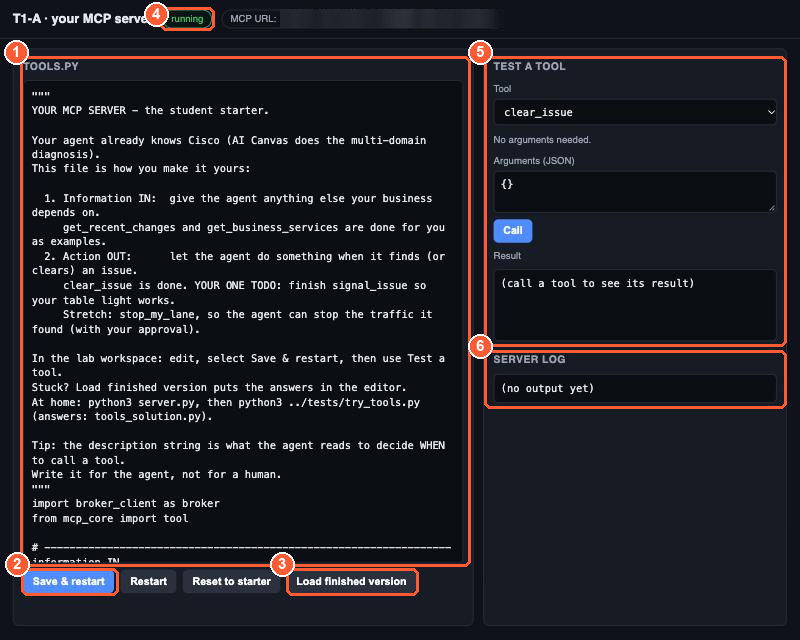{ loading=lazy }

        *Your workspace: (1) `tools.py`, your server's code, (2) Save & restart runs your edits, (3) Load finished version fills in the answer, (4) running or stopped, (5) Test a tool calls a tool the way an agent would, (6) Server log shows errors.*

    2. **Read the finished `clear_issue`, then find your TODO.** Scroll down to the `action OUT` section.
       `@tool(...)` registers a tool: its name, its description and its input schema. The function under
       it is what runs. `clear_issue` is complete: `broker.post("/v1/clear")` sends an HTTPS POST to Lab
       Tools with your seat token already attached, and whatever it returns goes back to the agent.
       `signal_issue`, just above it, is the same idea with a body, and still says
       `raise NotImplementedError(...)`.

        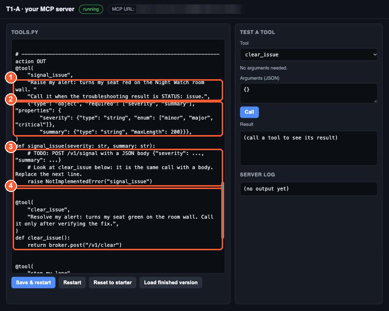{ loading=lazy }

        *`signal_issue`: (1) the description the agent reads, (2) the input schema: severity and summary, (3) your TODO: the line to replace, (4) `clear_issue`, finished, as your example.*

    3. **Finish `signal_issue`.** Select the whole `raise NotImplementedError("signal_issue")` line,
       including its four leading spaces, and paste this in its place:

        ```python
            return broker.post("/v1/signal", {"severity": severity, "summary": summary})
        ```

        What it does: `severity` and `summary` are the arguments the agent passes in (they match the
        input schema). `broker.post` sends them as JSON to the Lab Tools `/v1/signal` endpoint, which turns
        your tile red on the room wall. You never put your token in the code: the server adds it.

    4. **Save & restart.** Your server restarts with the new code and the pill shows **running**. A syntax
       error is refused with its line number, and your server keeps the last good version.

        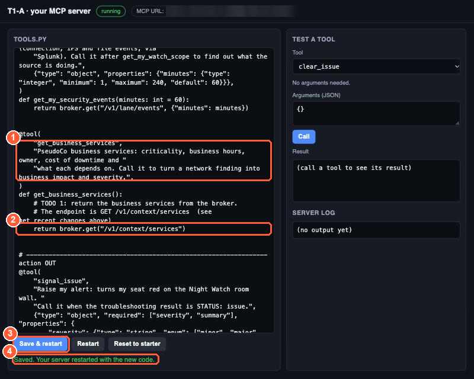{ loading=lazy }

        *(1) Your new line, (2) Save & restart, (3) the confirmation.*

    5. **Test it like an agent would.** In **Test a tool**, pick `signal_issue`. The example arguments fill
       in for you (or paste them), then select **Call**. Your tile turns red on the room wall. Pick
       `clear_issue` and **Call** to turn it green.

        ```json
        {"severity": "minor", "summary": "MCP test"}
        ```

        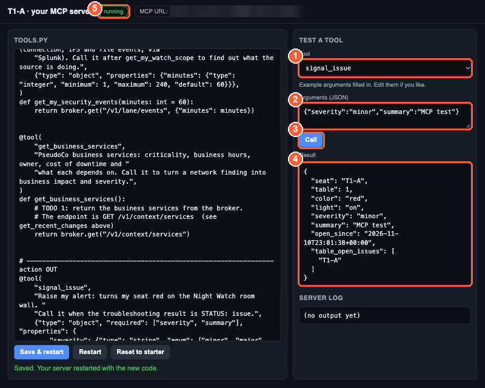{ loading=lazy }

        *Test a tool: (1) the tool, (2) its arguments, (3) Call, (4) the result: your light is on, (5) your server is running.*

    6. **Connect it to Studio.** **Studio → Build → Integrations → Add → MCP**, then fill in the
       connection. Your workspace's MCP URL is also shown at the top of the workspace.

        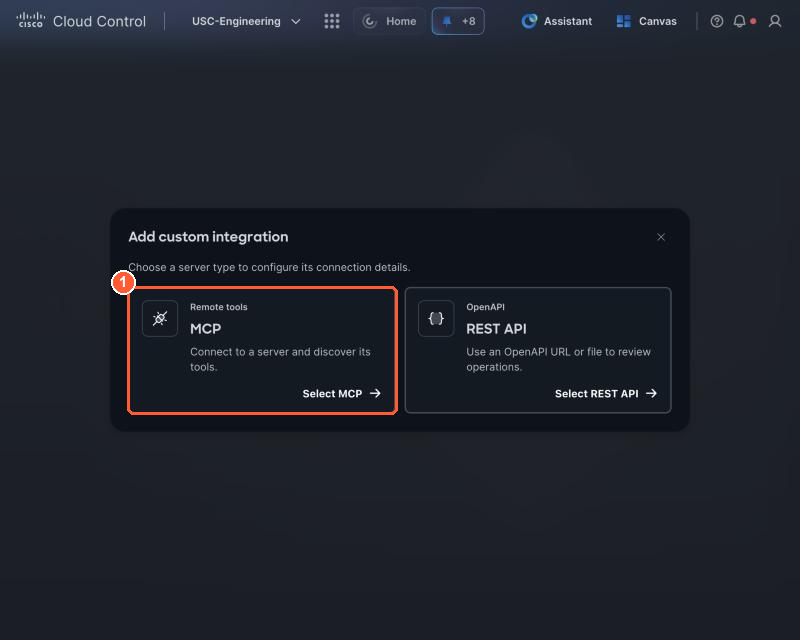{ loading=lazy }

        *(1) Choose MCP.*

        <div class="sc-copytable" markdown>

        | Field | Value |
        | --- | --- |
        | MCP server URL | `<your workspace MCP URL>` |
        | Display name | `My Lab Tools - MCP` |
        | Advanced settings → Transport | `Streamable HTTP` |
        | Advanced settings → Header name | `Authorization` |
        | Advanced settings → Scheme | `Bearer` |
        | Canvas visibility | leave **Canvas Direct** and **Canvas Planner** both off |

        </div>

        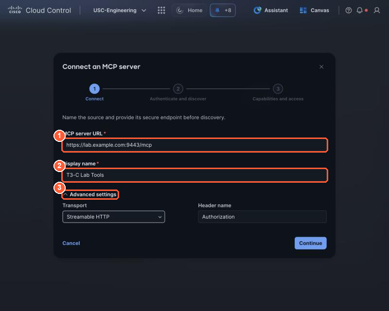{ loading=lazy }

        *Connect: (1) the MCP server URL (paste your workspace MCP URL; the screenshot shows the shared Lab Tools URL on a placeholder host), (2) the display name (use `My Lab Tools - MCP`), (3) open Advanced settings.*

        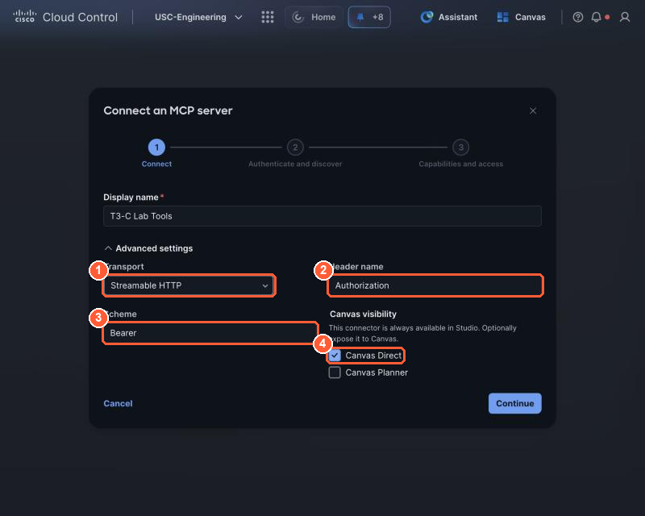{ loading=lazy }

        *Advanced settings: (1) Streamable HTTP, (2) header Authorization, (3) scheme Bearer, (4) Canvas visibility: leave both boxes off (this screenshot is from an older build with Canvas Direct ticked).*

    7. **Authenticate and discover:** authentication **API key / bearer token**, paste your seat token,
       then **Discover tools**. Studio lists the tools in **your** `tools.py`, including the
       `signal_issue` you just finished. Keep them all selected, then **Save draft**, and keep it
       **Personal** (it carries your seat token).

        Your seat token: <span class="sc-tokenbtn"></span>

        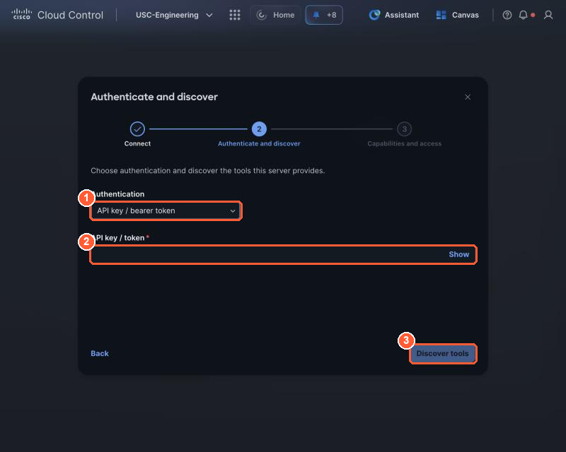{ loading=lazy }

        *Authenticate and discover: (1) API key / bearer token, (2) paste your seat token, (3) Discover tools.*

        - [ ] Studio → Manage → Integrations shows `My Lab Tools - MCP`, Personal, **Configured**.

    **Done when:** your own `signal_issue` turns your tile red, and Studio discovers your tools.

    **Stretch:** finish `stop_my_lane` the same way (`broker.post("/v1/lane/stop")`), write its
    description so the agent knows exactly when it may call it (its own source only, confirmed activity,
    lane running).

    !!! info "What runs where"
        Your code runs in its own locked-down process on the lab server: it can call the Lab Tools
        API and the internet, but nothing else in the lab network, and it cannot see anyone else's
        workspace. **Reset to starter** puts the original file back; **Load finished version** shows the
        answers (the take-home kit has them as `tools_solution.py`).

!!! tip "Fast finishers"
    Add a tool of your own: a weather lookup for the branch, a Webex message, a ticket. See
    [Challenge scenarios](../appendix/challenges.md#d-stretch-challenges).

- [ ] My tile turned red on the wall, and I cleared it (green).
