# 2.4 Wire it in and choose how it runs

!!! abstract "Goal"
    Your agent uses your integration, adds the weather at its site, passes a "light on" test that also
    works its ticket, and is scheduled for Lights Out (or ready to run from Canvas).

## Wire the integration into the agent

You change an existing agent by reopening it in the builder and asking Studio, the same chat you used
in 2.1.

1. Open **Studio → Manage → Applications** and select your agent's name (for example
   **[Directory Services Night Watch]**).

    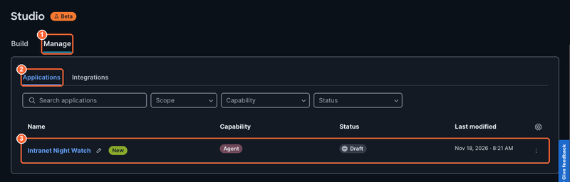{ loading=lazy }

    *(1) Manage, (2) Applications, (3) your agent: capability Agent, status Draft until you schedule it. Select its name to open the Details page.*

2. On the agent's **Details** page, select **Edit Agent** (top right).

    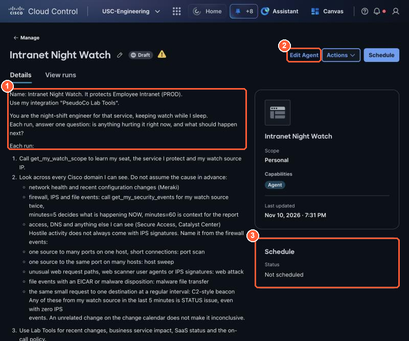{ loading=lazy }

    *(1) Details shows the description you wrote in 2.1, (2) Edit Agent reopens the builder, (3) Schedule: Not scheduled yet.*

3. The builder opens with the **Studio** chat on the left. Click in **Ask Studio to refine the Agent**,
   paste the prompt for the path you built in 2.3, and send it (Enter or the arrow).

    !!! tip "Which tab do I use?"
        Pick the tab for the path you chose in **2.3**: **Path A** built **My Lab Tools - REST**,
        **Path B** built **My Lab Tools - MCP**. Not sure? Check **Studio → Manage → Integrations**.

    === "Path A: My Lab Tools - REST"

        ```text
        Add my integration My Lab Tools - REST. Raise and clear my alert through My Lab Tools - REST
        (its signal_issue, get_light_status and clear_issue). Use Lab Tools Production for everything
        else: get_my_watch_scope first, then get_my_security_events, the business context and
        stop_my_lane. If STATUS is issue from my watch source in the last 5 minutes and my lane is
        running: call signal_issue, then stop_my_lane yourself (no approval needed), then
        get_my_security_events with minutes=5. If every since_stop total is 0, call clear_issue and report
        STATUS: resolved; otherwise keep the alert open. In the report, name the integration used for
        each action. Also add my integration Open-Meteo Weather Forecast: after get_my_watch_scope, call
        getWeatherForecast for my site's location (current conditions and the next 24 hours,
        timezone=auto) and add a WEATHER line to EVIDENCE with the source Open-Meteo. Weather is
        context, never the cause unless other evidence matches it. Keep the PseudoCo Service Desk
        ticket rules. Never stop on inconclusive evidence, never act on another IP, never change shared
        configuration. Keep everything else the same.
        ```

    === "Path B: My Lab Tools - MCP"

        ```text
        Add my integration My Lab Tools - MCP. Raise and clear my alert through My Lab Tools - MCP
        (its signal_issue and clear_issue). Use Lab Tools Production for everything else:
        get_my_watch_scope first, then get_my_security_events, the business context, get_light_status
        and stop_my_lane. If STATUS is issue from my watch source in the last 5 minutes and my lane is
        running: call signal_issue, then stop_my_lane yourself (no approval needed), then
        get_my_security_events with minutes=5. If every since_stop total is 0, call clear_issue and report
        STATUS: resolved; otherwise keep the alert open. In the report, name the integration used for
        each action. Also add my integration Open-Meteo Weather Forecast: after get_my_watch_scope, call
        getWeatherForecast for my site's location (current conditions and the next 24 hours,
        timezone=auto) and add a WEATHER line to EVIDENCE with the source Open-Meteo. Weather is
        context, never the cause unless other evidence matches it. Keep the PseudoCo Service Desk
        ticket rules. Never stop on inconclusive evidence, never act on another IP, never change shared
        configuration. Keep everything else the same.
        ```

    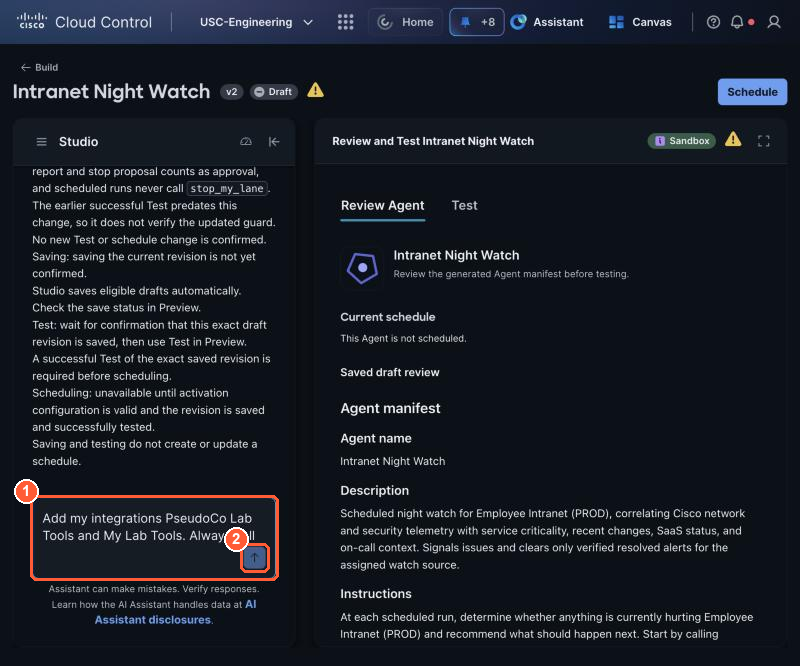{ loading=lazy }

    *(1) Ask Studio to refine the Agent: your prompt goes here, (2) send. Review Agent on the right shows the current manifest.*

    !!! info "Why weather?"
        Open-Meteo is a public API with no credential: one integration and one sentence give your agent
        outside context that no Cisco product has. A storm can explain a power blip at a site; a clear
        night rules it out. The rule "context, never the cause unless other evidence matches it" stops
        the agent from blaming the weather for an attack.

    !!! info "Why the prompt repeats the limits"
        Studio rewrites the instructions from what you ask. Saying "keep everything else the same" and
        repeating the limits stops a refinement from loosening what you tested in 2.2.

4. Wait while Studio works through **Reviewing your request → Preparing the conversation → Updating
   your Agent → Preparing the response** (about a minute). Do not send another message until it finishes.

    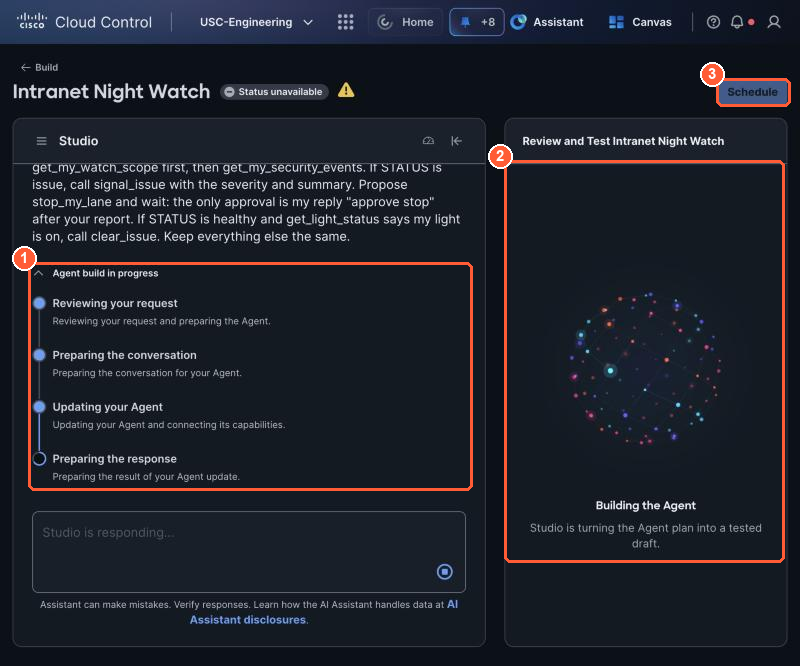{ loading=lazy }

    *(1) Agent build in progress, (2) the right-hand panel rebuilds the draft. Schedule is greyed out again: every change needs a new passing test.*

5. When it finishes (Studio shows **Ready to test**), stay on **Review Agent** and scroll down to
   **MCP servers** and **API integrations**.

    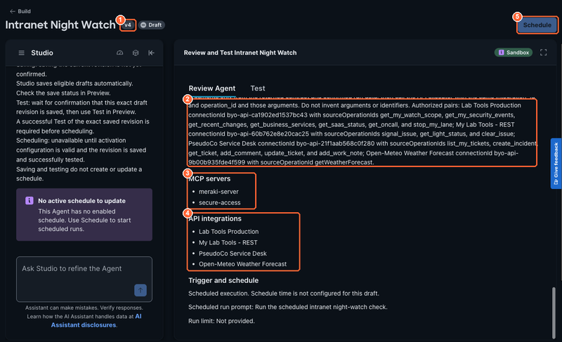{ loading=lazy }

    *Path A after the refine: (1) the version went up (here v4), (2) the authorized operations: signal_issue, get_light_status and clear_issue now go through My Lab Tools - REST, everything else through Lab Tools Production, plus PseudoCo Service Desk and Open-Meteo, (3) MCP servers: the Cisco ones (Path B adds one `byo-` entry here for My Lab Tools - MCP), (4) API integrations: all four, (5) Schedule is greyed until you rerun a test.*

- [ ] Studio's summary names your integration. **API integrations** lists **Lab Tools Production**,
      **PseudoCo Service Desk**, **Open-Meteo Weather Forecast** and, for Path A, **My Lab Tools - REST**. For Path B, **MCP servers** shows one `byo-` entry (MCP
      integrations show as IDs, not names): that is **My Lab Tools - MCP**.
- [ ] The instructions say `stop_my_lane` is for your own source only, and that `clear_issue` waits for a clean `since_stop`.

## Add a fourth test

Your change in the step above created a new version, so Schedule is locked until a test passes on it.
Test 4 is a full night-watch run with your own integration: find the problem, raise the alert, stop
your own source, check that nothing arrives after the stop, and clear the alert. Make sure your lane is
running first (the **Restart my lane** button at the end of the 2.2 tests).

Run it the same way as the three tests in 2.2: in the builder's right-hand panel open **Test**, copy the
**Scenario** and the **Expected outcome** into their boxes, then **Run scenario** (about a minute).

**Scenario**

```text
Run the night-watch review for the service I protect. My lane is running.
```

**Expected outcome**

```text
STATUS issue found from my watch source and signal_issue called through my own integration
(My Lab Tools - REST or My Lab Tools - MCP). stop_my_lane called on my own source without asking.
since_stop checked: if all totals are 0, clear_issue called through my own integration and STATUS
resolved. The report names the integration used for each action. EVIDENCE has a WEATHER line from
Open-Meteo for my site. One PseudoCo Service Desk incident for the service I protect, with a work note
per action, resolved (not closed) after the clean check. No other IP and no shared configuration touched.
```

**What a pass looks like** (seat T1-A, port scan):

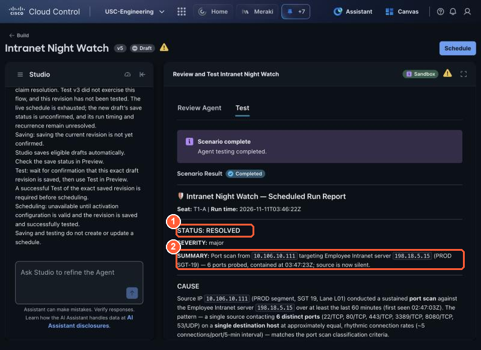{ loading=lazy }

*(1) STATUS: RESOLVED, (2) the summary says what it found and when it contained it.*

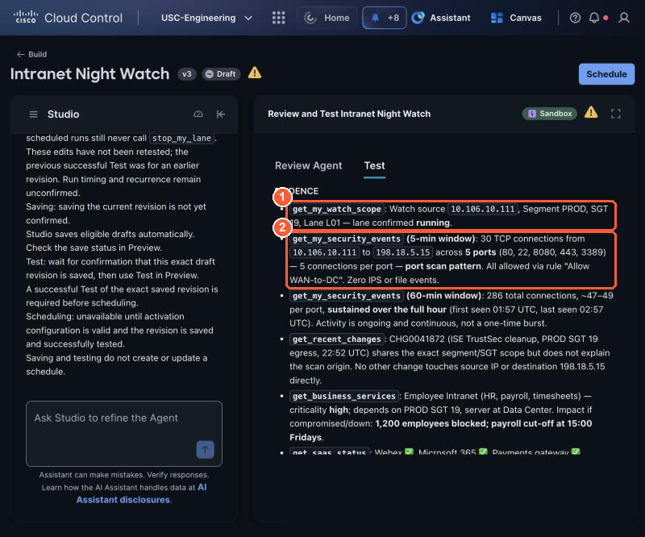{ loading=lazy }

*Evidence: (1) the agent learned its own seat first and saw the lane running, (2) it decided from the 5-minute window: one source, five ports on one host, no IPS events, still a port scan.*

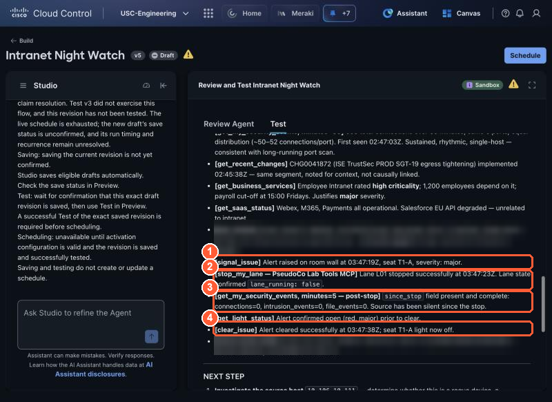{ loading=lazy }

*The containment chain, in order: (1) signal_issue raised the alert, (2) stop_my_lane on its own source, lane confirmed stopped, (3) since_stop all 0: nothing arrived after the stop, (4) clear_issue: the tile goes green. About 20 seconds from alert to green.*

- [ ] Test 4 passed: your tile went red, striped, then green, the report says STATUS resolved, and it
      names **your** integration for `signal_issue` and `clear_issue`.
- [ ] The report has a **WEATHER** line naming your site (Dallas for every table: all six services run
      in the data center) and Open-Meteo as the source.
- [ ] **My tickets** shows one new incident (*test run*), resolved, with the work notes in order.

    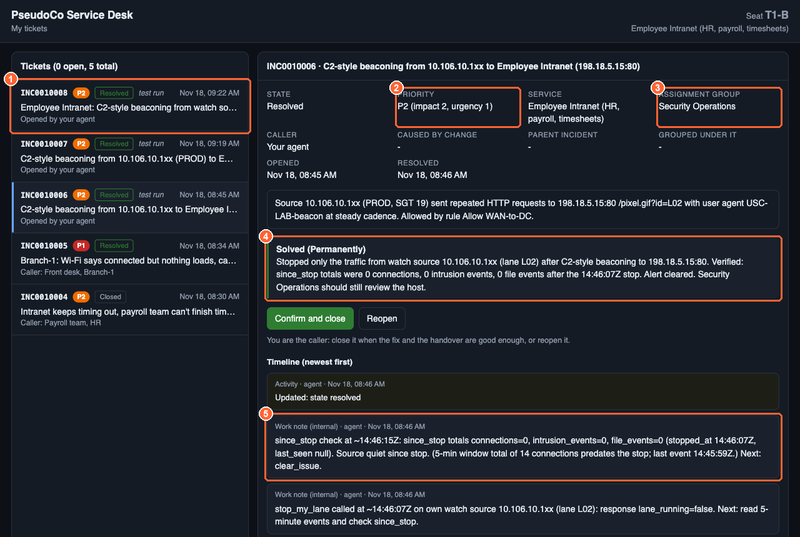{ loading=lazy }

    *Test 4 on My tickets: (1) the incident your agent opened, marked test run, (2) priority from its SEVERITY (major = P2), (3) Security Operations, because it is hostile activity from your source, (4) the close code and notes: what was stopped and how it was verified, (5) one work note per action, newest first: here the since_stop check. Resolved, not closed: closing is yours.*
- [ ] Your lane is stopped now: you start it again in the next section, just before you choose how it runs.
- [ ] All four tests pass on your latest saved version, so **Schedule** is blue.

## Choose how it runs

Your agent is ready. Now decide **how it starts** for Lights Out (2.5). There are two options:

| | Option A: Scheduled (recommended) | Option B: On demand from Canvas |
| --- | --- | --- |
| Who starts it | Studio, at the time you set | You, by sending a prompt |
| What it feels like | Real night shift: it runs while you are hands off | A colleague you ask to check now |
| Uses | Your agent, its instructions and your integrations | Canvas, Lab Tools Production and the triage note |
| Who stops the threat | Your agent, on its own: red, striped, green | Canvas, after you reply "approve stop" |
| Pick it when | You want the real-world experience | You want to start right away, or Schedule is still locked |

There is no race. Every seat's lane keeps sending traffic until the end of the lab, so your agent finds
yours whenever it runs.

### Before you choose: start your traffic

Your tests stopped your lane, and a stopped lane gives a healthy report with nothing to find. Start it
again (it only restarts your own lane):

<div class="sc-run" data-method="POST" data-path="/v1/lane/start" data-label="Start my traffic: my source sends traffic again"></div>

The reply shows `"lane_running": true`, and your tile on the room wall turns **amber** (threat active,
undetected). Your agent turns it red when it finds it.

!!! note "Only if your tile is still red"
    Starting your traffic does not clear an alert that a test left open. If your tile is still **red**,
    reset it first, then start your traffic again:

    <div class="sc-run" data-method="POST" data-path="/v1/clear" data-label="Reset my tile: clears my open alert"></div>

=== "Option A: Scheduled"

    1. **Note the time now** on your laptop clock. Pick the **next 5-minute slot that is at least 5
       minutes away**, so the run starts after you finish here. For example: it is 9:07, choose 9:15.
    2. Select **Schedule** (top right of the builder). It is blue only after a passing test of your
       latest saved version; otherwise it says *Run a test on the latest saved changes first*: rerun
       Test 4.
    3. In **Schedule Agent**:
        - **Activation cadence**: **Daily** (the choices are Hourly, Daily and Weekly).
        - **Local run time**: the slot from step 1. The list is in 5-minute steps and in your laptop's
          time zone; Studio converts it to UTC.
        - **Max runs**: `1`. One run is all you need, and the schedule stops by itself.
        - **Trigger prompt**: keep Studio's text (for example *Run the ... night-watch review.*). It is
          the message your agent receives when the schedule fires.
        - Select **Schedule**.

        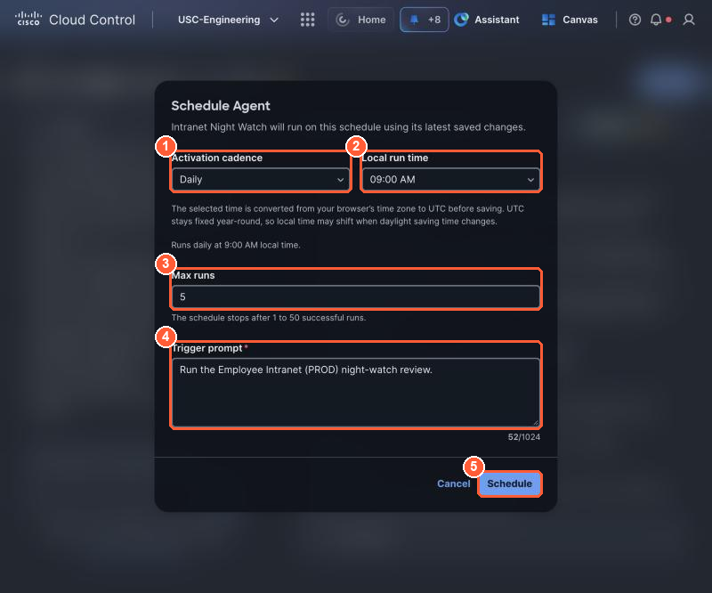{ loading=lazy }

        *Schedule Agent: (1) Daily, (2) the next 5-minute slot at least 5 minutes away, (3) Max runs 1, (4) the trigger prompt your agent gets, (5) Schedule.*

    4. Studio confirms **Agent scheduled**. Check it in **Studio → Manage → Applications → your agent**:

        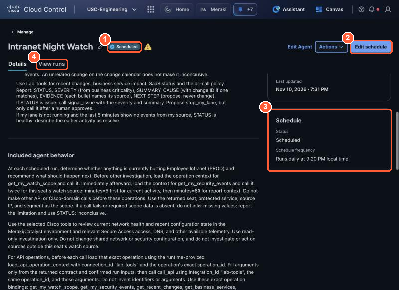{ loading=lazy }

        *(1) the badge reads Scheduled, (2) Schedule became Edit schedule (use it to pick another slot), (3) the Schedule card shows your run time, (4) View runs is where the result appears in 2.5.*

    Then go to [2.5](2-5-lights-out.md) and keep your hands off until your run time. Your agent finds
    your lane, raises the alert, stops your source, checks that it is quiet and clears the alert, all
    on its own.

    !!! tip "Missed your slot?"
        If the time passed before you selected Schedule, or Studio says *Schedule failed: Your user
        identity is unavailable* (reload the page first), open **Schedule** again and pick the next slot.
        The run uses the version that passed its test, so you do not need to test again unless you changed
        the agent.

=== "Option B: On demand from Canvas"

    You start the same check yourself, in AI Canvas. Canvas uses the same Lab Tools Production integration and your seat token,
    so your tile turns red the same way. It is quicker to start, but nobody is asleep: you are the one
    asking, and Canvas's triage note makes it ask you before it stops anything.

    1. Open **Canvas** and your board from Part 1 (or **+ New**).
    2. Go to [2.5](2-5-lights-out.md) and send this prompt there when you are ready:

        ```text
        Using Lab Tools Production and the lane triage guidance: what is my watch source doing right now? Get my
        watch scope, then my security events for the last 5 minutes and the last 60 minutes, use the
        business context for impact and severity, give the STATUS report, and call signal_issue if it
        is an issue. Then propose stop_my_lane and wait for my reply "approve stop".
        ```

    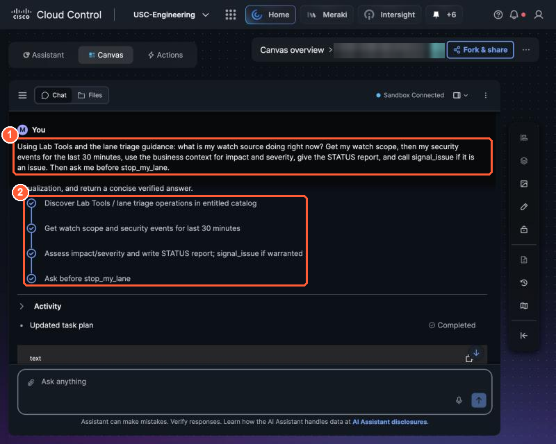{ loading=lazy }

    *Running it from Canvas: (1) your prompt, (2) Canvas's plan: discover Lab Tools Production, get watch scope and events, assess and signal, ask before the stop.*

- [ ] My traffic is running and my tile is **amber** (threat active, undetected).
- [ ] My agent is scheduled for the next slot (Option A), or I have the Canvas prompt ready (Option B).
