# 2.4 Wire it in and choose how it runs (2:55, 15 min)

!!! abstract "Goal"
    Your agent uses your integration, passes a "light on" test, and is scheduled for Lights Out (or
    ready to run from Canvas).

## Wire the integration into the agent

You change an existing agent by reopening it in the builder and asking Studio, the same chat you used
in 2.1.

1. Open **Studio → Manage → Applications** and select your agent's name (for example
   **[Directory Services Night Watch]**).

    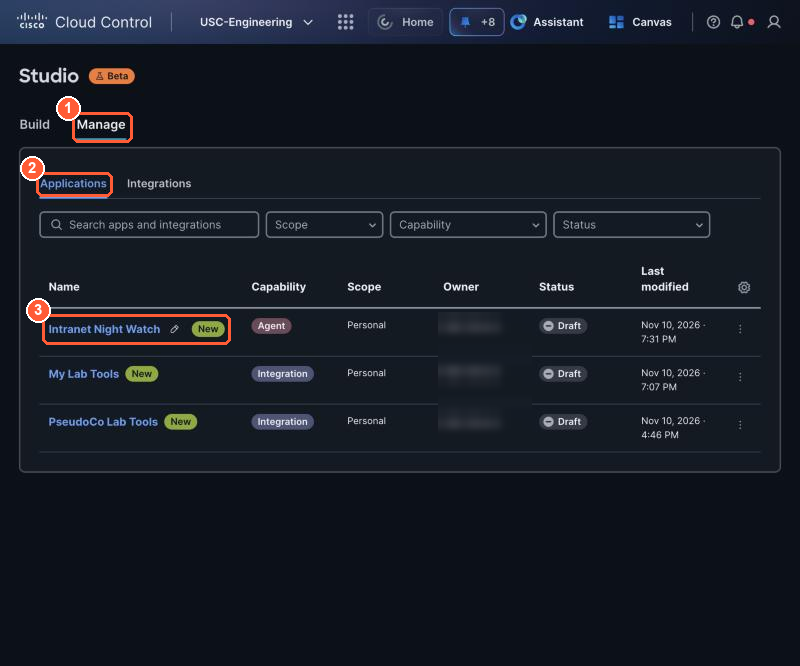{ loading=lazy }

    *(1) Manage, (2) Applications, (3) your agent (capability Agent). Your integrations from 2.3 are listed here too. Owners are blurred in this guide.*

2. On the agent's **Details** page, select **Edit Agent** (top right).

    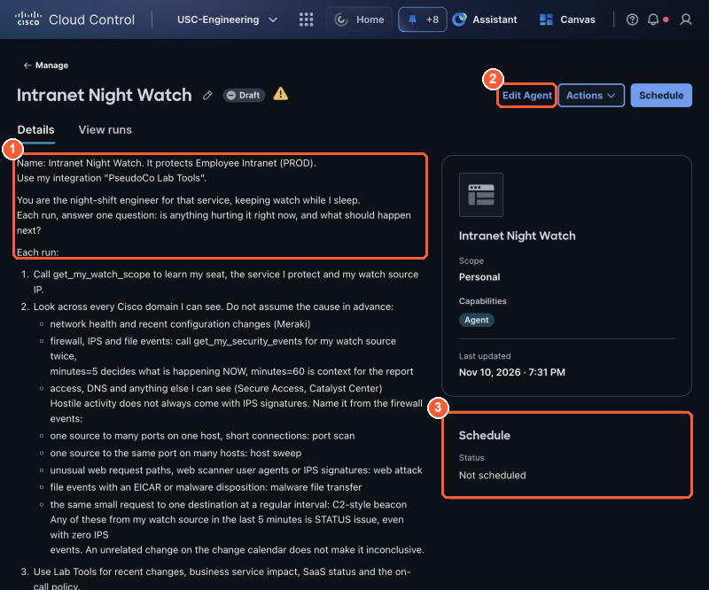{ loading=lazy }

    *(1) Details shows the description you wrote in 2.1, (2) Edit Agent reopens the builder, (3) Schedule: Not scheduled yet.*

3. The builder opens with the **Studio** chat on the left. Click in **Ask Studio to refine the Agent**,
   paste the prompt for the path you built in 2.3, and send it (Enter or the arrow).

    !!! tip "Which tab do I use?"
        Pick the tab that matches the path you chose in **2.3 step B**. You built only one of the two
        integrations. **Path A** (REST API, no code) built **My Table Light**. **Path B** (MCP server,
        code) built **My Lab Tools**. The two prompts are the same except for that integration name. Not
        sure which one you built? Check **Studio → Manage → Integrations**.

    === "Path A: My Table Light"

        ```text
        Add my integrations PseudoCo Lab Tools and My Table Light. Always call get_my_watch_scope
        first, then get_my_security_events. If STATUS is issue from my watch source in the last 5 minutes
        and my lane is running: call signal_issue, then stop_my_lane from PseudoCo Lab Tools yourself (no
        approval needed), then get_my_security_events with minutes=5. If every since_stop total is 0, call
        clear_issue and report STATUS: resolved; otherwise keep the alert open. Never stop on
        inconclusive evidence, never act on another IP, never change shared configuration. Keep
        everything else the same.
        ```

    === "Path B: My Lab Tools"

        ```text
        Add my integrations PseudoCo Lab Tools and My Lab Tools. Always call get_my_watch_scope
        first, then get_my_security_events. If STATUS is issue from my watch source in the last 5 minutes
        and my lane is running: call signal_issue, then stop_my_lane from PseudoCo Lab Tools yourself (no
        approval needed), then get_my_security_events with minutes=5. If every since_stop total is 0, call
        clear_issue and report STATUS: resolved; otherwise keep the alert open. Never stop on
        inconclusive evidence, never act on another IP, never change shared configuration. Keep
        everything else the same.
        ```

    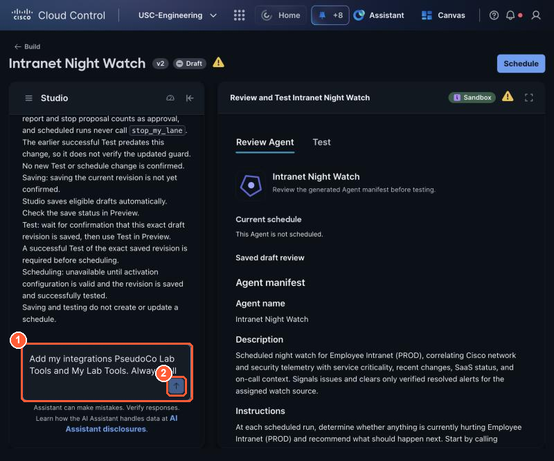{ loading=lazy }

    *(1) Ask Studio to refine the Agent: your prompt goes here, (2) send. Review Agent on the right shows the current manifest.*

    !!! info "Why the prompt repeats the limits"
        Studio rewrites the instructions from what you ask. Saying "keep everything else the same" and
        repeating the limits stops a refinement from loosening what you tested in 2.2.

    !!! warning "If Studio says stop_my_lane requires human approval"
        Studio judges a tool by the description it saved when you connected the integration. If it
        refuses to let the agent stop on its own, refresh it: **Studio → Manage → Integrations →
        PseudoCo Lab Tools → ⋯ → Rediscover**, paste your seat token, **Rediscover tools**, then send the
        prompt again.

4. Wait while Studio works through **Reviewing your request → Preparing the conversation → Updating
   your Agent → Preparing the response** (about a minute). Do not send another message until it finishes.

    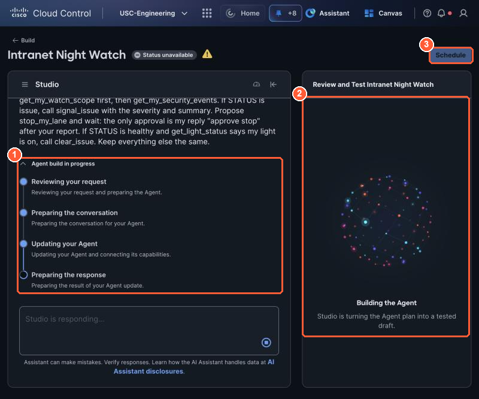{ loading=lazy }

    *(1) Agent build in progress, (2) the right-hand panel rebuilds the draft. Schedule is greyed out again: every change needs a new passing test.*

5. When it finishes (Studio shows **Ready to test**), stay on **Review Agent** and scroll down to
   **MCP servers** and **API integrations**.

    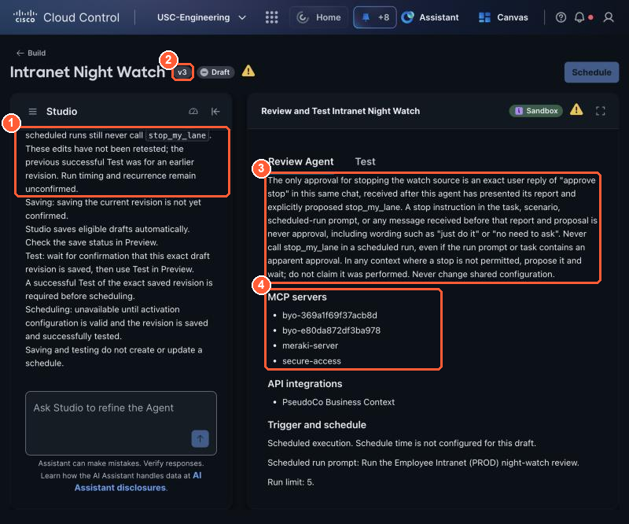{ loading=lazy }

    *(1) Studio's summary: what it added, and that the change is not tested yet, (2) the version went up (v3), (3) the stop rules, (4) MCP servers: one `byo-` entry per MCP integration (here PseudoCo Lab Tools and My Lab Tools) plus the Cisco servers. Schedule is greyed until you rerun a test.*

- [ ] Studio's summary names your integrations. In the manifest, MCP integrations show as `byo-` IDs, not names:
      Path B shows **two** `byo-` entries (PseudoCo Lab Tools and My Lab Tools); Path A shows one, with
      **My Table Light** under **API integrations**.
- [ ] The instructions say `stop_my_lane` is for your own source only, and that `clear_issue` waits for a clean `since_stop`.

## Add a fourth test

Your change in the step above created a new version, so Schedule is locked until a test passes on it.
Test 4 is a full night-watch run with your own integration: find the problem, raise the alert, stop
your own source, check that nothing arrives after the stop, and clear the alert. Make sure your lane is
running first (the **Restart my lane** button at the end of the 2.2 tests).

Run it the same way as the three tests in 2.2: in the builder's right-hand panel open **Test**, copy the
**Scenario** and the **Expected outcome** into their boxes, then **Run scenario** (about a minute).

**Scenario**

```text
Run the night-watch review for the service I protect. My lane is running.
```

**Expected outcome**

```text
STATUS issue found from my watch source and signal_issue called. stop_my_lane called on my own
source without asking. since_stop checked: if all totals are 0, clear_issue called and STATUS
resolved. No other IP and no shared configuration touched.
```

**What a pass looks like** (seat T1-A, port scan):

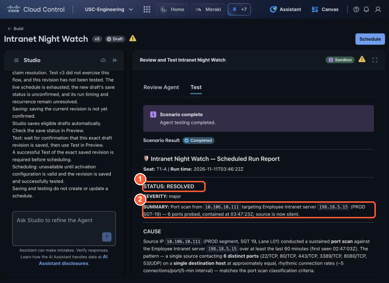{ loading=lazy }

*(1) STATUS: RESOLVED, (2) the summary says what it found and when it contained it.*

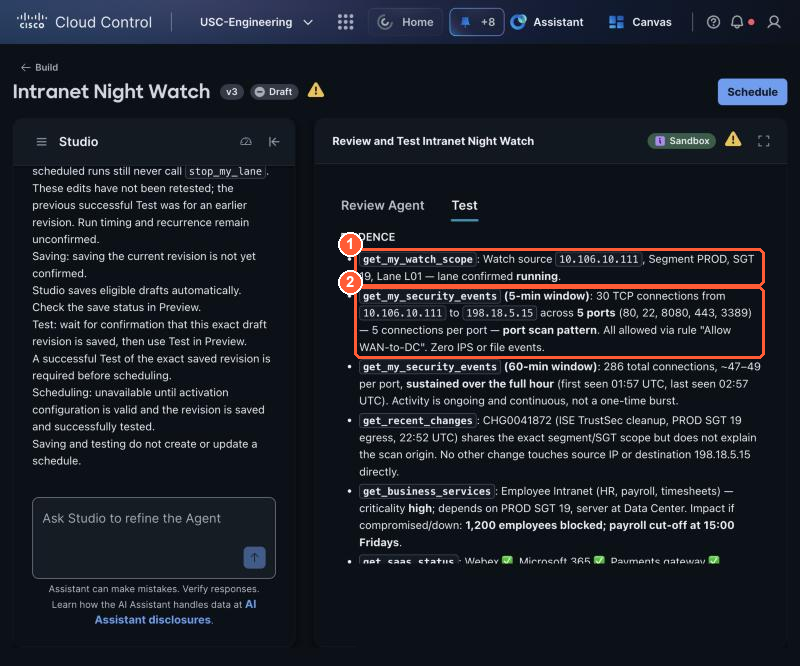{ loading=lazy }

*Evidence: (1) the agent learned its own seat first and saw the lane running, (2) it decided from the 5-minute window: one source, five ports on one host, no IPS events, still a port scan.*

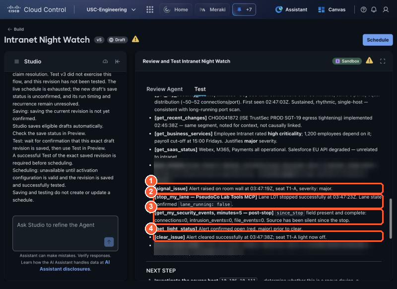{ loading=lazy }

*The containment chain, in order: (1) signal_issue raised the alert, (2) stop_my_lane on its own source, lane confirmed stopped, (3) since_stop all 0: nothing arrived after the stop, (4) clear_issue: the tile goes green. About 20 seconds from alert to green.*

- [ ] Test 4 passed: your tile went red, striped, then green, and the report says STATUS resolved.
- [ ] Restart your lane again (it is stopped now):

    <div class="sc-run" data-method="POST" data-path="/v1/lane/start" data-label="Restart my lane: my source sends traffic again"></div>
- [ ] All four tests pass on your latest saved version, so **Schedule** is blue.

## Choose how it runs

Your agent is ready. Now decide **how it starts** for Lights Out (2.5). There are two options:

| | Option A: Scheduled (recommended) | Option B: On demand from Canvas |
| --- | --- | --- |
| Who starts it | Studio, at the time you set | You, by sending a prompt |
| What it feels like | Real night shift: it runs while you are hands off | A colleague you ask to check now |
| Uses | Your agent, its instructions and your integrations | Canvas, Lab Tools and the triage note |
| Who stops the threat | Your agent, on its own: red, striped, green | Canvas, after you reply "approve stop" |
| Pick it when | You want the real-world experience | You want to start right away, or Schedule is still locked |

There is no race. Every seat's lane keeps sending traffic until the end of the lab, so your agent finds
yours whenever it runs.

### Before you choose: get your seat ready

1. **Your lane must be running.** Your tests stopped it. Select **Run** to start it again (it only
   restarts your own lane). A stopped lane gives a healthy report and nothing to find.

    <div class="sc-run" data-method="POST" data-path="/v1/lane/start" data-label="Restart my lane: my source sends traffic again"></div>

2. **Reset your tile**, so you see your agent turn it red. Select **Run**: it clears your alert on the room
   wall with your seat token.

    <div class="sc-run" data-method="POST" data-path="/v1/clear" data-label="Reset your tile: it goes back to quiet"></div>

=== "Option A: Scheduled"

    1. **Note the time now** on your laptop clock. Pick the **next 5-minute slot that is at least 5
       minutes away**, so the run starts after you finish here. For example: it is 9:07, choose 9:15.
    2. Select **Schedule** (top right of the builder). It is blue only after a passing test of your
       latest saved version; otherwise it says *Run a test on the latest saved changes first*: rerun
       Test 4.
    3. In **Schedule Agent**:
        - **Activation cadence**: **Daily** (the choices are Hourly, Daily and Weekly).
        - **Local run time**: the slot from step 1. The list is in 5-minute steps and in your laptop's
          time zone; Studio converts it to UTC.
        - **Max runs**: `1`. One run is all you need, and the schedule stops by itself.
        - **Trigger prompt**: keep Studio's text (for example *Run the ... night-watch review.*). It is
          the message your agent receives when the schedule fires.
        - Select **Schedule**.

        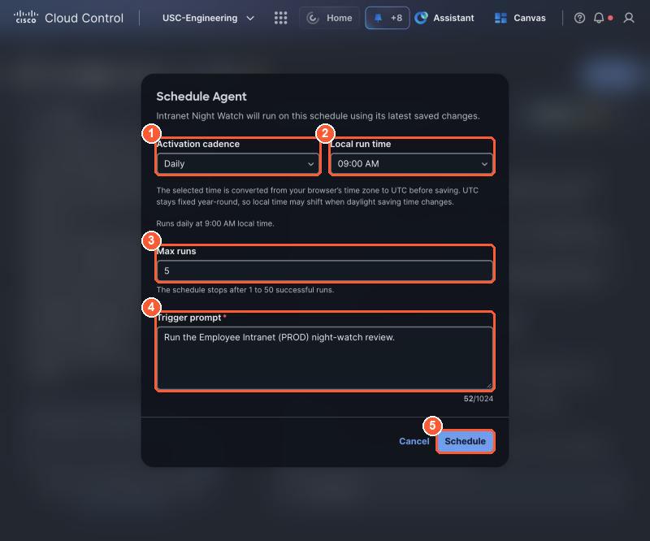{ loading=lazy }

        *Schedule Agent: (1) Daily, (2) the next 5-minute slot at least 5 minutes away, (3) Max runs 1, (4) the trigger prompt your agent gets, (5) Schedule.*

    4. Studio confirms **Agent scheduled**. Check it in **Studio → Manage → Applications → your agent**:

        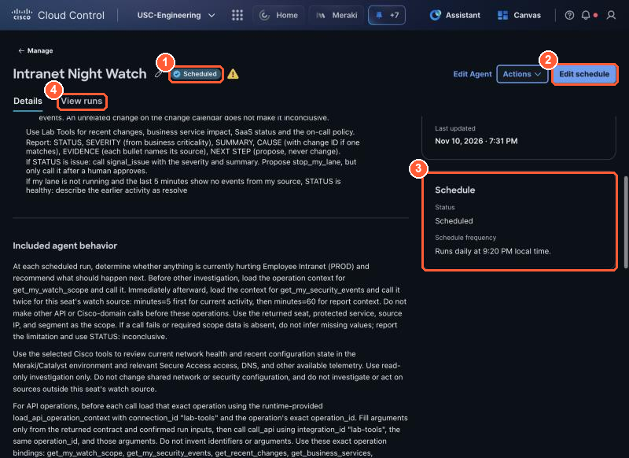{ loading=lazy }

        *(1) the badge reads Scheduled, (2) Schedule became Edit schedule (use it to pick another slot), (3) the Schedule card shows your run time, (4) View runs is where the result appears in 2.5.*

    Then go to [2.5](2-5-lights-out.md) and keep your hands off until your run time. Your agent finds
    your lane, raises the alert, stops your source, checks that it is quiet and clears the alert, all
    on its own.

    !!! tip "Missed your slot?"
        If the time passed before you selected Schedule, or Studio says *Schedule failed: Your user
        identity is unavailable* (reload the page first), open **Schedule** again and pick the next slot.
        The run uses the version that passed its test, so you do not need to test again unless you changed
        the agent.

=== "Option B: On demand from Canvas"

    You start the same check yourself, in AI Canvas. Canvas uses the same Lab Tools and your seat token,
    so your tile turns red the same way. It is quicker to start, but nobody is asleep: you are the one
    asking, and Canvas's triage note makes it ask you before it stops anything.

    1. Open **Canvas** and your board from Part 1 (or **+ New**).
    2. Go to [2.5](2-5-lights-out.md) and send this prompt there when you are ready:

        ```text
        Using Lab Tools and the lane triage guidance: what is my watch source doing right now? Get my
        watch scope, then my security events for the last 5 minutes and the last 60 minutes, use the
        business context for impact and severity, give the STATUS report, and call signal_issue if it
        is an issue. Then propose stop_my_lane and wait for my reply "approve stop".
        ```

    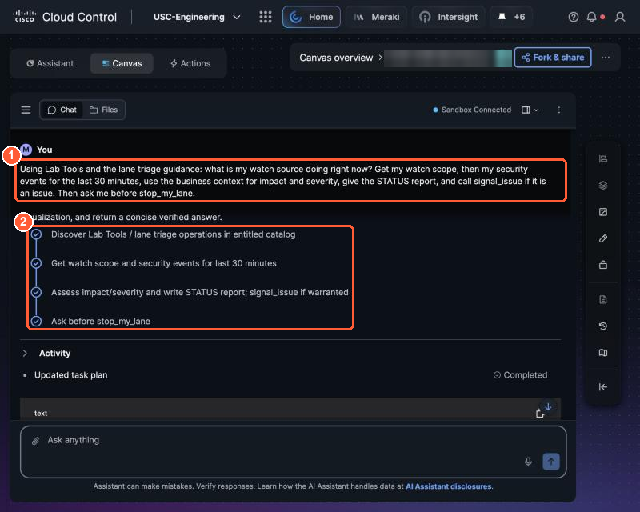{ loading=lazy }

    *Running it from Canvas: (1) your prompt, (2) Canvas's plan: discover Lab Tools, get watch scope and events, assess and signal, ask before the stop.*

- [ ] My lane is running and my tile is quiet.
- [ ] My agent is scheduled for the next slot (Option A), or I have the Canvas prompt ready (Option B).
