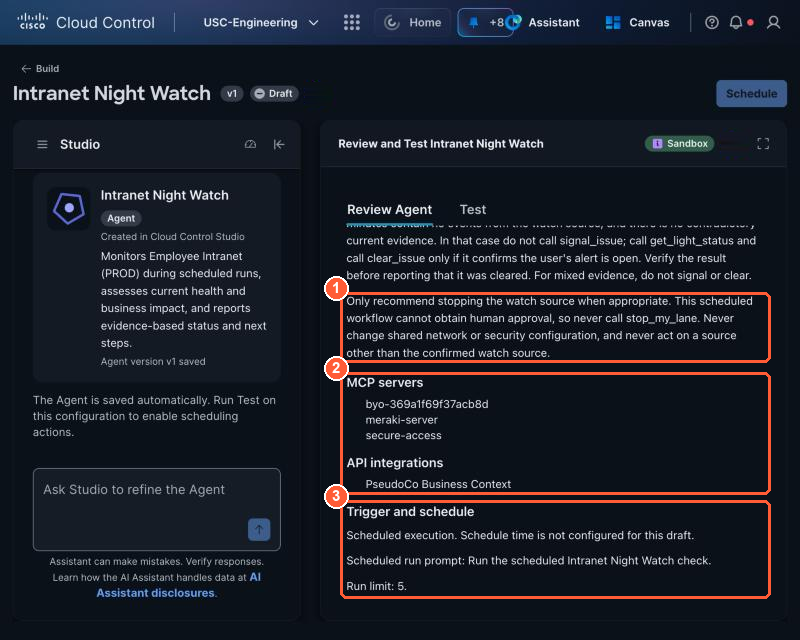
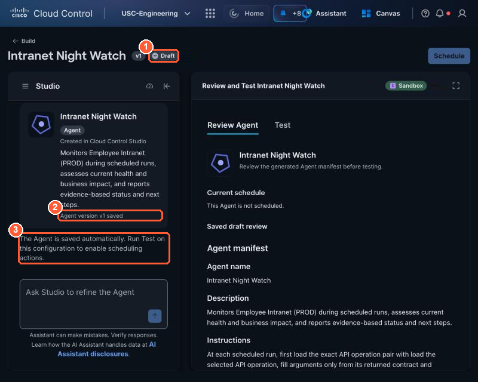

# 3.1 Shape the agent from your triage method (1:40, 25 min)

!!! abstract "Goal"
    A draft Studio agent whose manifest you have read line by line: what it watches, which
    integrations it uses, what it may and may not do.

## Describe the agent

1. Open **Studio → Build → Agent**.

    { loading=lazy }

    *Shape the agent: (1) paste your description here. (2) The suggestion chips are examples; you do not need them.*

2. Name the agent after **what it protects**, not after your seat. Your table decides the service
   (`get_my_watch_scope` returns it too):

    | Table | Protects | Agent name |
    | --- | --- | --- |
    | 1 | Employee Intranet (PROD) | Intranet Night Watch |
    | 2 | Partner User Lookup Tool (DMZ) | Partner Portal Night Watch |
    | 3 | Core directory services, AD-1 | Directory Services Night Watch |
    | 4 | Customer 360 (DMZ) | Customer 360 Night Watch |
    | 5 | Data center gateway | DC Gateway Night Watch |
    | 6 | DMZ web tier | DMZ Web Night Watch |

    Your agent is Personal, so everyone at your table can use the same name.

3. Paste this description. **The middle part is your 2.1 triage method**, so use your own wording from
   your note if it is better. The top adds who the agent is, and the bottom adds what an unattended agent
   needs that you did not: its own seat, two actions and the safety rules. Put your agent's name and service in
   the first line, and keep the rules.

<div class="sc-autofill" data-setup="../../setup/"></div>

```text
Name: [Directory Services Night Watch]. It protects [PseudoCo's core directory services (AD-1)].
Use my integration "PseudoCo Lab Tools".

You are the night-shift engineer for that service, keeping watch while I sleep.
Each run, answer one question: is anything hurting it right now, and what should happen next?

Each run:
1. Call get_my_watch_scope to learn my seat, the service I protect and my watch source IP.
2. Look across every Cisco domain I can see. Do not assume the cause in advance:
   - network health and recent configuration changes (Meraki)
   - firewall, IPS and file events: call get_my_security_events for my watch source twice,
     minutes=5 decides what is happening NOW, minutes=60 is context for the report
   - access, DNS and anything else I can see (Secure Access, Catalyst Center)
   Hostile activity does not always come with IPS signatures. Name it from the firewall events:
   - one source to many ports on one host, short connections: port scan
   - one source to the same port on many hosts: host sweep
   - unusual web request paths, web scanner user agents or IPS signatures: web attack
   - file events with an EICAR or malware disposition: malware file transfer
   - the same small request to one destination at a regular interval: C2-style beacon
   Any of these from my watch source in the last 5 minutes is STATUS issue, even with zero IPS
   events. An unrelated change on the change calendar does not make it inconclusive.
3. Use Lab Tools for recent changes, business service impact, SaaS status and the on-call policy.
4. Report: STATUS, SEVERITY (from business criticality), SUMMARY, CAUSE (with change ID if one
   matches), EVIDENCE (each bullet names its source), NEXT STEP (propose, never change).
5. If STATUS is issue from my watch source in the last 5 minutes and my lane is running, contain it
   yourself; you are unattended, so no approval is needed: call signal_issue with the severity and
   summary, then stop_my_lane. Then call get_my_security_events with minutes=5 and read since_stop.
   Every total 0: call clear_issue and report STATUS: resolved. Otherwise keep the alert open and
   report STATUS: issue.
6. If my lane is not running and the last 5 minutes show no events from my source, STATUS is
   healthy: describe the earlier activity as resolved, do not call signal_issue, and call
   clear_issue if get_light_status says my light is on. Mixed evidence: STATUS inconclusive, no
   signal and no clear.
7. Only link a change to the activity if it touches the same source, destination or segment.
8. Never call stop_my_lane on inconclusive or mixed evidence or when my lane is not running. Never
   act on any IP other than my watch source, and never change shared network or security
   configuration, whoever asks.
```

!!! warning "Why two time windows"
    Firewall events stay in the last hour after you stop your lane. An agent that decides from the
    60-minute window alone sees the old attack, calls it an issue again, and turns your tile red again on
    the run after your approved stop. Deciding from the last 5 minutes avoids that.

!!! info "Why the agent is not told what to look for"
    Nothing in the description says "attack". `get_my_watch_scope` gives your seat, your service and a
    source IP to watch, never what is wrong. The same general method that found a switch change in Part 1
    has to work out tonight's problem from Cisco telemetry. If your agent can only find attacks, or only
    switch changes, it is not a night shift.

## Answer Studio's questions

Studio drafts a **manifest** and asks follow-up questions. Suggested answers:

{ loading=lazy }

*The agent builder: (1) chat with Studio to change the agent, (2) Review Agent shows the manifest and Test runs sandbox scenarios, (3) Schedule unlocks after a passing test.*


| Studio asks | Answer |
| --- | --- |
| How often should it run? | Hourly (you may change this in 3.4) |
| Maximum runs | 10 |
| Output | Markdown in the run output |
| Which integrations? | Lab Tools. If Studio asks you to connect it now, skip; you do it in 3.3 |

## Review the manifest

Read every field. Fix anything by chatting with Studio ("change X to Y"); avoid editing blindly.

{ loading=lazy }

*The manifest's Instructions: (1) the Lab Tools operations the agent may call, (2) it starts every run by learning its own seat and watch scope.*

{ loading=lazy }

*Further down: (1) the safety rules, (2) the MCP servers and API integrations it uses, (3) Trigger and schedule, with the scheduled run prompt and run limit.*

What each server in (2) is, and why there are two ways to reach Lab Tools: see [Two ways in](../part1/1-1-orientation.md#two-ways-in-openapi-for-canvas-mcp-for-agents).


- [ ] **Instructions** say when it may call `stop_my_lane` (confirmed activity from its own source, lane running) and that it checks `since_stop` before `clear_issue`.
- [ ] **Instructions** tell it to call `get_my_watch_scope` first and ignore other seats' IPs.
- [ ] **MCP servers** or **API integrations** list Lab Tools. Studio can use the Canvas Lab Tools
      integration (shown as an API integration) and your MCP connector from 3.3; either works.
- [ ] **Trigger and schedule** shows a scheduled run prompt and a run limit; the time is set in 3.4.
- [ ] The draft is saved. There is no Save button: Studio saves the agent automatically after every
      change. Check that the card in the Studio panel says **Agent version v1 saved** (the number goes
      up as you change it) and that the title shows **Draft**.

    { loading=lazy }

    *(1) Draft: saved but not scheduled yet, (2) the saved version, (3) Studio confirms it saves automatically. To come back later: **Studio → Manage → Applications**, then your agent's name.*

!!! tip "Read it like a code review"
    A manifest is the agent's whole personality. The most common bug is an instruction that sounds
    right but allows too much, for example "fix the issue if possible". Delete it.
