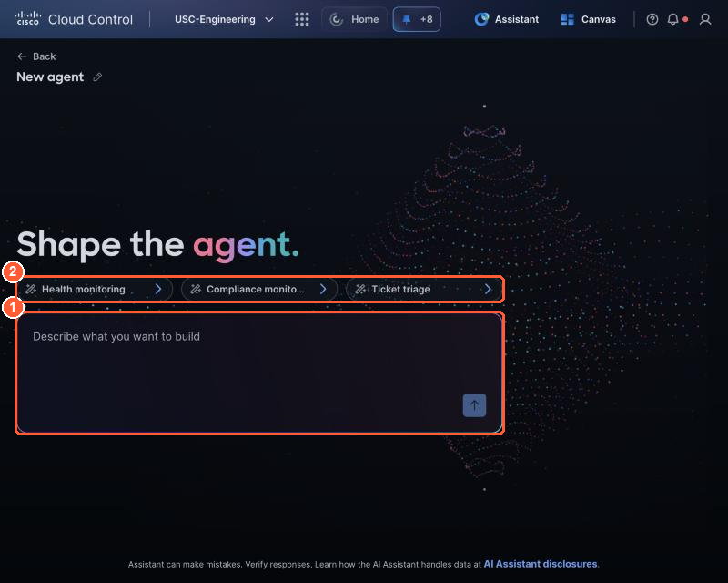
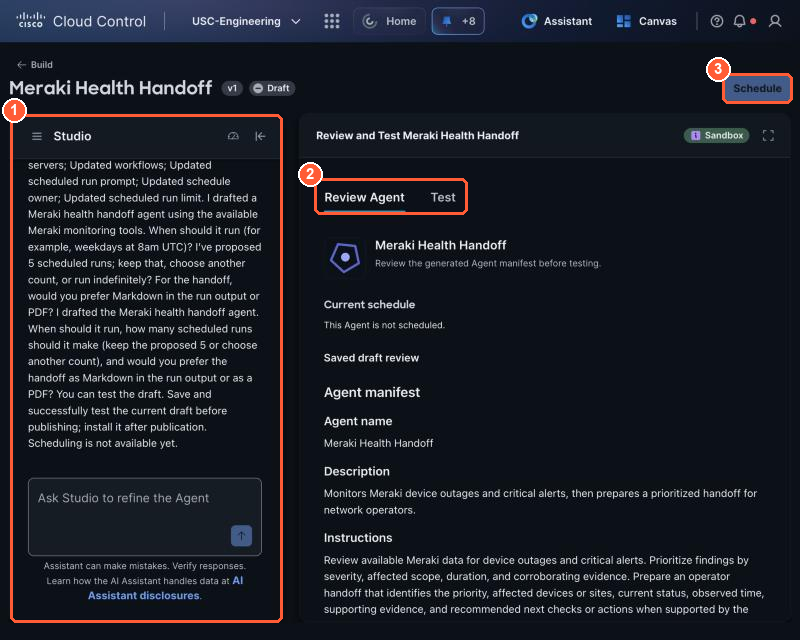
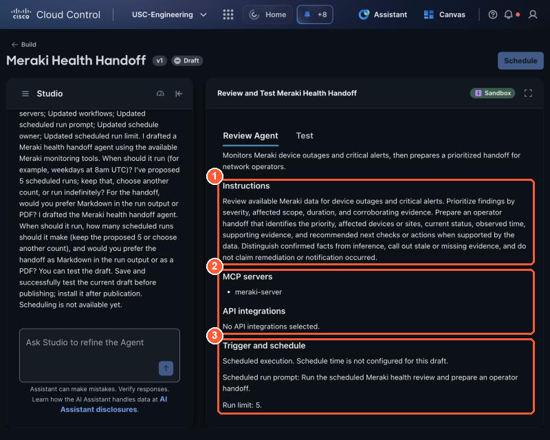

# 3.1 Shape the agent from the saved result (1:40, 25 min)

!!! abstract "Goal"
    A draft Studio agent whose manifest you have read line by line: what it watches, which
    integrations it uses, what it may and may not do.

## Describe the agent

1. Open **Studio → Build → Agent**.

    { loading=lazy }

    *Shape the agent: (1) paste your description here. (2) The suggestion chips are examples; you do not need them.*

2. Paste this description. Replace the bracketed parts with your own choices, and keep the rules.

```text
Build a security troubleshooting agent for PseudoCo that keeps watch while I sleep.

Each run:
1. Call get_my_watch_scope to learn my seat, my watch source IP and the service it is near.
2. Call get_my_security_events for that source IP over the last [60] minutes, and use any other
   Cisco data I can see (Secure Firewall, Secure Access, Meraki).
3. Use Lab Tools business context: which service is at risk, how critical it is, whether a recent
   change explains it, and whether on-call should be woken.
4. Report: STATUS, SEVERITY, SUMMARY, ATTACK (what the source is doing), EVIDENCE (each bullet
   names its source), NEXT STEP.
5. If STATUS is issue: call signal_issue with the severity and summary. Propose stop_my_lane, but
   only call it after a human approves.
6. If STATUS is healthy and get_light_status says my light is on: call clear_issue.
7. Never change shared network or security configuration. Only act on my own watch source.
```

!!! info "Why the agent is not told the attack type"
    `get_my_watch_scope` gives your source IP and the service it is near, never the attack. Your
    agent has to work it out from Cisco telemetry. That is the multi-domain troubleshooting.

## Answer Studio's questions

Studio drafts a **manifest** and asks follow-up questions. Suggested answers:

{ loading=lazy }

*The agent builder: (1) chat with Studio to change the agent, (2) Review Agent shows the manifest and Test runs sandbox scenarios, (3) Schedule unlocks after a passing test.*


| Studio asks | Answer |
| --- | --- |
| How often should it run? | Hourly (you may change this in 3.4) |
| Maximum runs | 10 |
| Output | Markdown in the run output |
| Which integrations? | Lab Tools. If Studio asks you to connect it now, skip; you do it in 3.3 |

## Review the manifest

Read every field. Fix anything by chatting with Studio ("change X to Y"); avoid editing blindly.

{ loading=lazy }

*The manifest: (1) Instructions, (2) MCP servers and API integrations, (3) Trigger and schedule, with the scheduled run prompt and run limit.*


- [ ] **Instructions** include "propose, don't change" and "only after a human approves".
- [ ] **Instructions** tell it to call `get_my_watch_scope` first and ignore other seats' IPs.
- [ ] **MCP servers** lists your Lab Tools integration, or nothing yet (you connect it in 3.3).
- [ ] **API integrations** is empty unless you build Path A in 3.3.
- [ ] **Trigger and schedule** shows a scheduled run prompt and a run limit; the time is set in 3.4.
- [ ] Save the draft.

!!! tip "Read it like a code review"
    A manifest is the agent's whole personality. The most common bug is an instruction that sounds
    right but allows too much, for example "fix the issue if possible". Delete it.
