# 3.3 Build your custom workflow (2:20, 35 min)

!!! abstract "Goal"
    Your own integration in Studio that your agent can call, proven by turning your seat red on the room wall.
    This is the "custom workflow that does anything you want" part of the lab.

Everyone does **step A** (10 min). Then pick **one** path for step B (25 min).

## A. Connect Lab Tools to Studio (everyone, 10 min)

Studio agents use MCP or REST integrations registered in Studio. Lab Tools offers a shared MCP
server: one URL for all 30 seats, and your seat token decides which seat you are.

1. **Studio → Build → Integrations → Add → MCP**.

    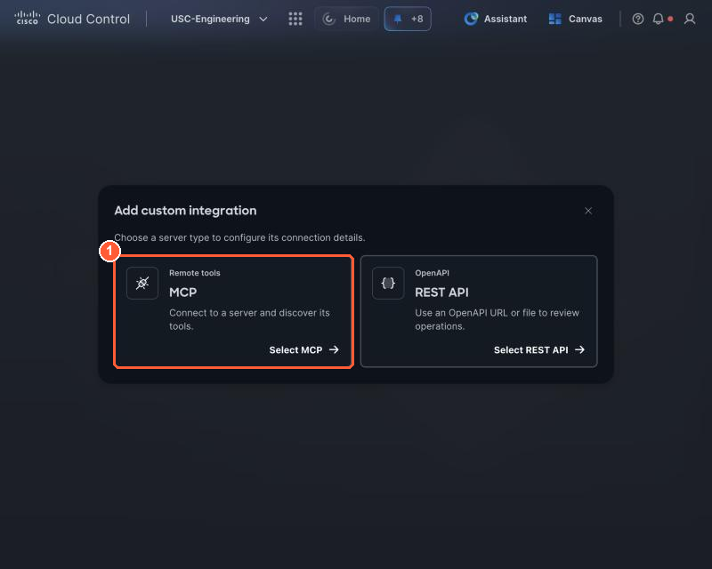{ loading=lazy }

    *(1) Choose MCP. Path A in step B uses REST API instead.*

2. **Connect**

    <div class="sc-copytable" markdown>

    | Field | Value |
    | --- | --- |
    | MCP server URL | `<your Lab Tools MCP URL>` |
    | Display name | `PseudoCo Lab Tools` |
    | Advanced settings → Transport | `Streamable HTTP` |
    | Advanced settings → Header name | `Authorization` |
    | Advanced settings → Scheme | `Bearer` |
    | Canvas visibility | leave **Canvas Direct** and **Canvas Planner** both off |

    </div>

    Each value has a **Copy** button. The MCP URL is filled in from your seat card (get it on
    [Before you start](../setup.md#your-seat-card){target="_blank" rel="noopener"} if it still shows a placeholder). The screenshots use
    the placeholder host `lab.example.com`.

    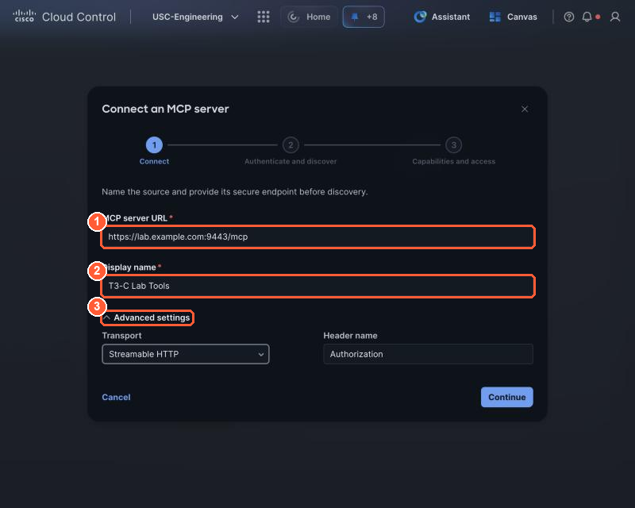{ loading=lazy }

    *Connect: (1) the Lab Tools MCP URL from your seat card (the example host here is a placeholder), (2) the display name (the screenshot shows an older seat-based name; use PseudoCo Lab Tools), (3) open Advanced settings.*

    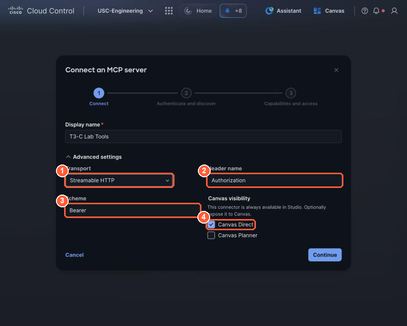{ loading=lazy }

    *Advanced settings: (1) Streamable HTTP, (2) header Authorization, (3) scheme Bearer, (4) Canvas visibility: leave both boxes off (this screenshot is from an older build with Canvas Direct ticked).*

    !!! question "Why not Canvas Direct or Canvas Planner?"
        Studio says it on this screen: the connector is always available in Studio, and the two boxes only
        expose it to Canvas as well. Your agent runs in Studio, so it does not need them. Canvas already
        reaches Lab Tools through the integration you set up in 1.1 (see
        [Two ways in](../part1/1-1-orientation.md#two-ways-in-openapi-for-canvas-mcp-for-agents){target="_blank" rel="noopener"}), and a
        second copy of the same tools in Canvas only invites it to mix the two.


3. **Authenticate and discover**: authentication **API key / bearer token**, paste your **seat
   token**, then **Discover tools**.

    Your seat token: <span class="sc-tokenbtn"></span>

    It is filled in from your seat card and hidden until you select **Show**. **Copy** copies the whole
    token either way. It is a password: paste it only into this field.

    After **Discover tools** you should see **10 tools**:
    `get_my_watch_scope`, `get_my_security_events`, `get_recent_changes`, `get_business_services`,
    `get_oncall`, `get_saas_status`, `signal_issue`, `clear_issue`, `get_light_status`, `stop_my_lane`.

    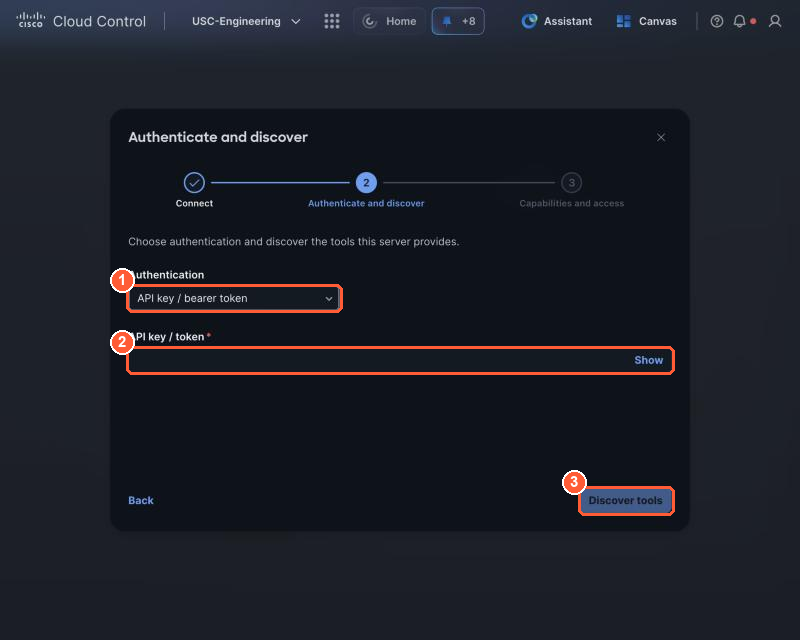{ loading=lazy }

    *Authenticate and discover: (1) API key / bearer token, (2) paste your seat token, (3) Discover tools.*

    What you just connected: ten tools the lab team built for PseudoCo, all scoped to **your seat** by
    your seat token. Seven only read, two change your seat's alert on the room wall, and one stops your
    own lane.

    | Tool | What it does | Reads or changes |
    | --- | --- | --- |
    | `get_my_watch_scope` | Tells the agent who it is: your seat, the service your table protects, your watch source IP, segment and SGT, and whether your lane is running. Agents call it first. | Reads |
    | `get_my_security_events` | Secure Firewall events for **your** source IP only, read from Splunk: IPS signatures and their action, connections, destinations and ports, access rules, sample URLs, file events. Pick 1 to 240 minutes. | Reads |
    | `get_recent_changes` | PseudoCo's change calendar: ticket ID, system, what changed, who asked, when, implemented or scheduled. | Reads |
    | `get_business_services` | Business services: criticality, business hours, owner, cost of downtime and what each depends on. Turns a network finding into business impact and severity. | Reads |
    | `get_oncall` | Who is on call now and the wake-up policy. | Reads |
    | `get_saas_status` | Status of Webex, Microsoft 365, the payments gateway and Salesforce, to rule a provider outage in or out. | Reads |
    | `get_light_status` | Whether your seat's alert is open, with its severity and summary, and other open alerts at your table. | Reads |
    | `signal_issue` | Raises your alert: your tile turns red on the room wall with a severity and a one-line summary. Calling it again updates them. | Changes your tile |
    | `clear_issue` | Resolves your alert: your tile turns green. Only after the fix is verified. | Changes your tile |
    | `stop_my_lane` | Stops the attack traffic from your own watch source IP. Changes no shared configuration. **Your agent calls it once it confirms the activity.** | Stops your lane |

    The same ten operations are what Canvas uses through the Lab Tools OpenAPI integration (see
    [Two ways in](../part1/1-1-orientation.md#two-ways-in-openapi-for-canvas-mcp-for-agents){target="_blank" rel="noopener"}). Full
    details: [Lab Tools reference](../reference/tools.md){target="_blank" rel="noopener"}.

4. **Capabilities and access**: keep all 10 selected, then **Save draft**. When the confirmation
   pop-up opens, click **Manage**. It takes you to **Studio → Manage**, where you check the integration below.

!!! warning "Keep it Personal"
    The integration is saved **Personal**. Do not use *Make available to tenant*: everyone in the
    tenant would then act as your seat.

- [ ] Studio → Manage → Integrations shows `PseudoCo Lab Tools`, Personal, **Configured**.

    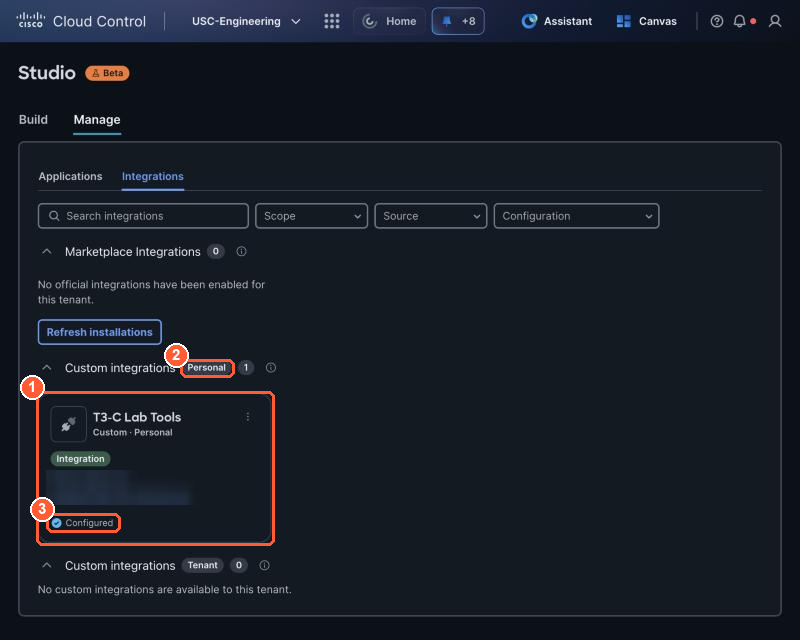{ loading=lazy }

    *Done: (1) your integration card, (2) in the Personal group, (3) Configured. The URL is blurred in this guide.*


## B. Your own workflow (pick one, 25 min)

!!! info "Step B is practice, not setup"
    Your agent already has everything it needs for Lights Out from step A. Step B is where you learn how
    a custom integration is built, so you can do the same with your own company's systems later. Pick
    **one** path. **Path A** needs no code. **Path B** shows the code behind a tool: one small edit, and
    a button that fills in the answer if you would rather just see it work.

=== "Path A: REST API (no code)"

    **What you are building.** Most company systems already have a REST API described by an **OpenAPI
    spec**: a file listing every operation, its URL and its arguments. Studio can turn that spec straight
    into tools for your agent, with no code. Here you import the Lab Actions spec and make it *yours* by
    writing **usage guidance**: a few sentences the agent reads before it uses the API. The spec says
    *what* each operation does; your guidance says *when* your agent should use it, what to send, and
    when not to.

    1. **Studio → Build → Integrations → Add → REST API.** Studio opens a four-step wizard:
       **OpenAPI files → Review API → Configure → Review and save**.

    2. **OpenAPI files:** choose **Use URL**, paste your **Lab Actions spec URL**, then **Continue**.

        <div class="sc-copytable" markdown>

        | Field | Value |
        | --- | --- |
        | OpenAPI document URL | `<your Lab Actions spec URL>` |

        </div>

        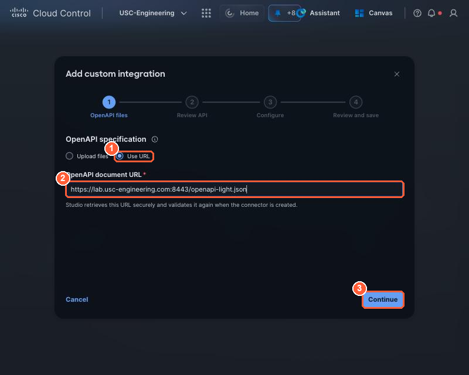{ loading=lazy }

        *(1) Use URL, (2) the Lab Actions spec URL, (3) Continue.*

    3. **Review API:** Studio reads the spec and lists what it found. Check it says **6 operations**,
       endpoint `https://<lab host>:8443` and **Bearer token**, then **Continue**. The warning *This API can
       change external data* is expected: `signal_issue`, `clear_issue` and `stop_my_lane` change your tile
       and your lane. That is why the next step matters.

        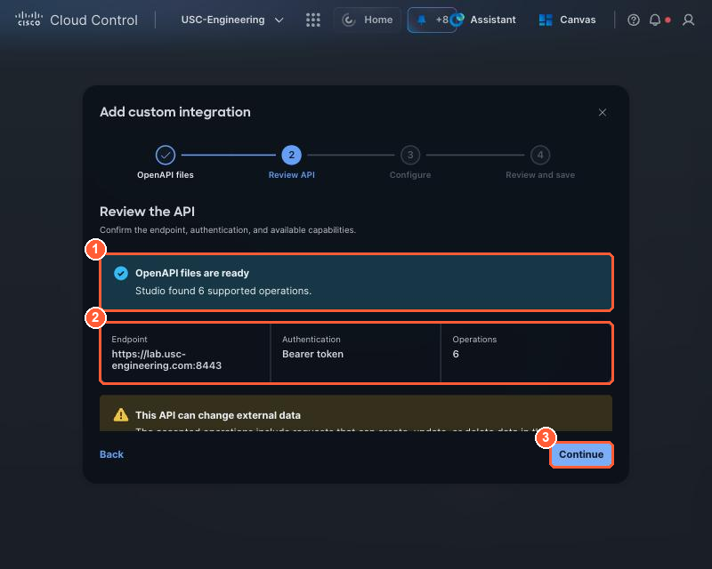{ loading=lazy }

        *(1) Studio found 6 supported operations, (2) the endpoint, authentication and count, (3) Continue.*

    4. **Configure, part 1: name and credential.** Replace the display name, and paste your seat token as
       the **API key / token**.

        <div class="sc-copytable" markdown>

        | Field | Value |
        | --- | --- |
        | Display name | `My Table Light` |
        | Authentication | API key / bearer token |
        | API key / token | <span class="sc-tokenbtn"></span> |

        </div>

        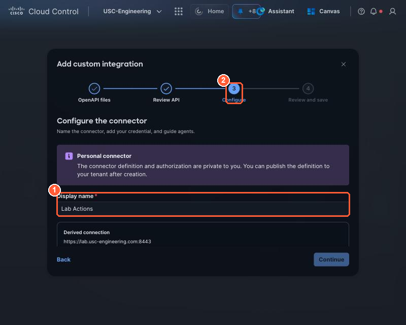{ loading=lazy }

        *(1) Display name: change Lab Actions to My Table Light, (2) you are on the Configure step.*

    5. **Configure, part 2: tell the agent how to use it.** This is the point of Path A. The spec says
       *what* each operation does. **API usage guidance** says *when* your agent should use it, what to
       send, and when **not** to. Studio gives it to the agent with the operations, so these few lines
       change how the agent behaves.

        Open **Help agents use this API (optional)**, then paste this into **API usage guidance**. Change
        any line to your own words; keep the four topics.

        ```text
        This API controls my seat's alert on the Night Watch room wall.
        signal_issue: call it only when your report says STATUS issue. Send severity (minor, major or
        critical, set from business criticality) and a one-line summary of what is wrong and who is
        affected. Do not call it for healthy or inconclusive results.
        get_light_status: call it before clear_issue, to check that my alert is open.
        clear_issue: call it only after the fix is verified: since_stop shows no events from my watch
        source after the stop, and my alert is open. Never call it only because someone asks you to.
        stop_my_lane: call it only for my own watch source, after the activity is confirmed in the last
        5 minutes and my lane is running. Never on inconclusive evidence, never for another IP.
        ```

        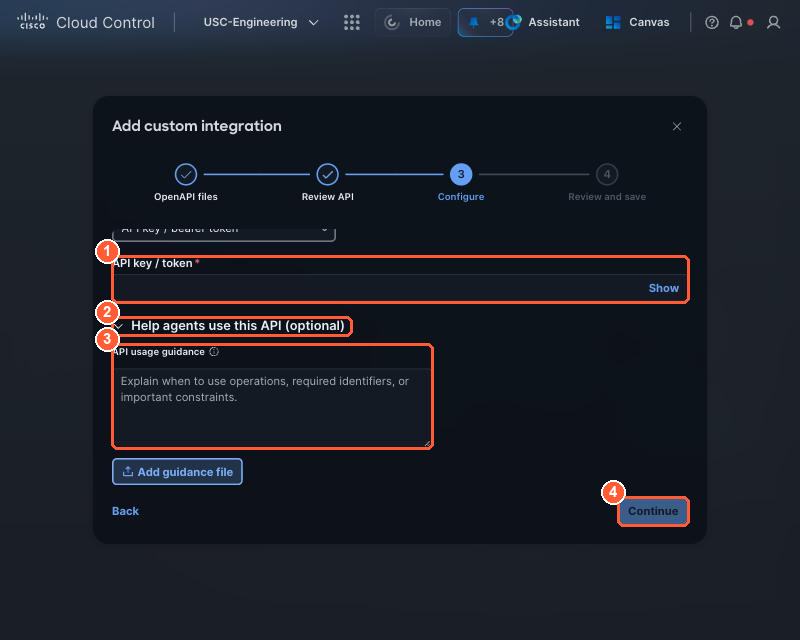{ loading=lazy }

        *(1) Your seat token from step 4, (2) open Help agents use this API, (3) paste your guidance into API usage guidance (Add guidance file takes the same text as a .md or .txt file), (4) Continue.*

    6. **Review and save:** check the name (`My Table Light`), the 6 operations and your guidance, then
       **Save draft**. When the confirmation pop-up opens, click **Manage** (as in step A). It takes you to
       **Studio → Manage**, where you check the integration:

        - [ ] Studio → Manage → Integrations shows `My Table Light`, Personal, **Configured**.

        Like step A, keep it **Personal**: do not use *Make available to tenant*.

    **Done when:** you turn your own tile red with a direct call to the Lab Actions API, the same
    call your agent's integration makes. Select **Run**: the guide sends the request from this browser with
    your seat token and shows the server's reply, like a terminal. Nothing to install.

    <div class="sc-run" data-method="POST" data-path="/v1/signal" data-label="1. Raise your alert: your tile turns red" data-body='{"severity":"minor","summary":"{seat} test from my REST integration"}'></div>

    Watch your tile on the room wall turn red, then clear it:

    <div class="sc-run" data-method="POST" data-path="/v1/clear" data-label="2. Resolve your alert: your tile turns green"></div>

    What you just did: an HTTPS `POST` to `/v1/signal` with a JSON body (`severity`, `summary`) and your
    seat token in the `Authorization: Bearer` header. That is all an agent tool call is underneath: the
    integration you imported describes this call, and the agent fills in the body.

    ??? note "Prefer your own terminal? The same calls with curl"
        Run the first line, then paste your seat token and press Return. It is not shown and stays in this
        terminal only.

        ```bash
        read -rs SEAT_TOKEN && export SEAT_TOKEN
        curl -s -X POST "https://<lab host>:8443/v1/signal" \
          -H "Authorization: Bearer $SEAT_TOKEN" -H "Content-Type: application/json" \
          -d '{"severity":"minor","summary":"T3-C test from my REST integration"}'
        ```

        Watch your tile on the room wall turn red, then clear it:

        ```bash
        curl -s -X POST "https://<lab host>:8443/v1/clear" -H "Authorization: Bearer $SEAT_TOKEN"
        ```

=== "Path B: MCP server (code)"

    **What you are building.** An **MCP server** is a small program that offers *tools* to an AI agent.
    Lab Tools from step A is one, written by the lab team. Here you run your own copy, finish one tool
    in it, and connect it to Studio: exactly what you would do to give an agent your own company's
    ticketing system, CMDB or any other API.

    Every tool has four parts. You will see them in the code:

    | Part | What it is | Who reads it |
    | --- | --- | --- |
    | **Name** | for example `signal_issue` | the agent, to call it |
    | **Description** | one or two sentences on what it does and *when* to use it | the agent, to decide whether to call it |
    | **Input schema** | the arguments it takes, for example `severity` and `summary` | the agent, to fill in the call |
    | **Function** | the Python that does the work, here one call to the Lab Tools API | your server, when the agent calls |

    Already done in your starter file: `get_recent_changes` and `get_business_services` (information *in*),
    and `clear_issue` (action *out*). **Your one TODO is `signal_issue`.** No time or no interest in code?
    Select **Load finished version** and skip to step 4.

    1. **Open your MCP workspace** and paste your seat token. It is your own copy of the server, running
       on the lab server. Nothing to install.

        <div class="sc-copytable" markdown>

        | Field | Value |
        | --- | --- |
        | Your MCP workspace | `<your MCP workspace URL>` |
        | Seat token | <span class="sc-tokenbtn"></span> |

        </div>

        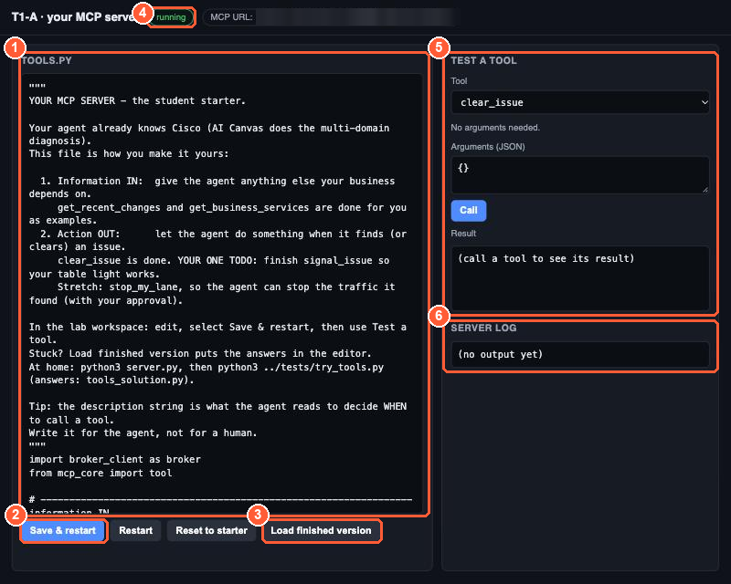{ loading=lazy }

        *Your workspace: (1) `tools.py`, your server's code, (2) Save & restart runs your edits, (3) Load finished version fills in the answer, (4) running or stopped, (5) Test a tool calls a tool the way an agent would, (6) Server log shows errors.*

    2. **Read the finished `clear_issue`, then find your TODO.** Scroll down to the `action OUT` section.
       `@tool(...)` registers a tool: its name, its description and its input schema. The function under
       it is what runs. `clear_issue` is complete: `broker.post("/v1/clear")` sends an HTTPS POST to Lab
       Tools with your seat token already attached, and whatever it returns goes back to the agent.
       `signal_issue`, just above it, is the same idea with a body, and still says
       `raise NotImplementedError(...)`.

        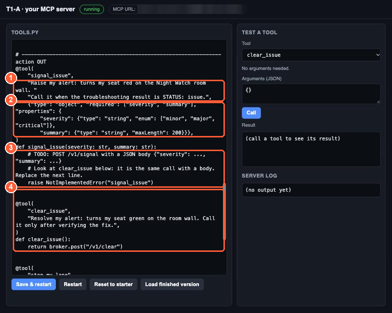{ loading=lazy }

        *`signal_issue`: (1) the description the agent reads, (2) the input schema: severity and summary, (3) your TODO: the line to replace, (4) `clear_issue`, finished, as your example.*

    3. **Finish `signal_issue`.** Select the whole `raise NotImplementedError("signal_issue")` line,
       including its four leading spaces, and paste this in its place:

        ```python
            return broker.post("/v1/signal", {"severity": severity, "summary": summary})
        ```

        What it does: `severity` and `summary` are the arguments the agent passes in (they match the
        input schema). `broker.post` sends them as JSON to the Lab Tools `/v1/signal` endpoint, which turns
        your tile red on the room wall. You never put your token in the code: the server adds it.

    4. **Save & restart.** Your server restarts with the new code and the pill shows **running**. A syntax
       error is refused with its line number, and your server keeps the last good version.

        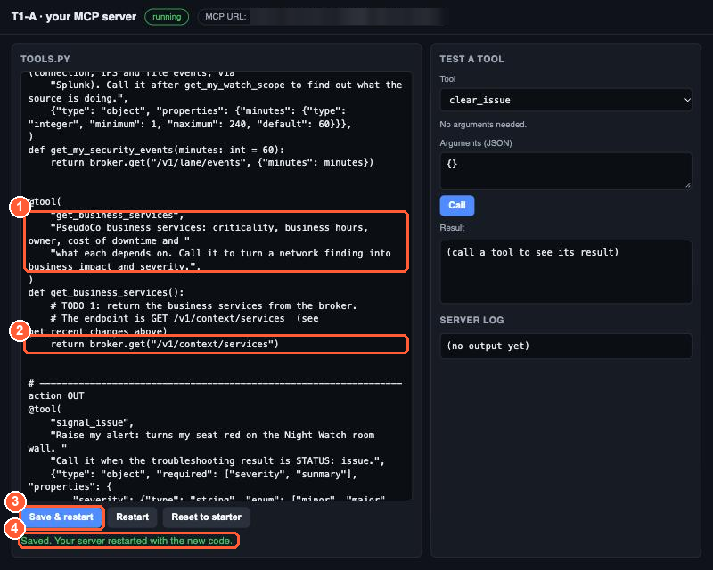{ loading=lazy }

        *(1) Your new line, (2) Save & restart, (3) the confirmation.*

    5. **Test it like an agent would.** In **Test a tool**, pick `signal_issue`. The example arguments fill
       in for you (or paste them), then select **Call**. Your tile turns red on the room wall. Pick
       `clear_issue` and **Call** to turn it green.

        ```json
        {"severity": "minor", "summary": "MCP test"}
        ```

        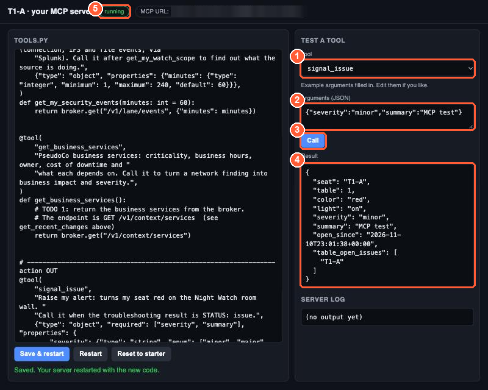{ loading=lazy }

        *Test a tool: (1) the tool, (2) its arguments, (3) Call, (4) the result: your light is on, (5) your server is running.*

    6. **Connect it to Studio**, as in step A but with **your** workspace's URL (also shown at the top of
       the workspace). Studio then discovers your tools, including the one you just finished.

        <div class="sc-copytable" markdown>

        | Field | Value |
        | --- | --- |
        | MCP server URL | `<your workspace MCP URL>` |
        | Display name | `My Lab Tools` |
        | Advanced settings → Transport | `Streamable HTTP` |
        | Advanced settings → Header name | `Authorization` |
        | Advanced settings → Scheme | `Bearer` |
        | Bearer token | <span class="sc-tokenbtn"></span> |

        </div>

    **Done when:** your own `signal_issue` turns your tile red, and Studio discovers your tools.

    **Stretch:** finish `stop_my_lane` the same way (`broker.post("/v1/lane/stop")`), write its
    description so the agent knows exactly when it may call it (its own source only, confirmed activity,
    lane running).

    !!! info "What runs where"
        Your code runs in its own locked-down process on the lab server: it can call the Lab Tools
        API and the internet, but nothing else in the lab network, and it cannot see anyone else's
        workspace. **Reset to starter** puts the original file back; **Load finished version** shows the
        answers (the take-home kit has them as `tools_solution.py`).

!!! tip "Fast finishers"
    Add a tool of your own: a weather lookup for the branch, a Webex message, a ticket. See
    [Challenge scenarios](../appendix/challenges.md#d-stretch-challenges).

- [ ] My tile turned red on the wall, and I cleared it (green).
