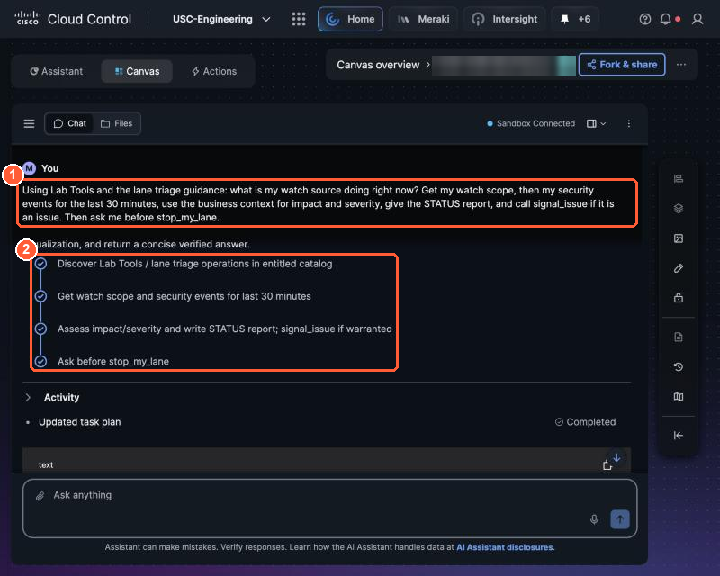

# 3.4 Wire it in and choose how it runs (2:55, 15 min)

!!! abstract "Goal"
    Your agent uses your integration, passes a "light on" test, is published as v2, and has a run
    mode for Lights Out.

## Wire the integration into the agent

Open your agent in Studio and tell it:

```text
Add my integration PseudoCo Lab Tools. Always call get_my_watch_scope first, then
get_my_security_events. If STATUS is issue, call signal_issue with the severity and summary.
Propose stop_my_lane and wait for my approval. If STATUS is healthy and get_light_status says my
light is on, call clear_issue.
```

Check the manifest's **Integrations** now lists your Lab Tools (and My Light, if you built Path A).

## Add a fourth test

| Scenario | Expected outcome |
| --- | --- |
| Fault present: my source shows IPS events | signal_issue called; my light is on afterwards |

- [ ] All four tests pass. Publish **v2**.

## Choose how it runs

=== "Scheduled"

    Studio needs three things before **Schedule** (top right of the builder) unlocks:

    1. A **schedule time** with your **timezone**. Tell Studio in the chat, for example:
       *"Run every 15 minutes between 03:00 and 04:00 Europe/London."* Use the window the
       proctor announces.
    2. A **schedule owner**: your lab login.
    3. A **passing test of the exact saved revision**. Any change you make creates a new revision,
       so test again after the last change. Until then Schedule says *Run a test on the latest
       saved changes first*.

    Saving and testing never create a schedule by themselves. If Schedule is not offered in your
    release, use the Canvas tab.

=== "On demand from Canvas"

    If scheduling is not available in your Studio release, you will run the same check from AI
    Canvas when the proctor says "go". Canvas uses the same Lab Tools, so your tile still turns red.
    Save this prompt now:

    ```text
    Using Lab Tools and the lane triage guidance: what is my watch source doing right now?
    Get my watch scope, then my security events for the last 30 minutes, use the business context
    for impact and severity, give the STATUS report, and call signal_issue if it is an issue.
    Then ask me before stop_my_lane.
    ```

    { loading=lazy }

    *Running it from Canvas: (1) your saved prompt, (2) Canvas's plan: discover Lab Tools, get watch scope and events, assess and signal, ask before the stop.*


- [ ] My agent is published as v2, and I know whether it runs on a schedule or from Canvas.
