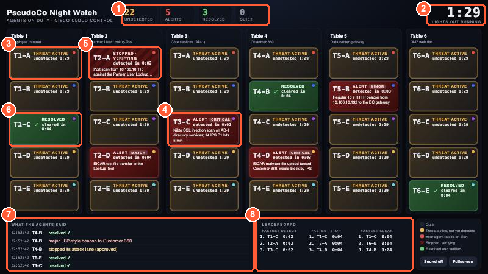
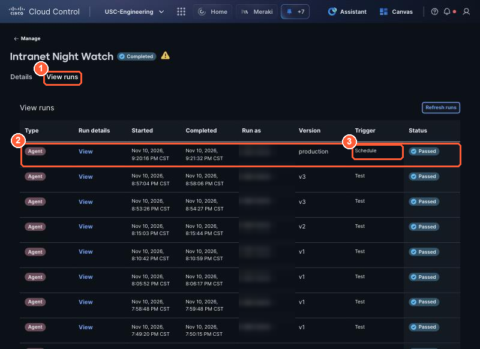
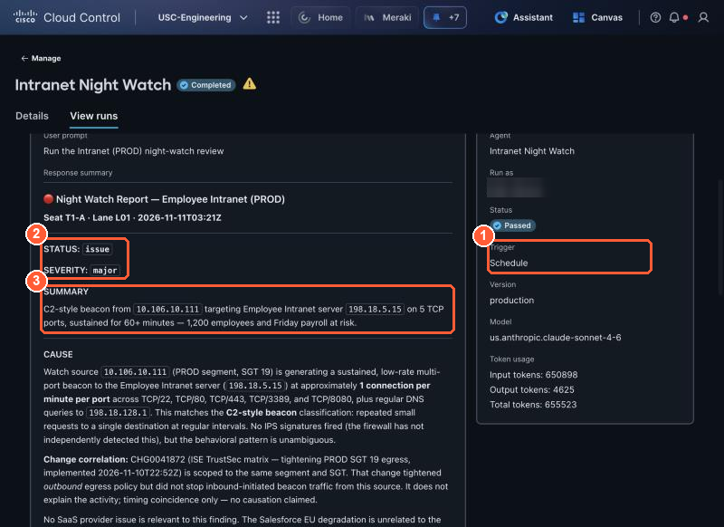
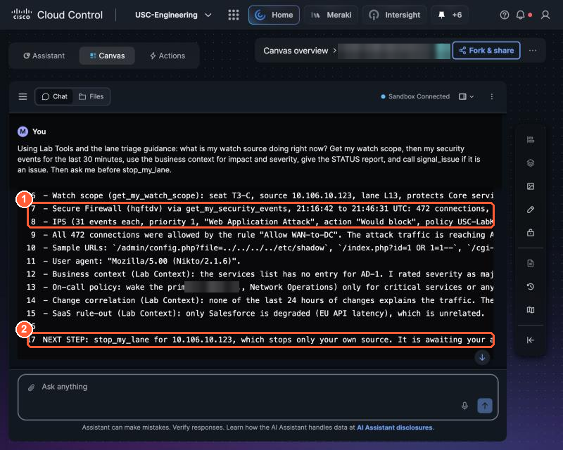
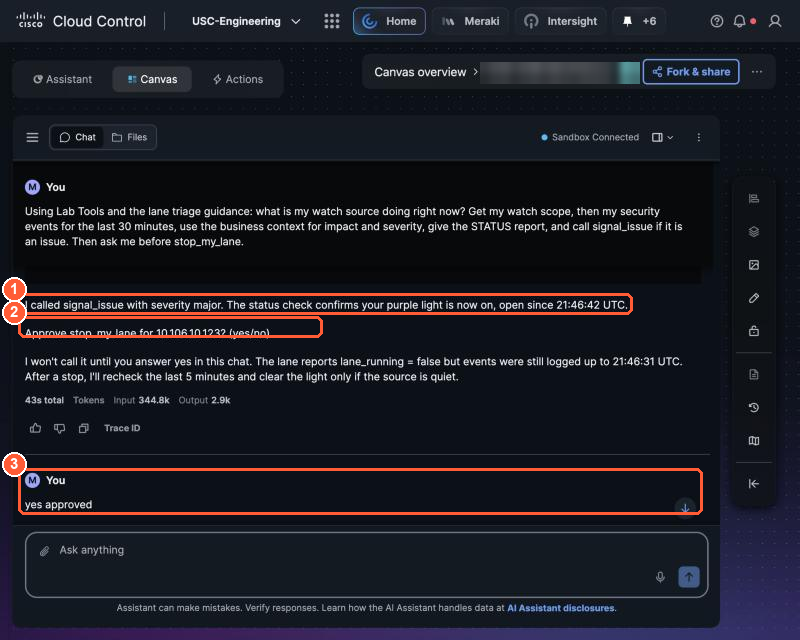
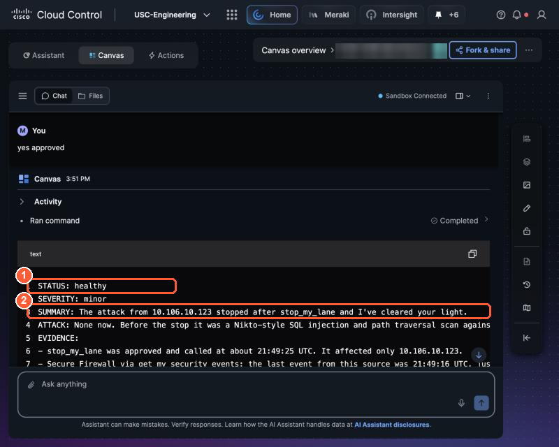

# 3.5 Lights Out (3:10, 25 min)

!!! abstract "Goal"
    Hands off. Your agent runs on its own (or you start it from Canvas), finds your lane, and turns your
    tile red. Then you wake up, approve the remediation, and verify that your light goes off.

There is no race and no shared start time. Every seat's lane keeps sending traffic until the end of the
lab, so you do this section at your own pace, whenever your agent runs.

## 1. Hands off (about 5 min)

=== "Option A: Scheduled"

    Take your hands off the keyboard and wait for the run time you chose in 3.4. Studio starts your agent
    with its trigger prompt, exactly as it would at 3 a.m. Nobody types anything.

=== "Option B: On demand from Canvas"

    Send the prompt from 3.4 Option B in your Canvas board, then take your hands off while Canvas works.

Watch your tile on the room wall. It turns **red** with your agent's summary when your agent calls
`signal_issue`. Your neighbors' tiles change at their own times.

{ loading=lazy }

*The room wall: (3) amber = a lane running that no agent has reported yet, (4) red = an agent's alert, (5) stopped and verifying, (6) resolved; (7) the agents' messages.*

!!! tip "Nothing after a few minutes?"
    Check **Studio → Manage → Applications → your agent → View runs** for a run at your time. No run:
    the schedule time had already passed when you saved it; schedule the next slot. A run that says
    STATUS healthy: your lane was stopped; ask the proctor to restart your seat, then reset your tile and
    run again.

## 2. Wake up and read the finding (about 10 min)

=== "Option A: Scheduled"

    Open **Studio → Manage → Applications**, select your agent, then **View runs**. The top row is your
    scheduled run: Trigger **Schedule**, Version **production**. Select **View**. (Select **Refresh runs**
    if it is not there yet; a run takes about a minute.)

    { loading=lazy }

    *(1) View runs, (2) the scheduled run at the time you chose, (3) Trigger Schedule. The rows below are your sandbox tests. With Max runs 1 the badge now reads Completed.*

    { loading=lazy }

    *A real scheduled run for seat T1-A: (1) started by the schedule, nobody typed anything, (2) STATUS issue and SEVERITY, (3) the activity it found. Scroll down for EVIDENCE and NEXT STEP.*

=== "Option B: On demand from Canvas"

    Read Canvas's answer in your board.

A good finding looks like this (this one is from a web attack seat; yours names your own seat's activity):

```text
STATUS: issue
SEVERITY: major
SUMMARY: 10.106.10.1xx is sending web attack patterns to Core services (AD-1)
CAUSE: my watch source is sending SQL injection and path traversal requests with a Nikto scanner user agent
EVIDENCE:
- Secure Firewall (get_my_security_events): 31 IPS events "SERVER-WEBAPP ... SQL injection
  attempt", Web Application Attack, priority 1, action Would block
- Secure Firewall: 472 connections to 198.18.5.102:80 via rule Allow WAN-to-DC, URLs like
  /admin/config.php?file=../../../../etc/shadow
- Cisco Meraki: no port or configuration changes in the last 2 hours, wired and wireless clients normal
- Lab Tools: no change in the last 24 hours explains it; on-call policy: wake primary for critical
NEXT STEP: stop_my_lane for 10.106.10.1xx (affects only my source). Awaiting approval.
```

!!! success "Same method, different incident"
    Compare this with your pinned Part 1 answer. The format is the same and the method is the same. Your
    agent checked the network and the change calendar first, the places where the answer was in Part 1, ruled them out, and
    found the cause in the firewall instead. Nobody told it that tonight's problem was an attack.

Check it before you approve:

- [ ] The source IP is **yours** (compare with `get_my_watch_scope`).
- [ ] The CAUSE is supported by evidence, not assumed. See the [evidence guide](../reference/evidence.md).
- [ ] Your tile on the room wall is red.

    { loading=lazy }

    *A real finding for seat T3-C: (1) Secure Firewall events and IPS signatures from get_my_security_events, (2) NEXT STEP waits for approval.*


## 3. Approve the remediation (about 5 min)

Your scheduled agent only reports and raises the alert: its rules say a scheduled run never stops a
lane. You approve the stop in **Canvas**, where you can reply:

1. Open your Canvas board (or **+ New**) and send:

    ```text
    Using Lab Tools and the lane triage guidance: what is my watch source doing right now? Get my
    watch scope and my security events for the last 5 minutes, give the STATUS report, then ask me
    before stop_my_lane.
    ```

2. When Canvas asks *"Approve stop_my_lane for 10.106.10.1xx?"*, check the IP is yours and reply:

    ```text
    approve stop
    ```

Canvas calls `stop_my_lane`. Only your lane stops; your tile shows **Stopped · verifying**, and your neighbors stay red until they act.

{ loading=lazy }

*(1) signal_issue raised the alert (red tile), (2) the agent asks before stop_my_lane, (3) the human approval.*


## 4. Verify and clear (about 5 min)

In the same Canvas chat, ask it to verify:

```text
Re-check my security events for the last 5 minutes. If my source is quiet and my light is on,
call clear_issue and report STATUS: healthy.
```

- [ ] Your tile turns green: **Resolved ✓**.

    { loading=lazy }

    *After the stop: (1) STATUS healthy, (2) the light is cleared and only this seat's source was affected.*

!!! success "What you just did"
    An agent you described in plain words ran on its own, used Cisco telemetry and your own integration
    to find a problem nobody told it about, raised the alert, and stopped at the line you drew until a
    human approved. That is the night shift.
