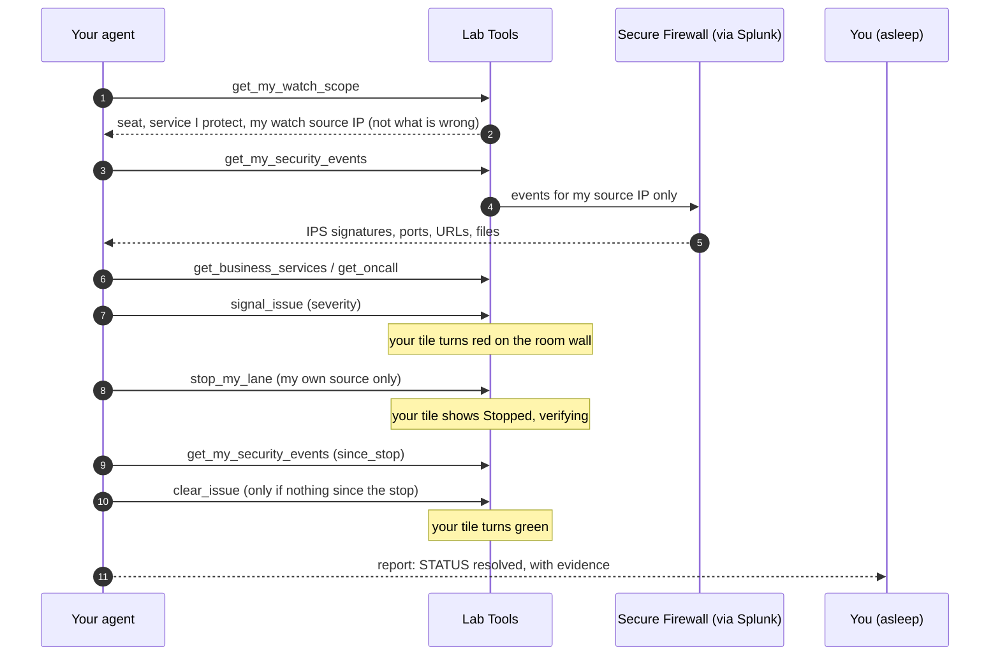

# Part 2: Build an agent that runs it (1:40 to 3:35)

**Incident 2: something hits your service.** You hand the night shift to an agent. You build it in
Cloud Control Studio from the triage method you saved in 2.1, test it, give it a custom workflow of your
own, and then go hands-off.

At Lights Out a different kind of problem arrives: hostile traffic against your table's service.
The traffic generator sends 30 streams of simulated attack traffic (*lanes*), one per seat, each from that seat's
own source IP. Nobody tells your agent it is an attack. Its general method has to work that out from Cisco
telemetry, turn **your** tile red on the room wall, and stop **only your** seat's traffic once you approve.

| Module | Min | You finish with |
| --- | --- | --- |
| [3.1 Shape the agent](3-1-shape-agent.md) | 25 | Draft agent, manifest reviewed |
| [3.2 Sandbox test](3-2-test-publish.md) | 15 | Three tests passed, Schedule unlocked |
| [3.3 Build your custom workflow](3-3-custom-workflow.md) | 35 | Your integration turns your seat red on the wall |
| [3.4 Wire it in and choose how it runs](3-4-wire-schedule.md) | 15 | Four tests passed, scheduled or Canvas chosen |
| [3.5 Lights Out](3-5-lights-out.md) | 25 | Light on at detection, off when fixed |

