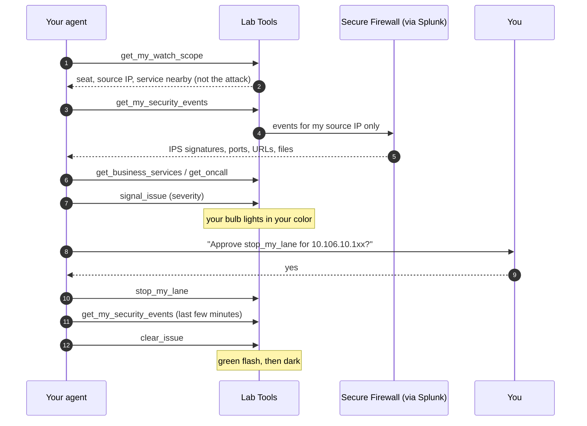

# Part 2: Build an agent that runs it (1:40 to 4:00)

In Part 2 you hand the night shift to an agent. You build it in Cloud Control Studio from the prompt
you saved, test it, give it a custom workflow of your own, and then go hands-off while 30 attack
lanes hit the lab network: one lane per seat, each from its own source IP. Your agent has to find
**its own** lane in Cisco telemetry, light **your** bulb, and stop **only your** lane once you approve.

| Module | Min | You finish with |
| --- | --- | --- |
| [3.1 Shape the agent](3-1-shape-agent.md) | 25 | Draft agent, manifest reviewed |
| [3.2 Sandbox test and publish](3-2-test-publish.md) | 15 | Three tests passed, v1 published |
| [3.3 Build your custom workflow](3-3-custom-workflow.md) | 35 | Your integration lights your bulb |
| [3.4 Wire it in and choose how it runs](3-4-wire-schedule.md) | 15 | v2 published, run mode chosen |
| [3.5 Lights Out](3-5-lights-out.md) | 25 | Light on at detection, off when fixed |
| [3.6 Your business](3-6-your-business.md) | 15 | One agent idea for your own company |
| Wrap | 10 | Take-home kit, survey |

