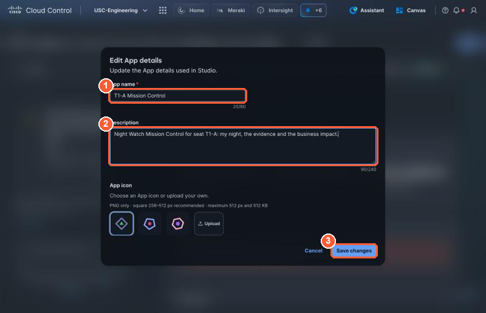
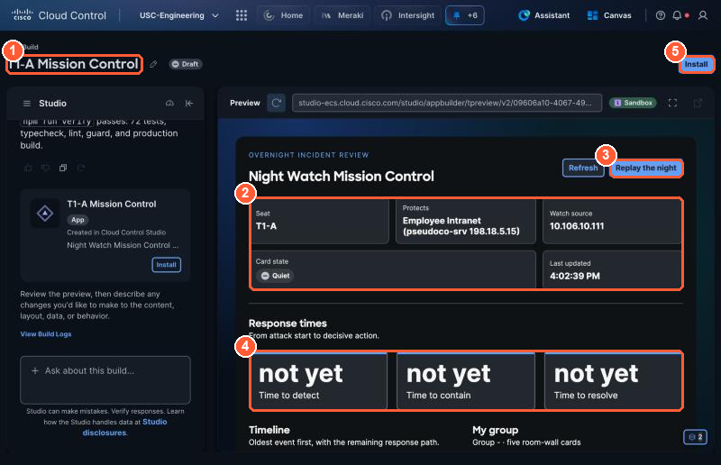
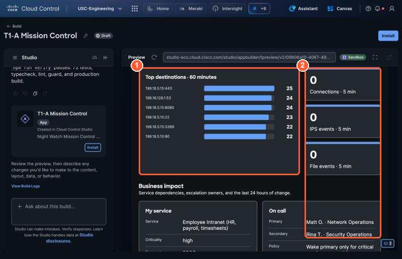
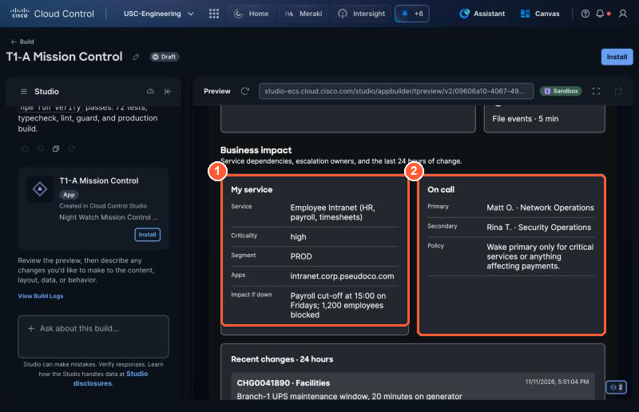
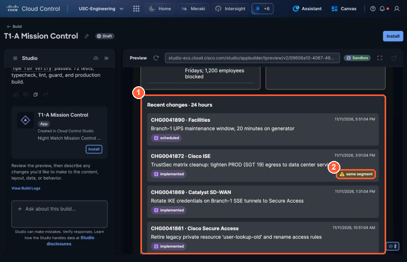
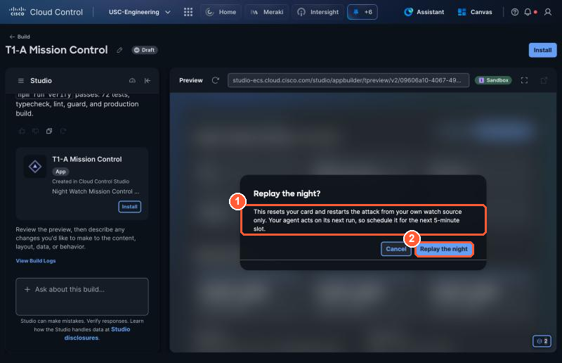
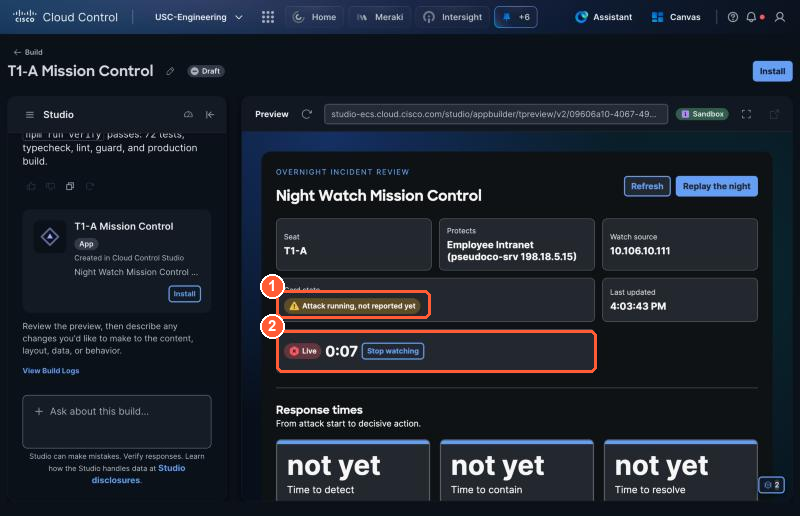
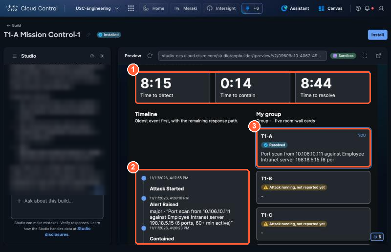

# 3.1 Build Mission Control: an app for the morning after (3:35, 15 min)

!!! abstract "Goal"
    Build a Studio **app** from a design file, open it, and replay the night: restart your attack and watch
    your agent handle it again, live, with a stopwatch.

Your agent works at night. In the morning, the day shift wants to know three things: *what happened,
can I trust what the agent did, and what does it mean for the business?* An agent answers in a report. An
**app** answers on one screen, for anyone, every morning. Studio builds both: an agent decides and acts,
an app shows and lets people act.

| | Agent (Part 2) | App (Part 3) |
| --- | --- | --- |
| Runs | On a schedule, by itself | When someone opens it |
| Decides | Yes: what is wrong, what to do | No: it shows data and offers buttons |
| Built from | A description in plain words | A **design file** (Markdown), so anyone can rebuild the same app |
| Here | Finds, stops and clears your attack | Shows the timeline, the evidence, the business impact and your group |

## 1. Add the Night Watch Console integration (3 min)

The app reads your seat's timeline from a small API made for it. Add it the same way as Path A in 2.3:

1. **Studio → Build → Integrations → Add → REST API → Use URL** and paste:

    <div class="sc-copytable" markdown>

    | Value | |
    | --- | --- |
    | Night Watch Console spec URL | `<your Night Watch Console spec URL>` |

    </div>

2. **Review API**: 7 operations. Three are for the core app: `get_my_timeline`, `get_my_group_board`,
   `replay_my_attack`. Four are read-only, for the add-ons: `get_my_security_events`, `get_business_services`,
   `get_oncall`, `get_recent_changes`.
3. **Configure**: Display name `Night Watch Console`, Bearer token <span class="sc-tokenbtn"></span>.
4. **Review and save → Save draft**, then click **Manage** in the pop-up.

!!! info "Why a separate integration"
    Your agent must never restart its own attack, so `replay_my_attack` lives only here, where only the app
    can use it. The four read-only operations are the same data your agent reads through Lab Tools, served
    on the standard HTTPS port: Studio apps reach APIs on port 443 only. The app never gets `stop_my_lane`;
    containment stays the agent's job.

## 2. Download the design file (1 min)

[Download NightWatch_Mission_Control.md](../app/NightWatch_Mission_Control.txt){ download="NightWatch_Mission_Control.md" .md-button }

It is plain Markdown: what the app is for, the rules it must follow, the **data contract** (the exact
fields each operation returns, so Studio does not have to guess), and four sections. Studio builds
**A** (your night: status, response times, timeline, your group, Replay the night), **B** (the evidence
your agent saw) and **C** (business impact) in one go. **D** is an add-on you can ask for afterwards. A
design file is how you make an app **repeatable**: the next person gets the same app from the same file.

## 3. Build the app from the file (6 min)

1. **Studio → Build → App → Build**.
2. Click **+** in the box, attach `NightWatch_Mission_Control.md`, and type:

    ```text
    Build the attached design now, without asking questions. Use my integration Night Watch Console.
    ```

3. Send it and wait. Studio checks the integration and all seven operations the design names, builds the
   app, then runs its own checks (styling, types, tests) and fixes what fails. This takes about 5 minutes;
   do not send another message while it works.


4. **Name it yours.** Studio names the app after your prompt, so every app in the room starts with the same
   name. Select the **pencil** next to the title at the top. In **Edit App details**:

    <div class="sc-copytable" markdown>

    | Field | Value |
    | --- | --- |
    | (1) App name | `<your seat> Mission Control` |
    | (2) Description | `Night Watch Mission Control for seat <your seat>` |

    </div>

    (3) Select **Save changes**. The title at the top now shows your seat.

    

!!! tip "Studio asks one question first"
    Before it builds, Studio's planner usually stops to confirm one detail (replay timing, the theme, a
    refresh rate). That is normal. Reply `Use your recommendation and build it.` and wait again. The one
    exception: if it offers to hide your seat or watch source, answer `Show them exactly as returned.`

!!! warning "If you see *This change didn't complete*"
    Studio restores the last good version. Send the same prompt again; if it fails twice, ask for
    `Build section A of the attached design.` first, then `Add sections B and C of the design.`

## 4. Open it and read your night (3 min)

When the build finishes, the app opens in **Preview** on the right.



1. Your app's name, with your seat.
2. **Header**: your seat, the service you protect, your watch source, your card state and when it last
   refreshed.
3. **Replay the night** (step 5).
4. **Response times**: Time to detect, Time to contain and Time to resolve, or *not yet*.
5. **Install** would add the app to your **Apps** menu. Skip it for this lab: use the app here in **Preview**.

!!! warning "Use the app in the Preview pane"
    Work in the **Preview** pane on the right of the builder. Two other views are not reliable yet:

    - **Open full preview** (and the pop-out icon) can show *Try again later* for several minutes before
      any data loads.
    - An **installed** app cannot reach REST integrations in this tenant yet: every panel says *unavailable*.

    Everything in this lab works in the Preview pane.

Scroll down:

- [ ] **Timeline**: when your attack started, your agent's alert in its own words, the stop and the clear.
      Steps that have not happened yet are greyed.
- [ ] **My group**: the five seats in your group, yours marked **You**.



- [ ] **Evidence my agent saw**: (1) the top destinations your source talked to in the last hour, (2)
      connections, IPS and file events in the last 5 minutes. After your agent stops your attack, a green
      **Quiet since** badge appears.



- [ ] **Business impact**: (1) your service: criticality, segment, apps and the impact if it goes down;
      (2) who is on call and the wake policy.



- [ ] (1) **Recent changes** in the last 24 hours. (2) **same segment** marks a change on your service's
      segment: the first place to look when something breaks.

## 5. Replay the night (3 min)

1. In the app, select **Replay the night**. (1) Read what it does, then (2) select **Replay the night**.

    

2. The app goes (1) amber, *Attack running, not reported yet*, and (2) **Live**, with a stopwatch.

    

3. In Studio, schedule your agent for the next 5-minute slot (Manage → your agent → **Edit schedule**),
   as in 2.4. Then hands off: when the run starts, the timeline fills in step by step (alert, contained,
   resolved) and the card goes **red**, then **Verifying**, then **green**.

    

- [ ] (1) **Response times** fill in. In this run: 8:15 to detect (mostly waiting for the scheduled slot),
      0:14 to contain, 8:44 to resolve.
- [ ] (2) The **Timeline** shows each step, with your agent's alert in its own words.
- [ ] (3) Your card in **My group** turns **Resolved**, with your agent's summary. In live mode the app
      also shows *"Your agent handled it in m:ss"*.

## 6. Add-on: shift handover notes (if you have time)

```text
Add section D of the design.
```

A note box your whole group shares: what your agent found, for the day shift. Notes are stored in the
app, so everyone in your group sees them.

!!! success "What you just did"
    You built a second kind of Studio application from a file, on top of the same integrations your agent
    uses. The agent does the night shift; the app is how people see and trust it. Change the design file
    (another panel, another integration) and build again: the file is the source code.
