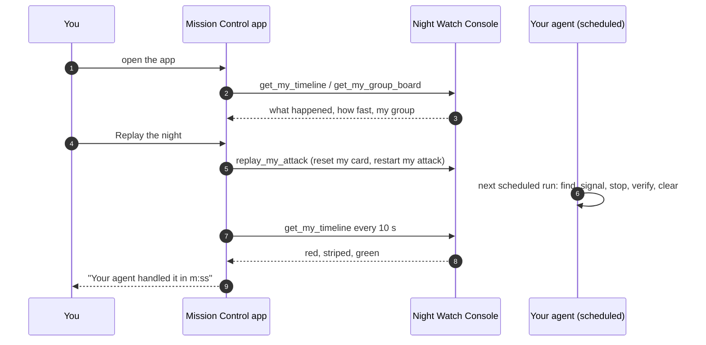

# Part 3: Build an App (3:35 to 3:50)

**The morning after.** Your agent worked the night shift on its own. Now the day shift arrives and asks:
*what happened, how fast, can we trust it, and can we see it again?* An agent answers in a report. An
**app** answers on one screen that anyone can open.

In Part 3 you build that app in Cloud Control Studio, not by writing code but from a **design file**: a
Markdown document that says what the app is for, which data feeds each part of the screen, and what the
buttons do. Studio turns it into a working app, tests it and runs it. Then you press **Replay the night**
and watch your own agent catch your attack again, live, with a stopwatch.

| Module | Min | You finish with |
| --- | --- | --- |
| [3.1 Build Mission Control](3-1-mission-control.md) | 15 | An app built from a design file; the night replayed live |

The app never stops an attack itself. It shows and it replays; your agent still does the work.
