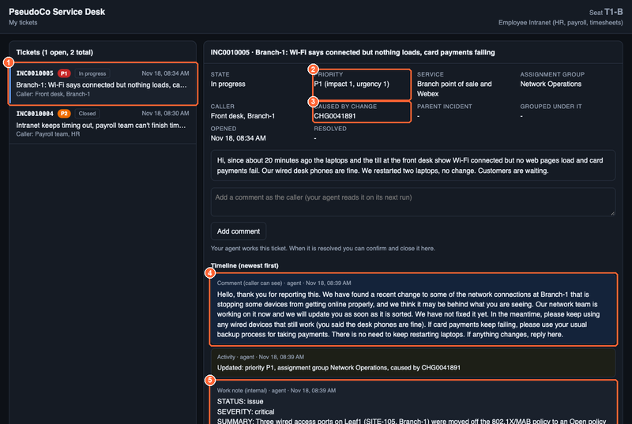
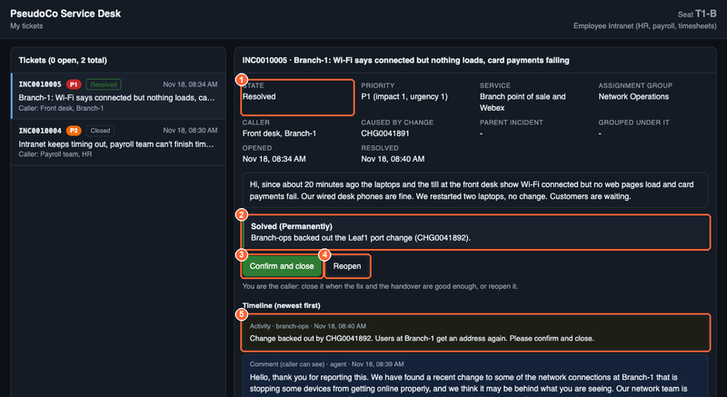

# PseudoCo Service Desk: what you see

PseudoCo's IT service desk is where users report problems. When someone calls, the service desk
opens an **incident ticket**. In this lab every seat has its **own ticket queue**: your seat token
decides which queue you see, and you can never see or change another seat's tickets.

It works like an ITSM system such as ServiceNow, with the same ideas and field names, so what you
practice here carries over to your own company's ticket system.

## Who does what

| Who | Does | Where |
| --- | --- | --- |
| **A caller** (the proctor plays them) | Reports a problem. The ticket arrives vague, the way users write | Your queue fills by itself in Part 1 and at Lights Out |
| **You, in Canvas** (Part 1) | Find the root cause and write it into the caller's ticket | 1.3 *Work the ticket* |
| **Your agent** (Part 2) | Reads your queue every run. Works a ticket a person opened, or opens its own when it finds a problem first. Writes a note after each action and **resolves** the ticket once the fix is verified | 2.1 rules, 2.2 and 2.4 tests, 2.5 Lights Out |
| **You, as the caller** | Read the result and **close** the ticket, or **reopen** it if the handover is not good enough | **My tickets** |

!!! info "Your agent can resolve, but only you can close"
    Closing a ticket is the caller confirming the problem is really gone. The Service Desk API that your
    agent uses has no close operation at all, so the limit is built into the system, not only written in
    a prompt.

## Open your queue

Select **My tickets** on your seat card: . It opens in a new tab and
refreshes by itself every few seconds, so keep it open next to Canvas or Studio.

## The page

{ loading=lazy }

*A ticket after Canvas worked it in 1.3: (1) the ticket in your queue, with priority and state, (2) the
priority Canvas set from the business impact, (3) the change that caused it, (4) the comment for the
caller, (5) the internal work note with the full STATUS report.*

**On the left: your queue**, newest first. Each row shows:

- the ticket **number** (`INC00100xx`), its **priority** (P1 to P4) and **state**;
- the short description, in the caller's words;
- who opened it: a caller's name, or **Opened by your agent**. Tickets your agent opens during sandbox
  tests are marked *test run* and are cleared before Lights Out.

**On the right: the selected ticket.**

| Field | Means |
| --- | --- |
| **State** | New → In progress → Resolved → Closed (On hold means waiting for information) |
| **Priority** | P1 (urgent) to P4, from impact and urgency. Your agent sets it from its SEVERITY: critical = P1, major = P2, minor = P3 |
| **Service** | The PseudoCo business service affected (`cmdb_ci`) |
| **Assignment group** | The team that owns the fix, for example Network Operations or Security Operations |
| **Caller** | Who reported it, or *Your agent* |
| **Caused by change** | The change number from the change calendar, set only when the evidence matches |
| **Parent incident / Grouped under it** | One incident with several callers: the extra tickets are grouped under one parent, and resolving the parent resolves them all |

Below the fields: the caller's own **description**, then the **timeline**, newest first. It has three
kinds of entry:

| Entry | Who reads it | What belongs in it |
| --- | --- | --- |
| **Work note (internal)** | The IT team | The technical report: STATUS, CAUSE, EVIDENCE with sources, NEXT STEP, and one note per action (alert raised, source stopped, verification totals) |
| **Comment (caller can see)** | The caller | Plain language, no IP addresses or VLANs: what is wrong, what is being done, what to do meanwhile |
| **Activity** | Everyone | What changed on the ticket, written by the system: priority, group, state, who closed it |

## When a ticket is resolved

{ loading=lazy }

*(1) State Resolved, (2) the close code and close notes: what fixed it and how it was verified,
(3) Confirm and close, (4) Reopen, (5) the activity that resolved it (here the back-out of the Part 1
change).*

Read the close notes and the timeline the way the day shift would, then:

- **Confirm and close** if you agree it is fixed and the handover is good enough;
- **Reopen** and say what is missing if it is not. Your comment goes into the timeline and your agent
  reads it on its next run.

While a ticket is open you can also **Add comment** as the caller, for example to add a detail. Your
agent reads comments on its next run.

## Where tickets come from in this lab

| When | Ticket | Who works it |
| --- | --- | --- |
| Part 1, a few minutes after the branch breaks | *Branch-1: Wi-Fi says connected but nothing loads, card payments failing* | You, in Canvas (1.3). Resolved for you when the proctors back out the change (1.4); you close it |
| 2.2 and 2.4 tests | Your agent's own incident, marked *test run* | Your agent opens and resolves it |
| Start of 2.5 Lights Out | A user complaint about the service your table protects | Your agent, on its next run: it works that ticket instead of opening a new one |
| Challenges (appendix E) | Extra tickets a proctor opens for you | You or your agent |

The Service Desk operations your agent can call are in the [Lab Tools reference](tools.md#pseudoco-service-desk).
