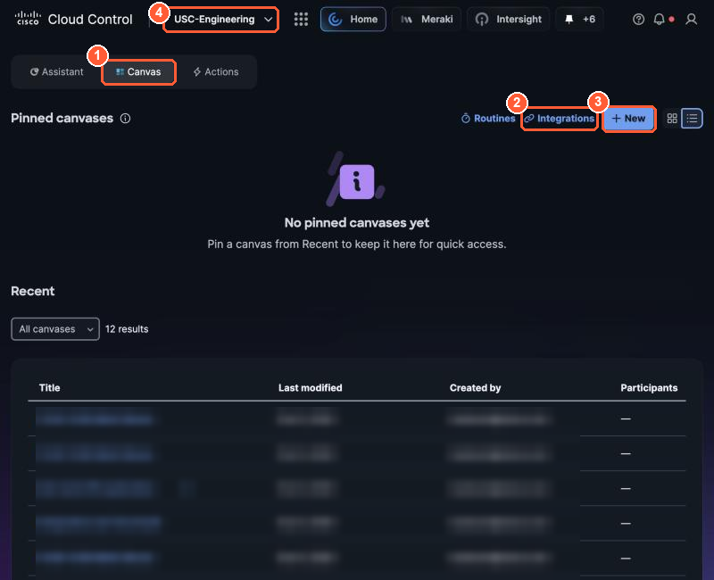

# Before you start (0:00, 10 min)

!!! abstract "Goal"
    Find your seat card, log in to Cisco Cloud Control, and know the one rule that keeps 30 people
    from stepping on each other.

## Your seat card

Everything personal to you is on the printed seat card, not in this guide. Keep it private.

| Field | Example | Used in |
| --- | --- | --- |
| Seat | `T3-C` (table 3, seat C, purple) | everywhere |
| Cloud Control login | `lab13` | 1.1 |
| **Seat token** | a long random string | 1.3, 3.3 |
| Lab Tools MCP URL | `https://<lab host>:9443/mcp` | 3.3 |
| Lab Actions spec URL | `https://<lab host>:8443/openapi-light.json` | 3.3 (REST path) |
| Lab Context spec URL | `https://<lab host>:8443/openapi-context.json` | 3.3 (REST path) |
| Your MCP workspace | `https://<lab host>:9443/seat/<your seat>/` | 3.3 (Path B) |
| Board | `https://<lab host>:8443/board` | 3.5 |

!!! warning "Your seat token is a password"
    It identifies your seat to every Lab Tools call. Paste it only into the credential fields named
    in this guide. Never paste it into a prompt, a Canvas chat, or an agent description: those are
    stored as plain text and can show up in run logs.

## The one rule

**You may troubleshoot anything, but the only thing you may change is your own lane.**

Everyone shares one Cisco Cloud Control tenant and one lab network (POD-45). Your login can read the
network; it cannot reconfigure it. Your agent's only action on the network is `stop_my_lane`, which
stops traffic from *your* source IP and nothing else, and only after you approve it.

## Log in

1. Open **https://cloud.cisco.com** and sign in with the login on your seat card.
2. Check the organization picker at the top shows **USC-Engineering**.

    { loading=lazy }

    *Cloud Control: (4) the organization picker must show USC-Engineering. (1) Canvas, (2) Integrations and (3) + New are used in 1.1.*

3. Keep this guide open in a second window or on your second screen.

- [ ] I can see the Cloud Control home page with **USC-Engineering** selected.
- [ ] My seat card is next to my keyboard, token side down.
